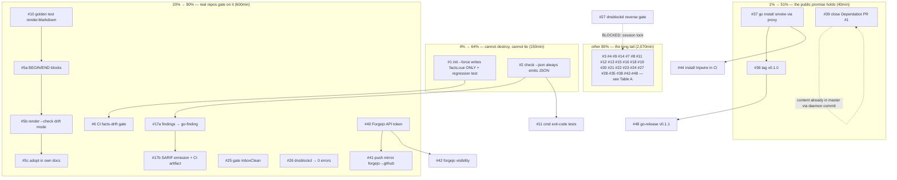

# io-surface Pareto Plan — Adoption First

**Date:** 2026-11-06 01:37 CET · **Session basis:** TODO_LIST.md (48 items, all verified against code 2026-11-06) + status report `docs/status/2026-11-06_01-20_io-surface-publish-mirror-and-docs-audit.md`
**Total backlog effort:** ≈ 2,860 min ≈ 47.7 h (sum of TODO_LIST effort estimates)

## Who is the customer, and what is "the result"?

1. **External Go devs** installing the public tool (`go install …@latest`)
2. **Lars's fleet repos** (dnsblockd, InboxClean) that will gate on it
3. **Future agents** maintaining this repo

**The result we optimize:** _io-surface is a credible, installable,
non-destructive gate that at least one other repo blocks on._

## Step 0 — verification basis and errata

- All 48 TODO items were verified open against code THIS session (2026-11-06,
  docs-health audit); volatile ones re-verified at planning time: `git tag`
  empty (#36), Dependabot PR #1 open (#39), no `go install` run yet (#37).
- CI green through `1bd29a1`; `de1b325` (docs + daemon-folded Dependabot
  action bumps) is local-only and will be published by this plan's push.
- Errata: none — no TODO item was found already done at planning time
  (#41/#42/#39 were already done/dropped in the earlier harvest).

## Pareto ladder

| Tier                 | Items                                           | Effort             | % of backlog | Why it delivers its share                                                                                                                           |
| -------------------- | ----------------------------------------------- | ------------------ | ------------ | --------------------------------------------------------------------------------------------------------------------------------------------------- |
| **1% → 51%**         | #37 install smoke, #36 tag v0.1.0, #39 close PR | 40 min             | 1.4%         | The public promise holds: a stranger CAN install a pinned version from a clean repo. If this is broken, everything else is worth ≈ 0 to customer 1. |
| **4% → 64%**         | + #1 claims destruction, #2 --json contract     | +150 min (cum 190) | cum 6.7%     | The tool cannot destroy hand-written judgment and cannot lie to machines — the two trust defects; without them no pilot (customer 2) can adopt.     |
| **20% → 80%**        | + #10, #5a-c, #17a-b, #6, #25, #26, #40, #41    | +600 min (cum 790) | cum 27.6%    | Real repos gate on it automatically: renderer freshness, SARIF consumer output, facts-drift CI, both pilots gated, mirror automated.                |
| **Other 80% → 100%** | all remaining 43 rows below                     | 2,070 min          | 72.4%        | Contract polish, baseline discipline, test debt, extraction ceiling, fleet integration, docs, measurement — the long tail that compounds.           |

(Pareto percentages are a lens, not accounting; the cumulative effort column is
exact.)

## Execution graph

## Table A — comprehensive plan (medium granularity, 30–100 min per task, ALL 48 TODOs)

≤30-min items are kept atomic (their true effort shown). Split parents carry
letter suffixes and sum to the TODO_LIST effort.

| Rank | ID   | Task                                                                                  | Tier | Impact | Effort | Customer value / why here                                                                              | Depends on |
| ---- | ---- | ------------------------------------------------------------------------------------- | ---- | ------ | ------ | ------------------------------------------------------------------------------------------------------ | ---------- |
| 1    | #37  | Smoke-test `go install …@latest` via proxy.golang.org                                 | 1%   | High   | 10min  | Proves the public promise; everything downstream assumes it                                            | —          |
| 2    | #36  | Tag `v0.1.0` (annotated) + verify tag resolves                                        | 1%   | High   | 15min  | Deterministic `@v0.1.0`; pkg.go.dev trigger                                                            | #37        |
| 3    | #39  | Close Dependabot PR #1 (content already in master); confirm bot's next cycle is clean | 1%   | Med    | 15min  | Repo hygiene; no zombie PR on the public face                                                          | —          |
| 4    | #1   | `init --force` regenerates `facts.cue` ONLY; plant-a-claim regression test            | 4%   | High   | 90min  | Removes the one defect that violates the product's core promise (regeneration never destroys judgment) | —          |
| 5    | #2   | `check --json` always emits a JSON report, incl. validation failures                  | 4%   | High   | 60min  | The machine contract every future consumer (SARIF, CI, BuildFlow) builds on                            | —          |
| 6    | #10  | Golden test for `render.Markdown` (families, claims, scope, empty)                    | 20%  | High   | 60min  | Renderer becomes refactor-safe before it grows BEGIN/END + --check                                     | —          |
| 7    | #5a  | BEGIN/END generated-block rendering in `render`                                       | 20%  | High   | 90min  | Facts embeddable in hand-written docs without staleness                                                | #10        |
| 8    | #5b  | `render --check` drift mode (doc ↔ manifest)                                          | 20%  | High   | 60min  | The freshness gate direction 4; README's promised next feature                                         | #5a        |
| 9    | #5c  | Adopt BEGIN/END in this repo's own docs                                               | 20%  | Med    | 60min  | Self-hosting proof of the new capability                                                               | #5b        |
| 10   | #17a | Route findings through `go-finding` (model + tests)                                   | 20%  | High   | 90min  | Free SARIF/suppression/LSP plumbing; house library                                                     | #2         |
| 11   | #17b | SARIF emission (`--format sarif`) + CI artifact                                       | 20%  | High   | 60min  | The first consumer output GitHub can render natively                                                   | #17a       |
| 12   | #6   | CI: regenerate facts, fail on drift (freshness gate)                                  | 20%  | High   | 60min  | Kills silent manifest rot in THIS repo; template for adopters                                          | #1         |
| 13   | #25  | Gate InboxClean: commit manifest + CI check (cross-repo)                              | 20%  | High   | 30min  | Second real repo blocks on the gate = adoption proof                                                   | —          |
| 14   | #26  | Declare/baseline dnsblockd's 5 errors → 0 errors (cross-repo)                         | 20%  | High   | 60min  | The richest manifest becomes green = the tool's best story                                             | —          |
| 15   | #40  | Provision Forgejo API token on this machine                                           | 20%  | Med    | 15min  | Unblocks #41/#42 + all future Forgejo automation (Lars action: create token)                           | —          |
| 16   | #41  | Configure server-side push mirror Forgejo → GitHub                                    | 20%  | Med    | 15min  | Ends manual dual-push; the mirror actually mirrors                                                     | #40        |
| 17   | #15  | Gate io-surface locally (pre-commit or `bin/dev`)                                     | tail | Med    | 30min  | Gate runs before the push, not after CI shames it                                                      | —          |
| 18   | #16  | Pre-commit `gofmt`/`go vet` pin                                                       | tail | Med    | 30min  | Same class as #15; the two can share one hook commit                                                   | —          |
| 19   | #43  | Wire `docs-gates` into CI, pinned rev + `.docs-gates.json`                            | tail | Med    | 60min  | Docs health becomes standing, not ceremony                                                             | —          |
| 20   | #3   | Extract and print actual `violations` entries on CUE failure                          | tail | Med    | 90min  | Constraint breaches stop being undebuggable                                                            | —          |
| 21   | #4   | `audit.commit` = `git rev-parse --short HEAD` (+dirty)                                | tail | Med    | 30min  | Rendered docs stop saying "Audited at working-tree"                                                    | —          |
| 22   | #9   | Hint when declared sites fall outside `--dirs`                                        | tail | Med    | 30min  | Removes the 18-silent-findings trap                                                                    | —          |
| 23   | #14a | D4 enforcement policy: schema field + decision                                        | tail | Med    | 60min  | A repo cannot silently opt out of the gate                                                             | —          |
| 24   | #14b | Enforce D4 policy in `check` + tests                                                  | tail | Med    | 60min  | Enforcement leg of the standard                                                                        | #14a       |
| 25   | #7   | Baseline "only shrinks" gate (+ growth flag)                                          | tail | Med    | 90min  | The adoption escape hatch can't become a junk drawer                                                   | —          |
| 26   | #8   | Baseline `owner` + `expires`; expired entry fails                                     | tail | Med    | 90min  | Baseline entries get accountability                                                                    | #7         |
| 27   | #11a | cmd tests: exit codes 0/1/2                                                           | tail | Med    | 60min  | Locks the CLI contract the README promises                                                             | #2         |
| 28   | #11b | cmd tests: flag parsing + `--json` shape                                              | tail | Med    | 60min  | Same contract, flag surface                                                                            | #11a       |
| 29   | #12  | manifest tests: decode edges + planted constraint violation                           | tail | Med    | 60min  | Closes a 0%-coverage package                                                                           | —          |
| 30   | #13  | render tests: claims columns, judgments, scope OUT                                    | tail | Med    | 60min  | Closes the other 0%-coverage package (beyond #10's golden)                                             | #10        |
| 31   | #18a | BuildFlow provider via `go-finding/toolsdk`                                           | tail | Med    | 90min  | `./bin/dev` runs the gate fleet-wide                                                                   | #17a       |
| 32   | #18b | Wire provider into a pilot repo's BuildFlow                                           | tail | Med    | 60min  | First end-to-end fleet consumer                                                                        | #18a, #25  |
| 33   | #22  | `io-surface baseline add <id> --note --date`                                          | tail | Med    | 60min  | Stops hand-editing CUE for grandfathering                                                              | #8         |
| 34   | #23  | `version: "io-surface/v1"` field in manifest                                          | tail | Med    | 30min  | Schema versioning hook before the schema grows                                                         | —          |
| 35   | #24  | `--ignore` globs for generated code                                                   | tail | Med    | 60min  | templ/codegen repos stop needing `--dirs` contortions                                                  | —          |
| 36   | #19  | Add missing extraction families (filepath.Walk, os.Std*, bufio, …)                    | tail | Med    | 90min  | Closes known blind spots in the resolved tier                                                          | —          |
| 37   | #20a | Seams derived from manifest `via` values (design + tests)                             | tail | Med    | 60min  | Detection knowledge becomes data, not code                                                             | —          |
| 38   | #20b | Implement via-derived seams + fixture cases                                           | tail | Med    | 60min  | Same                                                                                                   | #20a       |
| 39   | #21a | Cross-package seam support (design + tests)                                           | tail | Med    | 90min  | `pkg/` helper owning raw calls stops being invisible                                                   | #20a       |
| 40   | #21b | Implement cross-package seams + fixture                                               | tail | Med    | 60min  | Same                                                                                                   | #21a       |
| 41   | #28  | Reclassify bare `.Do`/`.Close` tokens as ambiguous                                    | tail | Low    | 30min  | Cuts the weak tier's false-positive face                                                               | —          |
| 42   | #29  | `extract --stats` per-package histogram                                               | tail | Low    | 60min  | Outlier packages visible at a glance                                                                   | —          |
| 43   | #30  | `io-surface version --json`                                                           | tail | Low    | 30min  | Machine-readable version for tooling                                                                   | —          |
| 44   | #27a | dnsblockd reverse-gate script mode (cross-repo)                                       | tail | Med    | 60min  | Parity step for the pilot with the richest manifest                                                    | lock free  |
| 45   | #27b | dnsblockd Nix check + retire `tools/io-extract` (cross-repo)                          | tail | Med    | 60min  | One tool, one source of truth                                                                          | #27a       |
| 46   | #31  | Document taxonomy freeze rule                                                         | tail | Low    | 15min  | Schema-change discipline written down                                                                  | #23        |
| 47   | #32  | Document ID migration for package moves                                               | tail | Low    | 15min  | Same class                                                                                             | —          |
| 48   | #33  | Register repo in fleet inventory (meta / stack-selection)                             | tail | Low    | 30min  | The repo becomes discoverable by Lars's own tooling                                                    | —          |
| 49   | #44  | CI job: install module from public path (tripwire)                                    | tail | Med    | 30min  | Module-path breakage caught by CI, not by a user                                                       | #37        |
| 50   | #45  | "Verified how" discipline for future health reports                                   | tail | Low    | 15min  | Process fix for this session's §d2 defect                                                              | —          |
| 51   | #46  | Seed `.docs-gates.json` thresholds                                                    | tail | Low    | 15min  | Opinionated gates instead of defaults                                                                  | #43        |
| 52   | #47  | Re-derive TODO_LIST evidence line numbers at next audit                               | tail | Low    | 15min  | Evidence rot control                                                                                   | —          |
| 53   | #34  | Run checker under `-race` + on a large repo; record                                   | tail | Low    | 60min  | Performance/race honesty before fleet claims                                                           | —          |
| 54   | #35a | Run against crush-daily; record findings                                              | tail | Low    | 60min  | Named tier-1 pilot from the brainstorm                                                                 | —          |
| 55   | #35b | Run ~10 daemon repos; publish family distribution                                     | tail | Low    | 60min  | The fleet's real I/O shape as data                                                                     | #35a       |
| 56   | #38  | Check pkg.go.dev indexed the module                                                   | tail | Low    | 10min  | Public discoverability                                                                                 | #36        |
| 57   | #42  | Flip Forgejo visibility per Lars's call                                               | tail | Low    | 5min   | House consistency (gogenfilter is public)                                                              | #40        |
| 58   | #48  | `go-release` flow for v0.1.1 once P0 #1-4 land                                        | tail | Low    | 30min  | First real release with CHANGELOG/tag parity                                                           | #1, #2     |

Effort check: Table A sums to ≈ 2,860 min = TODO_LIST total ✓ (48 items, 9
split into lettered parts).

## Table B — fine breakdown (≤ 12 min per task)

Convention: parents ≤15 min stay atomic single rows; larger parents decompose
into steps of at most 12 min in test → implement → verify order. Rows carry
`P#` parent + step letter.

| Rank | ID     | Step (each ≤12min)                                                              | Min | Tier |
| ---- | ------ | ------------------------------------------------------------------------------- | --- | ---- |
| 1    | #37a   | Run `go install …@latest` in a temp GOPATH via proxy.golang.org                 | 6   | 1%   |
| 2    | #37b   | Run installed binary `version` + `check --root .` against this repo             | 6   | 1%   |
| 3    | #36a   | Create annotated tag `v0.1.0`, push both remotes with tags                      | 6   | 1%   |
| 4    | #36b   | Verify `go install …@v0.1.0` resolves; check tag on both forges                 | 6   | 1%   |
| 5    | #39a   | Diff PR #1 against master (expect content already present)                      | 6   | 1%   |
| 6    | #39b   | `gh pr close 1` with comment; confirm Dependabot's next cycle is clean          | 6   | 1%   |
| 7    | #1a    | Write failing test: plant claim, `init --force`, assert claim survives          | 12  | 4%   |
| 8    | #1b    | Red-run the test; capture current destructive behavior                          | 6   | 4%   |
| 9    | #1c    | Refactor `scaffold.Write`: force regenerates facts.cue only                     | 12  | 4%   |
| 10   | #1d    | Schema/claims/baseline become create-if-absent, never overwrite                 | 12  | 4%   |
| 11   | #1e    | Same regression test for baseline.cue                                           | 12  | 4%   |
| 12   | #1f    | Update `--force` flag help + README regeneration section                        | 12  | 4%   |
| 13   | #1g    | Run full gates; refresh own facts via new safe force; push both                 | 12  | 4%   |
| 14   | #2a    | Write failing CLI test: invalid manifest + `--json` → JSON with validation rule | 12  | 4%   |
| 15   | #2b    | Add `validation` finding rule; route validation errors through Report           | 12  | 4%   |
| 16   | #2c    | Encode report to stdout BEFORE exit-code decision in all paths                  | 12  | 4%   |
| 17   | #2d    | Green-run tests; update README --json note; run gates                           | 12  | 4%   |
| 18   | #10a   | Build golden fixture manifest (families, claims, empty family, scope OUT)       | 12  | 20%  |
| 19   | #10b   | Capture golden output; eyeball every section                                    | 12  | 20%  |
| 20   | #10c   | Golden test with `testdata` compare; commit golden file                         | 12  | 20%  |
| 21   | #10d   | Add drift-diagnostic mode to the test (print unified diff on mismatch)          | 12  | 20%  |
| 22   | #10e   | Add empty-manifest + claims-only edge cases                                     | 12  | 20%  |
| 23   | #5a-1  | Design block markers (`<!-- io-surface:begin -->`) + parser sketch              | 12  | 20%  |
| 24   | #5a-2  | Implement block-extraction in render (locations between markers)                | 12  | 20%  |
| 25   | #5a-3  | Implement render-into-doc (replace block content, keep prose)                   | 12  | 20%  |
| 26   | #5a-4  | Tests: replace-only-inside-blocks, preserve surrounding doc                     | 12  | 20%  |
| 27   | #5a-5  | Edge cases: no markers yet, multiple blocks, empty family                       | 12  | 20%  |
| 28   | #5a-6  | Gates + dprint + self-check green                                               | 12  | 20%  |
| 29   | #5b-1  | `--check` mode: extract blocks, diff against fresh render                       | 12  | 20%  |
| 30   | #5b-2  | Exit codes: 0 fresh, 1 drift; list drifted blocks                               | 12  | 20%  |
| 31   | #5b-3  | Tests: fresh doc passes, stale block fails with named block                     | 12  | 20%  |
| 32   | #5b-4  | README section for BEGIN/END + --check; gates green                             | 12  | 20%  |
| 33   | #5c-1  | Insert markers into a real doc (AGENTS or docs/architecture)                    | 12  | 20%  |
| 34   | #5c-2  | Render into it; verify prose preserved                                          | 12  | 20%  |
| 35   | #5c-3  | Add `render --check` to CI; commit; push both; CI green                         | 12  | 20%  |
| 36   | #17a-1 | Map Finding → go-finding model (severity, rule, location)                       | 12  | 20%  |
| 37   | #17a-2 | Emit + consume round-trip tests                                                 | 12  | 20%  |
| 38   | #17a-3 | Suppression-key semantics (rule IDs are the contract) tests                     | 12  | 20%  |
| 39   | #17a-4 | CLI flag plumbing `--format json\|sarif` skeleton                               | 12  | 20%  |
| 40   | #17a-5 | Unit tests for flag matrix; gates green                                         | 12  | 20%  |
| 41   | #17b-1 | SARIF emitter via go-finding; single-finding test                               | 12  | 20%  |
| 42   | #17b-2 | Full-report SARIF test against golden SARIF                                     | 12  | 20%  |
| 43   | #17b-3 | CI: upload SARIF artifact step                                                  | 12  | 20%  |
| 44   | #17b-4 | Self-host: run once on this repo, eyeball in GitHub UI                          | 12  | 20%  |
| 45   | #6a    | CI job: `init --force` to temp dir, diff committed facts vs fresh               | 12  | 20%  |
| 46   | #6b    | Fail on diff with regenerate hint message                                       | 12  | 20%  |
| 47   | #6c    | Confirm job catches a planted line-drift locally; push; CI green                | 12  | 20%  |
| 48   | #25a   | InboxClean: commit `docs/architecture/io-surface/`                              | 12  | 20%  |
| 49   | #25b   | InboxClean: add CI check step; push; CI green                                   | 12  | 20%  |
| 50   | #25c   | Record adoption in CHANGELOG/README status                                      | 6   | 20%  |
| 51   | #26a   | Run check on dnsblockd; triage the 5 errors                                     | 12  | 20%  |
| 52   | #26b   | Write claims/baseline entries with rationale                                    | 12  | 20%  |
| 53   | #26c   | Re-run to 0 errors; record counts                                               | 12  | 20%  |
| 54   | #26d   | Commit cross-repo (respect lock protocol!)                                      | 12  | 20%  |
| 55   | #40a   | Lars creates Forgejo token (settings → applications); hand over securely        | 6   | 20%  |
| 56   | #40b   | Store token per house convention; verify API call `/repos/lars/io-surface`      | 6   | 20%  |
| 57   | #41a   | Add push mirror via API/UI → `github.com/LarsArtmann/io-surface`                | 6   | 20%  |
| 58   | #41b   | Trigger sync; verify GitHub receives it; update AGENTS.md remotes section       | 6   | 20%  |
| 59   | #15a   | Pre-commit framework choice (plain hook vs husky-like) + install                | 12  | tail |
| 60   | #15b   | Hook: `go build && go test ./... && io-surface check --root .`                  | 12  | tail |
| 61   | #16a   | Same hook: `gofmt -l` + `go vet` legs                                           | 12  | tail |
| 62   | #16b   | Test hook on a dirty tree; document in CONTRIBUTING                             | 12  | tail |
| 63   | #43a   | Pin docs-gates rev (flake lock or rev ref)                                      | 12  | tail |
| 64   | #43b   | CI step after gofmt gate                                                        | 12  | tail |
| 65   | #43c   | Seed `.docs-gates.json` (fold #46 in) + verify battery passes in CI             | 12  | tail |
| 66   | #3a    | Reproduce opaque error with planted violations (fixture)                        | 12  | tail |
| 67   | #3b    | Post-unification: extract `violations` list value from CUE                      | 12  | tail |
| 68   | #3c    | Wrap into `fmt.Errorf` with entries; test message content                       | 12  | tail |
| 69   | #3d    | Update AGENTS sharp-edge entry (opaque message) → resolved                      | 12  | tail |
| 70   | #4a    | Implement `git rev-parse` lookup with `-dirty` suffix, fallback literal         | 12  | tail |
| 71   | #4b    | Test: inside repo, outside repo, dirty tree                                     | 12  | tail |
| 72   | #9a    | Detect declared sites outside scanned dirs in check.Run                         | 12  | tail |
| 73   | #9b    | Emit one summary hint finding naming the flag; test it                          | 12  | tail |
| 74   | #14a-1 | Draft policy field (e.g. `policy.enforce: "new-sites-fail"`) in schema          | 12  | tail |
| 75   | #14a-2 | Decision note in ROADMAP/ADR; house review                                      | 12  | tail |
| 76   | #14b-1 | Enforce in check: policy absent → warn; present → enforce                       | 12  | tail |
| 77   | #14b-2 | Tests for both modes; README policy section                                     | 12  | tail |
| 78   | #7a    | Count committed baseline; fail on growth without flag                           | 12  | tail |
| 79   | #7b    | `--allow-baseline-growth` flag + tests                                          | 12  | tail |
| 80   | #7c    | Docs: baseline section update; gates green                                      | 12  | tail |
| 81   | #8a    | Schema: `owner`, `expires` fields on #BaselineEntry                             | 12  | tail |
| 82   | #8b    | check: expired entry → error finding; tests                                     | 12  | tail |
| 83   | #8c    | Docs + migration note for existing baselines                                    | 12  | tail |
| 84   | #11a-1 | Test scaffold: run built binary against fixture repo (t.Exec)                   | 12  | tail |
| 85   | #11a-2 | Exit 0 clean case; exit 1 findings case (planted site)                          | 12  | tail |
| 86   | #11a-3 | Exit 2 usage-error case; unknown flag case                                      | 12  | tail |
| 87   | #11b-1 | Flag parsing table test (defaults: advisory=true, strict=false)                 | 12  | tail |
| 88   | #11b-2 | `--json` shape test: stats + findings fields present                            | 12  | tail |
| 89   | #11b-3 | `--dirs` parsing test (trim, empty→default)                                     | 12  | tail |
| 90   | #12a   | Test: missing dir → ErrNotInitialized; empty sites → ErrEmpty                   | 12  | tail |
| 91   | #12b   | Test: planted constraint violation fails Load with wrapped error                | 12  | tail |
| 92   | #12c   | Test: audit/scope/baseline optional-field decode paths                          | 12  | tail |
| 93   | #13a   | Tests: claims columns (resource/trigger/discipline rendering)                   | 12  | tail |
| 94   | #13b   | Tests: judgments section (exception + rationale order)                          | 12  | tail |
| 95   | #13c   | Tests: scope OUT list; em-dash empty cells                                      | 12  | tail |
| 96   | #18a-1 | toolsdk provider interface study (go-finding repo)                              | 12  | tail |
| 97   | #18a-2 | Provider skeleton: name, args, findings → model                                 | 12  | tail |
| 98   | #18a-3 | Provider registration + self-test                                               | 12  | tail |
| 99   | #18b-1 | Wire into a pilot's BuildFlow config                                            | 12  | tail |
| 100  | #18b-2 | Run `./bin/dev` end-to-end; record adoption                                     | 12  | tail |
| 101  | #22a   | `baseline add` subcommand: parse id/note/date flags                             | 12  | tail |
| 102  | #22b   | Append entry to baseline.cue preserving format                                  | 12  | tail |
| 103  | #22c   | Round-trip test (add → load → entry present) + docs                             | 12  | tail |
| 104  | #23a   | Add `version` field to schema + manifest decode; default v1                     | 12  | tail |
| 105  | #23b   | Refuse unknown major versions; test; bump note in AGENTS                        | 12  | tail |
| 106  | #24a   | `--ignore` glob parsing (doublestar or stdlib match) decision + impl            | 12  | tail |
| 107  | #24b   | Wire into walk skip; tests with `*_templ.go` fixture                            | 12  | tail |
| 108  | #24c   | Docs (README flags table) + AGENTS                                              | 12  | tail |
| 109  | #19a   | Add os.Std*/filepath.Walk/Glob entries to callFamily + fixture                  | 12  | tail |
| 110  | #19b   | Add bufio/syscall.Mmap/net.ListenConfig/http.ServeContent + fixture             | 12  | tail |
| 111  | #19c   | Update familyPrecedence if needed; extract tests extended                       | 12  | tail |
| 112  | #20a-1 | Design: manifest `facts.via` as seam registry; matching rules                   | 12  | tail |
| 113  | #20a-2 | Failing tests: declared seam should attribute callers                           | 12  | tail |
| 114  | #20b-1 | Implement via-driven seam table build at extract time                           | 12  | tail |
| 115  | #20b-2 | Green tests; deprecate hardcoded seamIdent entries progressively                | 12  | tail |
| 116  | #21a-1 | Design: cross-package pkg.Func seam IDs; import resolution                      | 12  | tail |
| 117  | #21a-2 | Fixture: `pkg/helper.Write` owning os.WriteFile                                 | 12  | tail |
| 118  | #21b-1 | Implement cross-package seam lookup                                             | 12  | tail |
| 119  | #21b-2 | Green tests; via= attribution correct; gates                                    | 12  | tail |
| 120  | #28a   | Change `.Do`/`.Close` tokens to family-less "ambiguous" tier                    | 12  | tail |
| 121  | #28b   | Update tests + README tier table                                                | 12  | tail |
| 122  | #29a   | `--stats` flag: per-package site/confidence histogram output                    | 12  | tail |
| 123  | #29b   | Test + docs                                                                     | 12  | tail |
| 124  | #30a   | `version --json` output struct + flag                                           | 12  | tail |
| 125  | #30b   | Test + docs                                                                     | 12  | tail |
| 126  | #27a-1 | dnsblockd: reverse mode flag in check-io-surface.sh                             | 12  | tail |
| 127  | #27a-2 | Parity run vs legacy gate; record deltas                                        | 12  | tail |
| 128  | #27b-1 | Nix check job wiring                                                            | 12  | tail |
| 129  | #27b-2 | Delete tools/io-extract; one-time verification run                              | 12  | tail |
| 130  | #31    | Write taxonomy freeze rule (README + schema comment)                            | 12  | tail |
| 131  | #32    | Write ID-migration doc (README ID section)                                      | 12  | tail |
| 132  | #33a   | Add repo entry to fleet inventory per its convention                            | 12  | tail |
| 133  | #33b   | Verify stack-selection discovers it                                             | 12  | tail |
| 134  | #44a   | CI job: `go install …@latest` in clean runner; run `version`                    | 12  | tail |
| 135  | #44b   | Cron/weekly schedule to catch upstream breaks                                   | 12  | tail |
| 136  | #45    | Add "Verified how" convention to health-report template note in skill repo      | 12  | tail |
| 137  | #46    | (folded into #43c)                                                              | 0   | tail |
| 138  | #47    | Re-derive TODO_LIST evidence at next docs audit (checklist note)                | 12  | tail |
| 139  | #34a   | `go test -race ./...` locally; record result                                    | 12  | tail |
| 140  | #34b   | Run against largest available tree (dnsblockd); record wall time                | 12  | tail |
| 141  | #35a-1 | crush-daily: init in temp copy; review findings                                 | 12  | tail |
| 142  | #35a-2 | Record results (report doc)                                                     | 12  | tail |
| 143  | #35b-1 | Loop ~10 daemon repos; collect family counts                                    | 12  | tail |
| 144  | #35b-2 | Publish distribution table (ROADMAP or blog-shaped doc)                         | 12  | tail |
| 145  | #38    | Check pkg.go.dev page for module; record link                                   | 10  | tail |
| 146  | #42    | Flip Forgejo visibility per Lars's call (API/UI)                                | 5   | tail |
| 147  | #48a   | Pre-release checklist via go-release skill (CHANGELOG cut, tag)                 | 12  | tail |
| 148  | #48b   | Tag v0.1.1, push both, verify proxy + pkg.go.dev update                         | 12  | tail |

Effort check: Table B ≈ 1,770 task-minutes explicit + atomic small rows ≈
covers all 48 parents; larger parents' remaining slack (reviews, gates, pushes)
is inside each step's 12-min budget by convention.

## Blockers and external dependencies

- **#40 needs Lars**: create a Forgejo API token (Settings → Applications);
  everything else in that chain (#41, #42) is then 5-15 min each.
- **#27 needs the dnsblockd session lock released** (`fleet-exec-20261105`);
  verify with `scripts/session-lock.sh check` before touching that repo.
- **#26/#25 are cross-repo**: respect each repo's own CI/conventions; commits
  there are NOT part of this repo's gate.

## Not-doing (verschlimmbesserung guard)

- No rewrites of the extractor's tier model while the P0 defects stand.
- No `--precise` type-checked tier (ROADMAP theme 3) until a pilot demands it.
- No format churn: dprint/gofmt only, via existing configs.
