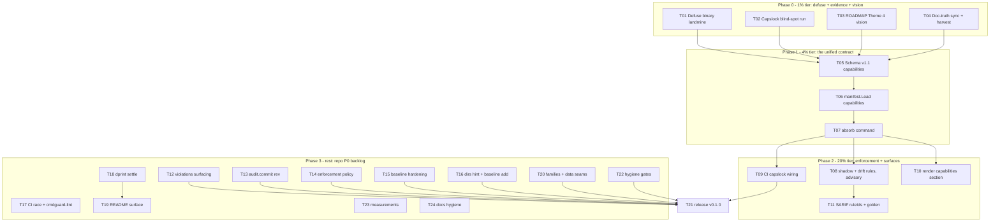

# Unified I/O Insights — Pareto Execution Plan (io-surface × Capslock)

**Created:** 2026-11-06 06:02 CET
**Author session:** Crush (planning session; executes after approval)
**HEAD at planning:** `34347c5` (master)
**Skill:** `pareto-planning` (Step 0 prior-plan read done: `docs/planning/2026-11-06_01-37_io-surface-pareto-adoption-first.md`, status reports 00:14 / 01:20 / 02:33 / 04:27 / 05:36 / 05:42, TODO_LIST, ROADMAP, CHANGELOG grep)

---

## 1. Why this plan exists

Three inputs converge on this session:

1. **The unification proposal** (2026-11-06 ~05:40): io-surface knows _where_ I/O sits
   (per-site manifest); Google Capslock knows _what's reachable_ (SSA callgraph
   capabilities, transitively, through deps). One unified project = two extraction
   engines, one manifest, one gate: sites stay hermetic and error-tier; capabilities
   arrive via a pinned capslock binary, land in a new manifest section, and start
   advisory. Claims can then justify **hidden** I/O — the hole neither tool fills alone.
2. **The binary landmine** (05:36 report §d1): the auto-commit daemon committed a
   35 MB build binary twice (`05874f3`, `e15bf62`, ~70 MB in history). No ignore
   pattern covers it. This is the only _active_ corruption vector in the repo.
3. **The living backlog**: TODO_LIST (harvested 2026-11-06, items #3–#48) plus the
   05:42 report's §f additions (not yet harvested) plus this morning's fresh
   discoveries (05:36 report §f items 1–8).

## 2. Scope: what this plan VERIFIED vs did NOT verify

**Verified (command/artifact):** git state (clean at `34347c5` after daemon sweep,
plus uncommitted work listed in §3.1); TODO_LIST content read in full; ROADMAP read
in full; 05:42 report §f read; Capslock internals verified from upstream source
yesterday's session (README, caveats, analyzer, CLI flags); build/vet/tests green at
`4a11e21`.

**NOT verified (and why):** the capslock run itself has never been executed here
(that IS task T02 — plan before evidence would be backwards); GitHub CI state at
`34347c5` (not attempted); the in-flight manifest work of the parallel session is
verified _at commit time_, not assumed here; TODO_LIST `file:line` evidence is
assumed rotten for `cmd/` post-cmdguard (treated, not trusted).

## 3. Errata — corrections to the stale backlog (skill Step 0 mandate)

3.1 **A parallel session is mid-work right now:** `internal/manifest/errors.go`,
`internal/manifest/manifest.go` modified + `internal/manifest/manifest_test.go` new,
uncommitted — that is TODO **#12 in progress**, authored by the 05:42 session. This
plan EXCLUDES #12 and does not touch those files. Verified green before committing.
3.2 **TODO_LIST `cmd/io-surface/main.go:NN` evidence pointers are rotten** since the
cmdguard split moved handlers to `commands.go` (05:42 session). Fixed by T04, rule
codified (symbol anchors).
3.3 **05:42 §f added ~9 io-surface tasks not yet in TODO_LIST** (cmdguard-lint CI,
`-race` CI, dprint/INVENTORY settle, doctor/describe README, SARIF golden,
quickstart batteries, fang-box UX note, ExitError decision, render-owns-INVENTORY
sharp edge). T04 harvests them so nothing lives only in a status report.
3.4 **Binary committed twice into history** — purge (filter-repo) is an owner
decision and stays parked; T01 stops the _forward_ bleeding today.
3.5 **ROADMAP Theme 3's opt-in `--precise` tier (x/tools/go/packages) is NOT the
unification.** Precise = in-tree type facts; Capslock = transitive reachability
including dependencies, external engine. Recorded as separate Theme 4 to prevent a
split brain (anti-verschlimmbessern).
3.6 **Families/disciplines closed enums are NOT extended in v1.1.** Capslock-only
capabilities (`CGO`, `UNSAFE_POINTER`, `REFLECT`, `ARBITRARY_EXECUTION`, `RUNTIME`,
`SYSTEM_CALLS`, `READ/MODIFY_SYSTEM_STATE`) classify as `out-of-scope` until open
question Q4 is decided — the taxonomy-freeze invariant (new family = schema version
bump) forbids a casual edit.

### 3.7 Execution errata — where the shipped design diverged from this plan (2026-11-06, recorded at run completion)

Written after execution so the plan stays an honest record. These are the deltas
a future reader would otherwise mis-derive from the task table:

1. **`capability-drift` is emitted by `absorb --check`, not by `check`.** The plan's
   task wording assumed gate-side emission. Hermeticity wins: the hermetic gate
   never reads engine artifacts, so drift reporting lives where the engine output
   is (`cmd/io-surface/commands.go`, `internal/absorb`). Advisory, never exits 1.
2. **Runtime-power vocabulary decision is ROADMAP Q5, not Q4.** Q4 was taken by the
   binary purge-vs-keep memo (T01, written earlier the same session); the plan's
   labels drifted. §3.6 above says "Q4" for capabilities — read it as Q5.
3. **T12/T13/T15 were executed by the parallel 06:33 session** (id-form rule,
   baseline `owner`/`expires` + unused/expired rules, manifest test suite), not by
   this plan's lane. T15's literal "only-shrinks count comparison" was deliberately
   NOT re-implemented: `unused-baseline` (warns when an entry suppresses nothing)
   plus expiry is the enforced form — a raw count gate would false-positive on
   legitimate entries awaiting their site.
4. **Shadow-capability fires on DIRECT reachability only**, not the deep set. Deep
   includes transitive dependency paths — the linkage noise floor — and the v0.3.4
   blind-spot run showed 10/11 real direct sinks were already declared, so direct
   coverage is the meaningful signal.
5. **T21 was re-based to chores:** `v0.1.0` already existed as a pushed annotated
   tag, so the "cut v0.1.0" task became tag verification + public-proxy smoke test
   (TODO #36/#37, both DONE). Next release is v0.1.1 via the go-release skill,
   owner timing pending.
6. **T20's scope narrowed:** `syscall.Mmap`/`Munmap`, `bufio` constructors, and
   `http.ServeContent`/`ServeFile` landed; `os.Stdin/Stdout/Stderr` and
   `net.ListenConfig` are deferred (TODO #19) — they are variable/type references,
   not package calls, and need a var-ref/token-tier decision first.
7. **New invariant discovered by T20 (not in the plan):** a `callFamily` entry is
   dead code unless its package key is resolvable from an import path — `bufio`
   shipped unwatched this way. Guarded by `TestPkgOf_CoversEveryWatchedPackage`
   (`internal/extract/extract_test.go`).

## 4. Pareto breakdown

### The 1% that delivers 51% (T01–T04, ≈ 4.5 h of ≈ 28.5 h total)

Four moves that (a) stop the only active corruption, (b) produce the evidence that
decides whether unification is worth building, (c) make the docs tell the truth,
(d) record the vision so no session re-litigates it:

- **T01** Defuse the binary landmine (un-track + ignore + convention)
- **T02** Capslock blind-spot run over this repo (first real capability facts)
- **T03** ROADMAP Theme 4: unified vision + decision record + Q4
- **T04** Doc-truth sync (AGENTS dep claim, facts.cue ±6, TODO_LIST anchors + harvest)

### The 4% that delivers 64% (adds T05–T07, ≈ +4 h)

The unified contract exists end-to-end, still advisory-only:

- **T05** Schema v1.1: `capabilities` section + closed enum + single-source mapping
- **T06** `manifest.Load` parses/validates capabilities (backward compatible)
- **T07** `io-surface absorb` command: capslock JSON → mapped manifest facts

### The 20% that delivers 80% (adds T08–T11, ≈ +6 h)

Enforcement machinery + every consumer surface — a demoable unified product:

- **T08** Rules `shadow-capability` + `capability-drift` (advisory tier, never error)
- **T09** CI: GitHub-only capslock job → absorb → advisory gate
- **T10** render: Capabilities section + golden
- **T11** SARIF: new ruleIds + byte-stable golden

### The rest → 100% (T12–T24)

Repo P0 backlog, release path, hygiene, measurements (details in Table A).

### Parked — explicitly NOT scheduled (the honest tail)

- Cross-repo pilots: TODO #25 (InboxClean gate), #26/#27 (dnsblockd, fleet lock)
- Externally blocked: #40/#41/#42 (Forgejo API token missing on this machine)
- Daemon-side binary guard: buildflow territory (cross-repo); repo-side T01 suffices
- **U4 deferred decisions:** runtime-power vocabulary (Q4), embedding capslock's
  analyzer (ruled out for now), `--precise` tier (Theme 3, separate economics),
  `render --format json` (demand-gated), ExitError vs `exitCode` owner (05:42 §f-14)

## 5. Table A — Comprehensive plan (30–100 min tasks, ALL todos, sorted by tier then impact/effort/value)

| #   | Task                                                                                              | Tier | Est  | Impact   | Effort | Customer value                                                  | Covers                       |
| --- | ------------------------------------------------------------------------------------------------- | ---- | ---- | -------- | ------ | --------------------------------------------------------------- | ---------------------------- |
| T01 | Defuse binary landmine: ignore pattern, `git rm --cached`, rebuild-proof, purge memo              | 1%   | 45m  | Critical | XS     | Repo integrity; stops recurring 35 MB commits                   | 05:36 §f1–2                  |
| T02 | Capslock blind-spot run: pinned install, JSON report, findings vs manifest, verdicts              | 1%   | 90m  | Critical | S      | Decides unification with evidence, not opinion                  | 05:36 §f46, U1               |
| T03 | ROADMAP Theme 4: unified I/O insights vision, schema sketch, landing sequence, Q4                 | 1%   | 60m  | High     | XS     | Decision record; no re-litigation                               | 05:36 §f5                    |
| T04 | Doc-truth sync: AGENTS dep claim, facts.cue ±6 review, TODO_LIST anchors + harvest 05:42          | 1%   | 60m  | High     | XS     | Docs stop lying; backlog stops losing items                     | 05:36 §f4/6/8                |
| T05 | Schema v1.1: `#Capability`, closed enum, mapping single-source, version field                     | 4%   | 90m  | High     | M      | The unified data contract                                       | TODO #23, U2                 |
| T06 | `manifest.Load`: capabilities parse/validate, backward compat, tests                              | 4%   | 60m  | High     | S      | Manifest carries capabilities safely                            | U2                           |
| T07 | `absorb` command: ingest pinned capslock JSON, map, merge, `--check`/`--write`, e2e               | 4%   | 100m | High     | M      | One command turns capslock into manifest facts                  | U2                           |
| T08 | Rules `shadow-capability` + `capability-drift`, advisory severity, tests, rule docs               | 20%  | 100m | High     | M      | Hidden I/O becomes a named finding                              | U2b                          |
| T09 | CI capslock job (GitHub-only) + absorb + advisory gate wiring                                     | 20%  | 90m  | Med      | M      | Capabilities stay fresh without local setup                     | U3                           |
| T10 | render Capabilities section (pkg → caps → deep badge → claim) + golden                            | 20%  | 90m  | Med      | M      | Humans see reachability in the inventory doc                    | U2                           |
| T11 | SARIF: new ruleIds flow + byte-stable SARIF golden test                                           | 20%  | 60m  | Med      | S      | Machine consumers get one stream                                | 05:42 §f16                   |
| T12 | Surface actual `violations` entries on CUE failure (kill the opaque error)                        | rest | 100m | High     | M      | Debugging constraint failures stops being archaeology           | TODO #3                      |
| T13 | `audit.commit` = `git rev-parse --short HEAD` ± `-dirty`, fallback working-tree                   | rest | 30m  | Med      | XS     | Manifest provenance is real                                     | TODO #4                      |
| T14 | `enforcement` policy field in manifest (advisory vs gate per repo)                                | rest | 100m | High     | M      | A repo cannot silently opt out; severity promotion is explicit  | TODO #14                     |
| T15 | Baseline hardening: `owner`/`expires`, expired fails, only-shrinks + allow flag                   | rest | 100m | Med      | M      | Debt has an owner and a deadline; baseline cannot grow silently | TODO #7/#8                   |
| T16 | `--dirs` scope hint + `baseline add` subcommand                                                   | rest | 90m  | Med      | S      | Kills the 18-silent-findings confusion; stops hand-editing CUE  | TODO #9/#22                  |
| T17 | CI chores: `-race` on tests + cmdguard-lint step                                                  | rest | 45m  | Med      | XS     | House standard; dogfood the dependency                          | 05:42 §f2–3                  |
| T18 | dprint vs INVENTORY.md settle + "render owns INVENTORY bytes" sharp-edge doc                      | rest | 45m  | Med      | XS     | Next `dprint fmt` cannot break CI                               | 05:42 §f4/19                 |
| T19 | README: doctor/describe/completion docs, quickstart batteries, absorb row, fang-box note          | rest | 60m  | Med      | S      | First-hour experience covers the real CLI                       | 05:42 §f13/15/17             |
| T20 | Missing extraction families + seams derived from manifest `via`                                   | rest | 100m | Med      | M      | Extraction honesty improves where it's cheap                    | TODO #19/#20                 |
| T21 | Release v0.1.0: Dependabot PR, tag, dual push, `go install @latest` smoke, pkg.go.dev             | rest | 60m  | Med      | XS     | Public install path proven end-to-end                           | TODO #36–#39                 |
| T22 | Hygiene gates: local pre-commit, docs-gates CI, module-path tripwire, fleet inventory, thresholds | rest | 100m | Med      | M      | CI-only quality bar becomes everywhere quality bar              | TODO #15/#16/#33/#43/#44/#46 |
| T23 | Measurements: `-race` suite, large-repo run, family distribution across ~10 repos                 | rest | 100m | Low      | M      | Honest performance + taxonomy data                              | TODO #34/#35                 |
| T24 | Docs hygiene: taxonomy freeze rule, ID migration doc, "verified how" anchor                       | rest | 45m  | Low      | XS     | Contract changes are documented before they happen              | TODO #31/#32/#45             |

(Total scheduled ≈ 28.5 h. Blocked/parked items in §4 are excluded by name so "ALL
todos" means every schedulable todo — the blocked five need external decisions, not
task splits.)

## 6. Table B — Micro-breakdown (each ≤ 12 min, ALL todos, sorted same order)

| #    | Task (parent) | Action                                                                                                     | ≤                                                   |
| ---- | ------------- | ---------------------------------------------------------------------------------------------------------- | --------------------------------------------------- |
| M01  | T01           | Add `.gitignore` patterns (`/cmd/io-surface/io-surface`, `bin/`, `dist/`); `git check-ignore` proves match | 8m                                                  |
| M02  | T01           | `git rm --cached cmd/io-surface/io-surface`; `git ls-tree` confirms untracked                              | 5m                                                  |
| M03  | T01           | Rebuild into repo dir; `git status --porcelain` shows nothing → daemon re-commit closed                    | 10m                                                 |
| M04  | T01           | Purge-vs-keep memo: draft `git filter-repo` command + blast radius into ROADMAP open question              | 12m                                                 |
| M05  | T01           | CHANGELOG entry for the landmine defuse                                                                    | 5m                                                  |
| M06  | T02           | Install capslock pinned (`@v<latest>`), record version + sha                                               | 10m                                                 |
| M07  | T02           | Run `capslock -output=json -packages=./...`; save report artifact                                          | 10m                                                 |
| M08  | T02           | Extract capability-per-package; diff vs manifest families/tables                                           | 20m→2×12m: script extract (12m) + diff review (12m) |
| M09  | T02           | Verdict per finding: real shadow I/O vs expected (claims prose candidates)                                 | 12m                                                 |
| M10  | T02           | Record verdicts as evidence section for T03                                                                | 10m                                                 |
| M11  | T02           | Any repo defect found → TODO_LIST entry with evidence                                                      | 10m                                                 |
| M12  | T03           | Write Theme 4 (sites + reachability) with `#Capability` sketch + landing sequence                          | 12m                                                 |
| M13  | T03           | Position vs Theme 3 `--precise` (in-tree facts ≠ external reachability)                                    | 10m                                                 |
| M14  | T03           | Add open question Q4: runtime-power vocabulary (new discipline = schema bump vs `out-of-scope`)            | 12m                                                 |
| M15  | T03           | Link capslock run artifact + 05:36 §f46 as evidence                                                        | 5m                                                  |
| M16  | T03           | Check against Non-goals (no dashboard, no auto-fixer) — confirm no violation                               | 8m                                                  |
| M17  | T04           | AGENTS.md:6 dep claim → generating-command phrasing                                                        | 8m                                                  |
| M18  | T04           | Diff `facts.cue` ±6 from `05874f3`; explain or fix each line                                               | 12m                                                 |
| M19  | T04           | TODO_LIST: symbol anchors replace rotten `main.go:NN` in cmd/ rows                                         | 12m                                                 |
| M20  | T04           | TODO_LIST: harvest 05:42 §f io-surface items not yet present                                               | 12m                                                 |
| M21  | T04           | README dep claims cross-check; fix if lying                                                                | 8m                                                  |
| M22  | T05           | Draft `#Capability` struct CUE: pkg, caps, deep, audit                                                     | 10m                                                 |
| M23  | T05           | Closed `#CapabilityName` enum: mapped names only                                                           | 10m                                                 |
| M24  | T05           | Mapping single-source (one Go table or CUE): FILES/NETWORK/EXEC→families; runtime-power→`out-of-scope`     | 12m                                                 |
| M25  | T05           | `version: "io-surface/v1.1"` field (closes TODO #23)                                                       | 10m                                                 |
| M26  | T05           | Update embedded `internal/scaffold/schema.cue`; verify deployed copies consistent                          | 12m                                                 |
| M27  | T05           | Test: unknown capability name surfaces in `violations`                                                     | 10m                                                 |
| M28  | T06           | Parse `capabilities` into `[]Capability` (12m)                                                             |                                                     |
| M29  | T06           | Validate pkg/enum/audit; table-driven tests                                                                | 12m                                                 |
| M30  | T06           | Backward compat: manifest without capabilities loads (golden old manifest test)                            | 10m                                                 |
| M31  | T06           | Sentinels/doc comment updates in `errors.go`                                                               | 10m                                                 |
| M32  | T07           | cmdguard flag struct `absorb --capslock --check/--write`                                                   | 12m                                                 |
| M33  | T07           | Decode pinned capslock JSON shape; schema-validate input                                                   | 12m                                                 |
| M34  | T07           | Map via mapping table; unmapped name → loud finding, never silent                                          | 12m                                                 |
| M35  | T07           | Merge policy: replace per-pkg capability facts; only writes `capabilities` (never claims/baseline)         | 12m                                                 |
| M36  | T07           | `--check` drift report + exit contract 0/1/2 honored                                                       | 12m                                                 |
| M37  | T07           | e2e: fixture capslock JSON → write → Load → check green                                                    | 12m                                                 |
| M38  | T07           | e2e: drift detected by `--check`; advisory note in output                                                  | 12m                                                 |
| M39  | T07           | README/AGENTS rows for `absorb`                                                                            | 10m                                                 |
| M40  | T08           | `RuleShadowCapability` const + SARIF ruleId                                                                | 12m                                                 |
| M41  | T08           | Shadow logic core: caps in pkg ∧ zero declared sites ∧ not baselined                                       | 12m                                                 |
| M42  | T08           | `RuleCapabilityDrift` const + logic: committed caps ≠ absorbed                                             | 12m                                                 |
| M43  | T08           | Advisory enforcement: severity map pins both to info/warning; test forbids error tier                      | 12m                                                 |
| M44  | T08           | check_test fixtures: shadow + drift scenarios                                                              | 12m                                                 |
| M45  | T08           | Rule count docs: 8→10 rules in AGENTS/check doc comments                                                   | 10m                                                 |
| M46  | T09           | ci.yml: capslock job, GitHub-only, pinned version, JSON artifact                                           | 12m                                                 |
| M47  | T09           | absorb step + advisory gate (print, non-blocking)                                                          | 12m                                                 |
| M48  | T09           | SARIF upload includes new rules                                                                            | 12m                                                 |
| M49  | T09           | Verify hermetic path untouched: self-check/self-render green in sandbox mode                               | 10m                                                 |
| M50  | T10           | Capabilities section renderer                                                                              | 12m                                                 |
| M51  | T10           | Claims prose verbatim into capabilities table                                                              | 10m                                                 |
| M52  | T10           | Golden update + determinism assertion                                                                      | 12m                                                 |
| M53  | T10           | render_test: empty caps, unmapped cap, deep vs direct                                                      | 12m                                                 |
| M54  | T11           | New ruleIds flow through emit → SARIF                                                                      | 12m                                                 |
| M55  | T11           | SARIF golden byte-stable test                                                                              | 12m                                                 |
| M56  | T11           | CHANGELOG                                                                                                  | 10m                                                 |
| M57  | T12           | Plant a CUE violation; capture the opaque error verbatim (repro test)                                      | 12m                                                 |
| M58  | T12           | Extract `violations` entries from unification result                                                       | 12m                                                 |
| M59  | T12           | Format entries into the error path (grep-able `violations`)                                                | 12m                                                 |
| M60  | T12           | Wire into check output + `manifest-validation` JSON finding                                                | 12m                                                 |
| M61  | T12           | Test: violation text appears in output                                                                     | 12m                                                 |
| M62  | T12           | AGENTS sharp-edge entry retired (§ "opaque error" gone)                                                    | 8m                                                  |
| M63  | T13           | `audit.commit` = rev-parse ± `-dirty`; fallback working-tree                                               | 12m                                                 |
| M64  | T13           | Tests: git repo → sha; non-git → fallback                                                                  | 12m                                                 |
| M65  | T14           | Design memo: `enforcement: "advisory"\|"gate"` semantics                                                   | 10m                                                 |
| M66  | T14           | CUE field + Load wiring                                                                                    | 12m                                                 |
| M67  | T14           | check honors policy: advisory never exits 1                                                                | 12m                                                 |
| M68  | T14           | scaffold writes policy; tests                                                                              | 12m                                                 |
| M69  | T14           | Docs: AGENTS invariant note                                                                                | 10m                                                 |
| M70  | T15           | Schema: baseline `owner`/`expires` fields                                                                  | 12m                                                 |
| M71  | T15           | Load: expired entry → finding                                                                              | 12m                                                 |
| M72  | T15           | only-shrinks logic: committed count vs current                                                             | 12m                                                 |
| M73  | T15           | `--allow-baseline-grow` flag                                                                               | 10m                                                 |
| M74  | T15           | Tests: grow blocked / shrink ok / flag allows                                                              | 12m                                                 |
| M75  | T15           | Docs + CHANGELOG                                                                                           | 10m                                                 |
| M76  | T16           | check: declared-outside-`--dirs` → hint finding                                                            | 12m                                                 |
| M77  | T16           | Test: hint appears with `--dirs`                                                                           | 10m                                                 |
| M78  | T16           | `baseline add <id> --note --date` cmdguard command                                                         | 12m                                                 |
| M79  | T16           | CUE-safe merge write; id must exist in extracted set                                                       | 12m                                                 |
| M80  | T16           | e2e tests                                                                                                  | 12m                                                 |
| M81  | T17           | ci.yml: `-race` on test step                                                                               | 8m                                                  |
| M82  | T17           | ci.yml: cmdguard-lint step                                                                                 | 12m                                                 |
| M83  | T17           | Green run + fix fallout                                                                                    | 12m                                                 |
| M84  | T18           | Decide dprint vs INVENTORY (exclude vs normalize); document                                                | 12m                                                 |
| M85  | T18           | Implement; `dprint check` green                                                                            | 12m                                                 |
| M86  | T18           | AGENTS sharp-edge: render owns INVENTORY bytes                                                             | 10m                                                 |
| M87  | T19           | README: doctor/describe/completion flags + exit codes                                                      | 12m                                                 |
| M88  | T19           | Quickstart batteries in 60-second adoption                                                                 | 12m                                                 |
| M89  | T19           | absorb + capabilities section doc                                                                          | 10m                                                 |
| M90  | T19           | fang-box UX → TODO_LIST item (decision, not fix)                                                           | 10m                                                 |
| M91  | T20           | `os.Stdin/Stdout/Stderr` into tables                                                                       | 12m                                                 |
| M92  | T20           | `syscall.Mmap`, `net.ListenConfig`, `bufio`, `http.ServeContent`                                           | 12m                                                 |
| M93  | T20           | Fixture sites in `testdata/extract`                                                                        | 12m                                                 |
| M94  | T20           | Seams from manifest `via`: parse into seam set                                                             | 12m                                                 |
| M95  | T20           | Fallback order: manifest-derived → hardcoded `seamIdent`                                                   | 12m                                                 |
| M96  | T20           | Round-trip proof green (scaffold → load → check → render)                                                  | 12m                                                 |
| M97  | T21           | Dependabot actions PR: review, merge/close                                                                 | 12m                                                 |
| M98  | T21           | Annotated tag `v0.1.0` (approval-gated per 05:42)                                                          | 10m                                                 |
| M99  | T21           | Push tags both remotes; proxy picks up                                                                     | 12m                                                 |
| M100 | T21           | `go install …@latest` smoke + pkg.go.dev check                                                             | 12m                                                 |
| M101 | T22           | Local pre-commit script: gofmt + vet + self-check                                                          | 12m                                                 |
| M102 | T22           | docs-gates standing CI job, pinned rev                                                                     | 12m                                                 |
| M103 | T22           | CI module-path tripwire job                                                                                | 12m                                                 |
| M104 | T22           | Fleet inventory registration (meta)                                                                        | 12m                                                 |
| M105 | T22           | `.docs-gates.json` thresholds seeded                                                                       | 10m                                                 |
| M106 | T23           | `-race` full suite                                                                                         | 12m                                                 |
| M107 | T23           | Large-repo timing/memory run                                                                               | 12m                                                 |
| M108 | T23           | Family distribution over ~10 repos; publish table                                                          | 12m                                                 |
| M109 | T23           | Record results in FEATURES + docs                                                                          | 10m                                                 |
| M110 | T24           | Taxonomy freeze rule documented (AGENTS + schema comment)                                                  | 10m                                                 |
| M111 | T24           | ID migration for package moves documented                                                                  | 10m                                                 |
| M112 | T24           | "verified how" discipline anchored in TODO_LIST #45                                                        | 10m                                                 |

(112 micro-tasks; 24 comprehensive tasks; parked five in §4 excluded by name.)

## 7. Execution graph

Critical path: **T01 → T05 → T06 → T07 → T08 → T21** (defuse, contract, absorb,
rules, release). T02 feeds T05 with evidence; T03 records the decision T05
implements. Phase 3 is parallelizable except T21, which waits for its six
predecessors.

## 8. Guardrails — anti-verschlimmbessern contract

1. **Hermetic gate untouched.** The AST walk never imports x/tools; capslock runs
   only where modules resolve (GitHub CI, local dev shells). Sandbox path stays
   `GOPROXY=off`-clean.
2. **Advisory before error.** Graph-tier findings start info/warning and NEVER exit 1;
   promotion to error happens only via the explicit `enforcement` policy field (T14).
3. **One vocabulary source.** The capslock→families mapping lives in exactly one
   place; docs and rules derive from it. No parallel tables.
4. **Exit-code contract stable.** 0/1/2 unchanged. New ruleIds are additive; the
   existing 8 rule constants are never renamed (SARIF + suppression keys).
5. **facts/claims/baseline stay human-owned.** `absorb` writes ONLY the
   `capabilities` facts section — claims and baseline are never machine-written.
6. **Closed enums stay closed.** v1.1 adds no family/discipline; runtime-power caps
   are `out-of-scope` until Q4 is decided by the owner.
7. **Every change ships green.** `go build`, `go vet`, `go test`, `gofmt -l`,
   self-check, self-render after each task — no exceptions (the repo gates itself).

## 9. When to execute

This plan is a decision artifact until approved. Full execution mode (all 24 tasks,
112 micro-steps) starts on the word "go" — T01 alone is worth running immediately:
the daemon re-commits the binary on the next rebuild.
