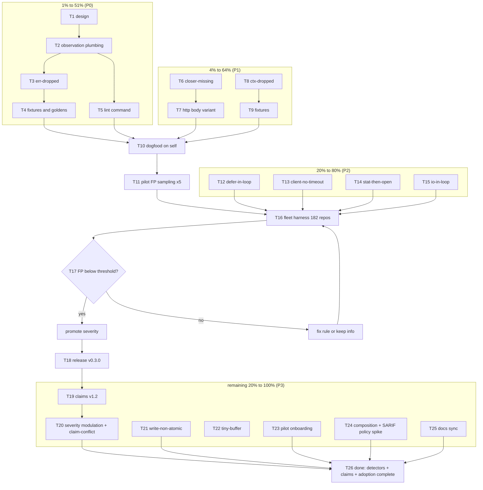

# io-bug-radar — Pareto Plan: I/O Bug & Inefficiency Detection

**Created:** 2026-11-07 05:02 CET
**Author session:** Crush (planning session; executes after approval)
**HEAD at planning:** `d380384` (master)
**Skill:** `pareto-planning` (Step 0 prior-plan read done: `docs/planning/2026-11-06_01-37_*`, `docs/planning/2026-11-06_06-02_*`, TODO_LIST, ROADMAP, CHANGELOG 0.2.0, live code greps)
**Trigger:** owner question 2026-11-07 — "How can we make sure io-surface finds I/O bugs and I/O inefficiencies?"

---

## 1. Why this plan exists

io-surface today answers **"is every I/O call site declared?"** — it finds
_undocumented_ I/O, not _bad_ I/O. The previous session produced the fleet
baseline (2026-11-07 scan, 182 projects via pma discovery:
5,802 production sites, 9,222 test-only sites, 1,672 token-tier sites,
raw data `/tmp/io-surface-portfolio-stats.json`) and a detector strategy
sketch. This plan turns that sketch into ranked, bounded, verifiable work:
a **detector layer** that finds bugs (dropped errors, leaked closers,
missing timeouts, context-blind I/O) and inefficiencies (loop-carried I/O,
double-stat, tiny buffers, non-atomic writes) on top of the existing
extraction, findings, SARIF, and baseline machinery.

**Customer value ladder:** (a) a repo that has NO manifest still gets real
bug findings (`lint` face — 181/182 fleet repos qualify today), (b) a
declared repo gets severity modulated by its own claims, (c) the fleet gets
a measurable, promotable quality signal without breaking any existing gate.

## 2. Scope: verified vs NOT verified

**Verified (command/artifact, 2026-11-07):** 14 rule constants in
`internal/check/check.go:41-54`; CLI command set = check/init/render/extract/
absorb/baseline (+ baseline add), **no `lint`** (`cmd/io-surface/main.go:68-137`);
`enforcement?: "gate" | "audit"` already in schema
(`internal/scaffold/schema.cue:41`); `--ignore` globs + manifest-derived seams
shipped (TODO #24/#20); SARIF via `--format sarif` (TODO #17); self-hosting
gate green at `d380384` (previous session: `check --root .` → 0 errors);
fleet baseline numbers above.

**NOT verified (and why):** actual FP rates of the proposed detectors —
that IS task T16/T17 (plan before evidence would be backwards); the exact
count of closable-ctor sites (measured in T16); whether `err-dropped` finds
real bugs in this fleet (sampled in T10/T11 — no claims made before that).

## 3. Errata — corrections & boundary-keeping (Step 0 mandate)

3.1 **No detector work exists anywhere in the backlog.** TODO_LIST open
items (#19, #27, #40-42, #47, #49, #50, #61, #63, #64) are unrelated; this
plan adds genuinely new tasks (#65-#90, harvested below). No duplication.
3.2 **ROADMAP Theme 3 (`--precise`, x/tools/go/packages) is NOT this plan.**
Detectors are AST-pattern observations on already-resolved call sites; they
need no type facts. Precise tier remains Theme 3's own track (cross-ref in
T24 so the two never merge silently).
3.3 **ROADMAP Theme 2 "Test-gap map" is adjacent, not overlapping:** it maps
declared write-sites to crash-recovery tests; `write-non-atomic` (T21)
detects the missing temp+rename pattern. Different inputs, kept separate.
3.4 **Non-goals inherited verbatim (ROADMAP):** no runtime benchmarks or
perf gates sharing an exit code with the deterministic gate; no auto-fixer
(detectors classify, never rewrite); no dashboard. Consequence: "inefficiency"
means _static shapes_ (loop-carried I/O, double syscall, tiny buffer), and
any future `budget` claim is display-only.
3.5 **ROADMAP Q3 (may the weak tier ever fail a build?) stays intact:**
detectors fire on the **resolved tier only**; token sites (1,672 fleet-wide)
never produce detector findings.
3.6 **Fleet scan caveat carried over:** family numbers come from the
2026-11-07 scan with generated code (`*_templ.go`, `*.pb.go`, sqlc
`*.sql.go`, stringer) and `testdata/`/`docs/` filtered; surface sizes cited
below are therefore honest _authored-code_ lower bounds.

## 4. Pareto breakdown

| Layer                    | What                                                                                                                                                                                                             | Why it wins                                                                                                                                       | Fleet evidence (2026-11-07 scan)                                                                                      |
| ------------------------ | ---------------------------------------------------------------------------------------------------------------------------------------------------------------------------------------------------------------- | ------------------------------------------------------------------------------------------------------------------------------------------------- | --------------------------------------------------------------------------------------------------------------------- |
| **1% → 51%**             | `err-dropped` detector + observation plumbing + advisory output                                                                                                                                                  | One rule, stdlib signature table, mechanical, near-zero FP by construction; dropped errors are the most common real I/O bug class                 | ~2,400+ authored file/process call sites (`os.ReadFile` 821, `os.Stat` 825, `os.WriteFile` 405, `os.MkdirAll` 350, …) |
| **4% → 64%**             | + `closer-missing`, `ctx-dropped`, and the **`lint` face** (detectors without a manifest)                                                                                                                        | Closers and context are the #2/#3 bug classes; `lint` unlocks value in all 181 undeclared repos with zero onboarding                              | db-dominant 1,153 sites, ipc-subprocess 517; `.ExecContext` 480 vs `exec.Command*` 375 shows the mixed-context fleet  |
| **20% → 80%**            | + framework hardening (fixtures/goldens/determinism), self-dogfood, `defer-in-loop`, `client-no-timeout`, `stat-then-open`, `io-in-loop`, 182-repo FP harness, evidence-gated severity promotion, v0.3.0 release | Precision proven before severity; release makes it installable (`go install …@v0.3.0`) and BuildFlow-provider-ready                               | 89 repos open sockets; `os.Getenv` 526; hotspots like `go-taskqueue/internal/queue/companion/reads.go` (18 sites)     |
| **remaining 20% → 100%** | claims v1.2 (`criticality`/`durability`) + severity modulation + `claim-conflict`, `write-non-atomic`, `tiny-buffer`, pilot onboarding (2-3 repos), composition/SARIF-policy spike, docs sync                    | Turns heuristics into contracts (severity from the manifest, not the tool); completes adoption, docs, and the honest boundary to heavier analysis | file-write 917 sites (atomicity surface); only io-surface itself declares today                                       |

## 5. Architecture decisions (the anti-verschlimmbessern core)

- **D1 — Observations never ride `Site`.** `Site`'s JSON IS the manifest
  facts contract; adding fields would drift every committed `facts.cue`.
  Instead: `extract.Observation{SiteID, Rule, Location, Evidence …}` from a
  parallel channel (`ExtractWithObservations`), consumed by `check` and
  `lint`. Manifest schema untouched in phase 1.
- **D2 — Phase 1 is schema-free.** No new families/disciplines, no version
  bump, no changes to pairing rules. Detector findings are additive rule IDs.
- **D3 — Resolved tier only** (3.5). Token sites: zero detector findings.
- **D4 — Severity ladder is evidence-gated.** Every rule ships at `info`.
  Promotion to `warning`/`error` only after fleet FP measurement (T17),
  self-gate proven green (T10). Existing declared repos can never go red by
  surprise.
- **D5 — `lint` mirrors the shipped `enforcement` policy**: extraction +
  observations → findings, exit 0 unless `--enforce`; manifest optional.
- **D6 — Table-driven detectors** like `callFamily`: rule = table rows +
  fixture row in `testdata/extract` (repo invariant, AGENTS.md).
- **D7 — Rule IDs are additive and stable**: `io-surface/err-dropped`,
  `io-surface/closer-missing`, … never renamed (SARIF/suppression contract).
- **D8 — Deliberate-ignore is respected**: `_ = os.Remove(...)` (explicit
  acknowledgment) is NOT `err-dropped`; `x, _ := os.ReadFile(...)` IS.

## 6. Level-1 plan — tasks of 30–100 min (sorted: tier, then impact/effort/value)

| ID  | Tier | Task                                                                                                                                                 | Impact | Effort | Depends | Done when                                                              |
| --- | ---- | ---------------------------------------------------------------------------------------------------------------------------------------------------- | ------ | ------ | ------- | ---------------------------------------------------------------------- |
| T1  | 1%   | Design: observation channel, detector registry, lint policy (§5 signatures)                                                                          | High   | 60m    | —       | Design section reviewed; signatures fixed                              |
| T2  | 1%   | Plumbing: `extract.Observation`, `ExtractWithObservations`, AST capture contexts (assign shapes, loop ancestry, ctx param, composite literals)       | High   | 100m   | T1      | Type + capture contexts exist, unit-tested, suite green                |
| T3  | 1%   | `err-dropped`: error-return table + discard detection + deliberate-ignore escape (D8)                                                                | High   | 90m    | T2      | Rule fires on fixture positives, silent on negatives                   |
| T4  | 1%   | Detector fixture tree + golden + SARIF golden + round-trip assert                                                                                    | High   | 45m    | T3      | Golden tests byte-pin lint output; scaffold round-trip stays green     |
| T5  | 1%   | `lint` command (no manifest): flags, handler, `--format text\|json\|sarif`, exit-0 policy, README quickstart                                         | High   | 90m    | T2      | e2e test via `runApp`; `io-surface lint --root .` works on any repo    |
| T6  | 4%   | `closer-missing`: ctor table (os.Open/Create/OpenFile/CreateTemp, sql.Open, net.Listen), defer/plain Close search, escape suppression                | High   | 100m   | T2      | Local-scope leaks flagged; returned/passed values suppressed           |
| T7  | 4%   | `closer-missing` http variant: `client.Do/Get/Post` → `resp.Body` close duty + tests/golden                                                          | Med    | 45m    | T6      | Body-leak fixtures pass; FPs documented                                |
| T8  | 4%   | `ctx-dropped`: variant-pair table + enclosing-ctx detection, info severity                                                                           | High   | 90m    | T2      | Pairs fire only when ctx is in scope; receiver-ctx FP documented       |
| T9  | 4%   | `ctx-dropped` fixtures/goldens + TODO evidence                                                                                                       | Med    | 30m    | T8      | Golden pinned; negatives (no ctx in scope) silent                      |
| T10 | 4%   | Dogfood: `lint` on io-surface itself; verify/fix/baseline every hit (self-gate must stay green)                                                      | High   | 45m    | T4,T5   | Zero unexplained hits; real bugs fixed; FPs recorded per rule          |
| T11 | 4%   | Pilot FP sampling: 5 repos from hotspot list; hand-verify ~10 findings/rule; FP table                                                                | High   | 100m   | T10     | Per-rule FP table written; go/no-go recorded                           |
| T12 | 20%  | `defer-in-loop` (loop-ancestry rule, warning justification note)                                                                                     | Med    | 45m    | T2      | Fixture + tests pass                                                   |
| T13 | 20%  | `client-no-timeout` (Client literal sans Timeout; bare http.Get/Post/Head)                                                                           | Med    | 60m    | T2      | Fixture + tests pass                                                   |
| T14 | 20%  | `stat-then-open` (identical-path-expr matching via printer; TOCTOU + double syscall)                                                                 | Med    | 90m    | T2      | Only exact-expr pairs fire; message carries both locations             |
| T15 | 20%  | `io-in-loop` (loop ancestry, info only — N+1 shape)                                                                                                  | Med    | 45m    | T2      | Fixture + tests pass                                                   |
| T16 | 20%  | Fleet harness: committed 182-repo runner (resurrect portfolio-runner pattern on the lint face), SARIF collection, FP aggregates                      | High   | 100m   | T11     | One command reproduces the fleet run; numbers land in a report         |
| T17 | 20%  | Severity promotion from evidence: thresholds, per-rule verdicts, promote passing rules, re-prove self-gate                                           | High   | 100m   | T16     | Verdict table committed; only FP≈0 rules promoted                      |
| T18 | 20%  | Release v0.3.0: CHANGELOG, README detectors section, version const, full gates, tag both remotes, proxy check, GitHub Release, BuildFlow pickup note | High   | 90m    | T17     | `go list -m @v0.3.0` serves; release published                         |
| T19 | rest | Claims v1.2: `criticality`/`durability` schema fields, byte-identical schema copies, decode, render, round-trip                                      | High   | 100m   | T18     | Schema bump lands; both schema.cue copies identical                    |
| T20 | rest | Severity modulation (claims × observations) + `claim-conflict` rule (discipline vs family)                                                           | High   | 90m    | T19     | Hot-path io-in-loop → error in test; conflicts detected                |
| T21 | rest | `write-non-atomic`: final-path write sans temp+rename; seam whitelist via manifest `via`; durability escalation                                      | Med    | 90m    | T19     | Atomic-wrapper users not flagged; escalation only on durability claims |
| T22 | rest | `tiny-buffer`: `make([]byte, N<4096)` feeding `.Read` in loop                                                                                        | Low    | 45m    | T2      | Fixture + tests pass                                                   |
| T23 | rest | Pilot onboarding: init + claims (incl. criticality for hotspots) + green gate + CI wiring in 2-3 repos                                               | High   | 100m   | T19     | Each pilot repo's CI runs the gate green                               |
| T24 | rest | Spike: golangci focus-filter vs audit module vs ROADMAP `--precise` boundary + SARIF upload policy (unblocks #61 path); ADR into ROADMAP             | Med    | 60m    | T17     | ADR section written; one option chosen with rationale                  |
| T25 | rest | Docs sync: TODO_LIST statuses, FEATURES inventory, ROADMAP cross-links                                                                               | Med    | 30m    | T18     | One fact, one home; no split brains                                    |

Total: 25 tasks, ≈ 31 h. Critical path: T1→T2→T3→T4→T10→T11→T16→T17→T18.

## 7. Level-2 breakdown — micro tasks ≤ 12 min (ALL tasks, same sort)

| ID    | Micro-task                                                                           | Est |
| ----- | ------------------------------------------------------------------------------------ | --- |
| T1.1  | Write `Observation` struct + `ExtractWithObservations` signature sketch into plan §5 | 12m |
| T1.2  | Fix evidence payload fields (rule, siteID, location, message args)                   | 10m |
| T1.3  | Decide detector registry shape (table rows + capture hooks)                          | 12m |
| T1.4  | Decide `lint` exit-code policy mirroring `enforcement`; record                       | 10m |
| T1.5  | Walk `scanFunc`; list exact instrumentation points per capture context               | 12m |
| T2.1  | Add `Observation` type + `ExtractWithObservations` API                               | 12m |
| T2.2  | Capture assignment shapes at `record()` (multi-assign, blank slots)                  | 12m |
| T2.3  | Capture expression-statement calls (all returns dropped)                             | 10m |
| T2.4  | Capture loop ancestry (parent tracking through `ast.Inspect`)                        | 12m |
| T2.5  | Capture enclosing-func `ctx` param presence                                          | 12m |
| T2.6  | Capture composite-literal field sets (`http.Client{}`)                               | 12m |
| T2.7  | Unit test: observation determinism + ordering                                        | 12m |
| T2.8  | gofmt + vet + full suite green                                                       | 8m  |
| T3.1  | Error-return table: os/io/http/exec/net/sql watched calls                            | 12m |
| T3.2  | Rule logic: blank-discard in multi-assign                                            | 12m |
| T3.3  | Deliberate-ignore escape: `_ = f()` not flagged                                      | 10m |
| T3.4  | Bare expression-statement call flagged                                               | 10m |
| T3.5  | Severity wiring (info) + finding message with call + location                        | 12m |
| T3.6  | Unit tests: positive/negative table                                                  | 12m |
| T3.7  | `testdata/extract` fixture file covering all discard shapes                          | 12m |
| T4.1  | Scaffold round-trip asserts zero unexpected detector findings                        | 12m |
| T4.2  | Golden: `lint` text output byte-pinned                                               | 12m |
| T4.3  | SARIF golden: rule IDs + severities                                                  | 12m |
| T4.4  | Doc comment in `internal/extract`: tier policy for detectors                         | 9m  |
| T5.1  | `lintFlags` struct + cmdguard registration                                           | 12m |
| T5.2  | Handler: extract + observations → findings                                           | 12m |
| T5.3  | `--format text\|json\|sarif` reuses `internal/emit`                                  | 12m |
| T5.4  | Exit-code policy: 0 unless `--enforce`                                               | 10m |
| T5.5  | e2e test via `runApp` (json shape, exit codes)                                       | 12m |
| T5.6  | README quickstart: lint without a manifest                                           | 12m |
| T5.7  | Help text + `describe` contract test update                                          | 10m |
| T6.1  | Closable ctor table (os.Open/Create/OpenFile/CreateTemp, sql.Open, net.Listen)       | 12m |
| T6.2  | Ident-scope capture at ctor assignment                                               | 12m |
| T6.3  | `defer X.Close()` search in enclosing func                                           | 12m |
| T6.4  | Plain `X.Close()` also suppresses                                                    | 10m |
| T6.5  | Escape suppression: ident returned/passed/stored                                     | 12m |
| T6.6  | Observation emission + info severity                                                 | 10m |
| T6.7  | Unit tests pos/neg                                                                   | 12m |
| T6.8  | Fixture rows                                                                         | 10m |
| T7.1  | `client.Do/Get/Post` → `resp.Body` ctor table entries                                | 12m |
| T7.2  | Body close-duty detection + tests                                                    | 12m |
| T7.3  | Golden + fixture update                                                              | 12m |
| T7.4  | FP notes recorded                                                                    | 9m  |
| T8.1  | Variant-pair table (Query/Exec/QueryRow, Command, Dial, http.Get/Post)               | 12m |
| T8.2  | ctx-in-scope detection (param name + `context.Context` via import)                   | 12m |
| T8.3  | Rule logic + info severity                                                           | 10m |
| T8.4  | Table-driven unit tests                                                              | 12m |
| T8.5  | Fixture rows                                                                         | 10m |
| T8.6  | Document receiver-ctx FP class                                                       | 10m |
| T9.1  | Negative fixture: no ctx in scope                                                    | 10m |
| T9.2  | Golden byte-pin                                                                      | 10m |
| T9.3  | TODO_LIST evidence update                                                            | 10m |
| T10.1 | Run `lint` on io-surface tree; list hits                                             | 10m |
| T10.2 | Hand-verify each hit: real bug or FP                                                 | 12m |
| T10.3 | Fix real hits in own code                                                            | 12m |
| T10.4 | Record FPs + causes; open refinement follow-ups                                      | 11m |
| T11.1 | Select 5 pilot repos from hotspot list; confirm clean checkouts                      | 10m |
| T11.2 | Run `lint` per repo; capture SARIF                                                   | 10m |
| T11.3 | Verify sample batch 1 (~10 findings) by hand                                         | 12m |
| T11.4 | Verify sample batch 2                                                                | 12m |
| T11.5 | Verify sample batch 3                                                                | 12m |
| T11.6 | Verify sample batch 4                                                                | 12m |
| T11.7 | Write FP table into a status report                                                  | 12m |
| T11.8 | Record go/no-go per rule                                                             | 10m |
| T12.1 | DeferStmt-in-loop rule on loop ancestry                                              | 12m |
| T12.2 | Tests + fixture                                                                      | 12m |
| T12.3 | Severity justification note (warning candidate, promoted via T17 only)               | 10m |
| T13.1 | `http.Client` literal field-presence check                                           | 12m |
| T13.2 | Bare `http.Get/Post/Head` info finding                                               | 10m |
| T13.3 | Tests + fixture                                                                      | 12m |
| T13.4 | Docs: rule card in README                                                            | 8m  |
| T14.1 | Identical-expr keying via `format.Node` printer                                      | 12m |
| T14.2 | Pair os.Stat/Lstat → Open*/ReadFile/WriteFile within func                            | 12m |
| T14.3 | Info severity + message with both locations                                          | 10m |
| T14.4 | Tests                                                                                | 12m |
| T14.5 | Fixture                                                                              | 12m |
| T15.1 | Loop-ancestry io-in-loop rule, info only                                             | 12m |
| T15.2 | Tests + fixture                                                                      | 12m |
| T16.1 | Commit fleet runner (decision: `scripts/` vs `internal/fleetscan`)                   | 12m |
| T16.2 | Lint loop over pma discovery + SARIF collection                                      | 12m |
| T16.3 | FP-aggregate report generator                                                        | 12m |
| T16.4 | Full 182-repo run                                                                    | 10m |
| T16.5 | Verify sample batch 1 (30 findings across rules)                                     | 12m |
| T16.6 | Verify sample batch 2                                                                | 12m |
| T16.7 | Verify sample batch 3                                                                | 12m |
| T16.8 | Numbers + verdicts into status report                                                | 10m |
| T17.1 | Write FP-threshold promotion policy                                                  | 12m |
| T17.2 | Per-rule verdict table                                                               | 12m |
| T17.3 | Promote passing rules to warning                                                     | 12m |
| T17.4 | Re-run self gate green after promotion                                               | 12m |
| T17.5 | TODO_LIST/CHANGELOG entries                                                          | 10m |
| T18.1 | CHANGELOG 0.3.0 cut                                                                  | 12m |
| T18.2 | README detectors section + status line                                               | 12m |
| T18.3 | Version const bump                                                                   | 5m  |
| T18.4 | Full local gates (build/vet/test/gofmt/self-check/self-render)                       | 12m |
| T18.5 | Annotated tag to both remotes                                                        | 10m |
| T18.6 | Proxy `go list -m @v0.3.0` check                                                     | 10m |
| T18.7 | GitHub Release                                                                       | 10m |
| T18.8 | BuildFlow provider pickup note (new tag required)                                    | 8m  |
| T19.1 | Schema field design (`criticality`, `durability`)                                    | 12m |
| T19.2 | `internal/scaffold/schema.cue` + deployed copy, byte-identical                       | 12m |
| T19.3 | Manifest decode + tests                                                              | 12m |
| T19.4 | Render claims columns                                                                | 12m |
| T19.5 | Scaffold round-trip incl. new fields                                                 | 12m |
| T19.6 | Version enum v1.2 + taxonomy prose                                                   | 10m |
| T20.1 | Claims × observations severity mapping                                               | 12m |
| T20.2 | `claim-conflict` rule (discipline vs extracted family)                               | 12m |
| T20.3 | Tests                                                                                | 12m |
| T20.4 | Golden updates                                                                       | 12m |
| T20.5 | README claims documentation                                                          | 10m |
| T21.1 | Final-path write pattern detection                                                   | 12m |
| T21.2 | Temp+rename presence check + manifest-`via` seam whitelist                           | 12m |
| T21.3 | Durability escalation (post-T19)                                                     | 10m |
| T21.4 | Tests + fixture                                                                      | 12m |
| T22.1 | Tiny-buffer rule (`make([]byte,N<4096)` + `.Read` in loop)                           | 12m |
| T22.2 | Tests + fixture                                                                      | 12m |
| T23.1 | Pick 2-3 pilot repos; `init` each                                                    | 12m |
| T23.2 | Hand-port claims incl. criticality for hotspot sites                                 | 12m |
| T23.3 | Port claims batch 2 + gate green per repo                                            | 12m |
| T23.4 | CI wiring per repo                                                                   | 12m |
| T23.5 | Pilot retro notes into status report                                                 | 10m |
| T24.1 | golangci-lint focus-filter prototype notes                                           | 12m |
| T24.2 | Audit-module vs `--precise` boundary vs ROADMAP Theme 3                              | 12m |
| T24.3 | SARIF upload policy proposal (path to unblock TODO #61)                              | 12m |
| T24.4 | ADR section into ROADMAP                                                             | 12m |
| T25.1 | TODO_LIST statuses refreshed                                                         | 10m |
| T25.2 | FEATURES inventory updated                                                           | 10m |
| T25.3 | ROADMAP cross-links (Themes 2/3/4 + Q3)                                              | 10m |

128 micro tasks. Execution rule: one L1 task at a time, its micro tasks in
order, suite green after each L1 task (no half-landed rules).

## 8. Execution graph

## 9. Risk register (verschlimmbesser guards)

| Risk                                                                                | Guard                                                                          |
| ----------------------------------------------------------------------------------- | ------------------------------------------------------------------------------ |
| Self-hosting gate goes red when a promoted rule fires on own code                   | T10 dogfoods BEFORE any promotion; fix-or-baseline every hit first             |
| Manifest contract drift via new Site fields                                         | D1: observations ride a parallel type; facts.cue bytes unchanged in phase 1    |
| Existing declared repos (io-surface, dnsblockd, InboxClean) surprised by new errors | D4: everything ships info; promotion is a separate, evidence-gated step        |
| FP flood burns trust in the tool                                                    | T11/T16 sampling gates every severity decision; lint face is exit-0 by default |
| Token-tier heuristics poison detectors                                              | D3: resolved tier only, enforced by test                                       |
| Rule-ID renames break SARIF/suppressions                                            | D7: additive IDs only, pinned by SARIF golden (T4.3)                           |
| Scope creep into runtime perf / auto-fix                                            | 3.4 non-goals inherited; `budget` claims display-only                          |
| Split brain with ROADMAP Theme 3 (`--precise`)                                      | 3.2 boundary recorded; T24 writes the ADR                                      |

## 10. Rollout & verification policy

Every claim in future execution reports names its command ("verified how").
Minimum verification per phase: P0 — `go test ./...` + golden diff + manual
review of every io-surface hit; P1 — FP table from 5 pilots; P2 — 182-repo
run + 3×30 hand-verified samples + promoted-rule self-gate green; P3 —
pilot CI green + schema round-trip + `go list -m @v0.3.0` proxy check.

Harvest: TODO_LIST #65–#89 mirror T1–T25 (this file is the snapshot,
TODO_LIST is the living source; docs-health HARVEST on completion).
