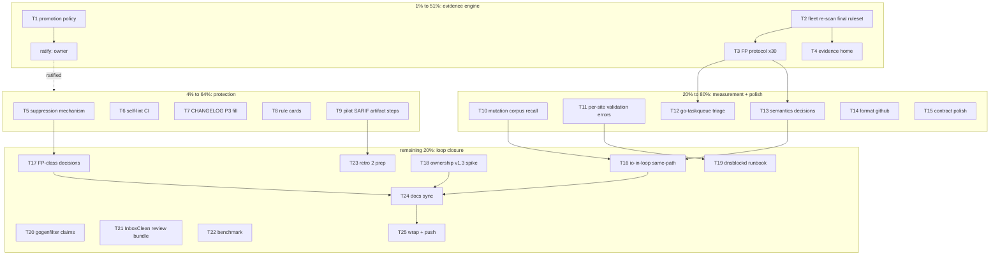

# io-surface SUPERB — Pareto Plan: published precision, measured recall, earned severity

**Created:** 2026-11-07 20:06 CET
**Author session:** Crush (superb-strategy session; executes after approval)
**HEAD at planning:** `333da32` (master; v0.3.0 tagged at `e3b…/336c279`; a
concurrent session has an in-flight **v0.4.0 version bump** in the working
tree — this plan neither touches nor stages it)
**Trigger:** owner question 2026-11-07 — "How can we make sure io-surface is superb!?"
**Prior plans:** `docs/planning/2026-11-07_05-02_io-bug-radar-pareto-plan.md`
(executed T1–T25, v0.3.0 shipped); retrospectives
`docs/status/2026-11-07_09-09_…` and `docs/status/2026-11-07_20-01_…`.

---

## 1. Why this plan exists

The io-bug-radar line made io-surface find bad I/O. The superb question is
different: **how do we KNOW it is superb?** The answer from the strategy
round is the superb loop — **MEASURE → FIX → PROMOTE → PROTECT** — and this
plan builds its missing machinery:

- **MEASURE:** precision is sampled but never at protocol volume; recall has
  never been measured at all (two real-bug finds are an existence proof, not
  a rate). The fleet evidence predates two shipped rules.
- **FIX:** the evidence-driven carve-out flywheel worked once (io.ReadAll,
  filepath.Glob, rand.Read) but has no standing suppression mechanism —
  every legitimate FP class is a permanent nag.
- **PROMOTE:** T17 shipped the verdict table but the bar itself ("FP≈0") was
  never given a number. Severity without a published threshold is a vibe.
- **PROTECT:** goldens and the self-check exist; self-lint is not in CI, and
  nothing re-verifies fleet evidence after rule changes.

Customer value: a tool whose **precision and recall are published numbers**,
whose **severity is earned by evidence**, and whose **own gate runs on
itself** — that is the superb definition this plan makes real.

## 2. Scope: verified vs NOT verified

**Verified (2026-11-07):** 10 detector rules shipped (v0.3.0 + P3 on HEAD);
fleet scan 160/160 (72 with findings) — but for the P0-era ruleset only;
`scripts/fleetscan.sh` reproduces it; CI green on pushed HEAD (run
42353726369, verified by the 19:52 dogfooding session); self-check 0/0/0;
docs-gates 5/5 (cadence 15/15 after archiving the birth report); two real
bugs found-and-fixed (symbolVisible N+1 here; InboxClean pdf.go fd leak,
disk-only there); 3 evidence carve-outs shipped with tests
(`internal/extract/tables.go` comments + `TestErrResults_CoversWatchedFamilies`).

**NOT verified (and why):** write-non-atomic/tiny-buffer fleet counts (rules
postdate the scan); recall (no mutation corpus exists); FP volume per rule
(~13 deep-verified vs the 3×30 protocol); the promotion bar (a phrase, not a
number); InboxClean CI on the bumped pin (files uncommitted).

## 3. Errata — corrections & boundary-keeping (Verschlimmbesser guards)

3.1 **The D1–D8 architecture decisions are FROZEN.** Observations never ride
`Site`; token tier never fires detectors; every new rule ships info; rule
IDs additive. This plan adds zero families and zero schema bumps except the
explicitly gated v1.3 spike (T18, design-only).
3.2 **Inherited non-goals hold:** no runtime perf gates sharing exit codes,
no auto-fixer, no dashboard. Benchmark (T22) is display-only.
3.3 **dnsblockd judgment stays owner-gated.** T19 builds only the mechanical
runbook (using T11's fixed error messages); the 131-claim discipline→exception
mapping requires owner context (open question 1).
3.4 **InboxClean/gogenfilter commits stay owner-gated** (open question 3).
T21 prepares the review bundle; nothing is pushed from here.
3.5 **The in-flight v0.4.0 bump is another session's work.** This plan's
tasks build on v0.3.0 semantics and stage only their own files; T7's
release-cut decision coordinates with that bump rather than duplicating it.
3.6 **Concurrent-session rule:** the 19:52 dogfooding report verified CI and
pilot states — its findings are cited as ground truth, not re-derived.
3.7 **Suppression design constraint (T5):** the mechanism must be
hermetic (comment-scanned, no external state) and visible in review — a
reason is mandatory, mirroring the baseline's note discipline.

## 4. Pareto breakdown

| Layer                    | What                                                                                                                                                                                                                                                                            | Why it wins                                                                                                                                                   | Evidence (2026-11-07)                                                                                            |
| ------------------------ | ------------------------------------------------------------------------------------------------------------------------------------------------------------------------------------------------------------------------------------------------------------------------------- | ------------------------------------------------------------------------------------------------------------------------------------------------------------- | ---------------------------------------------------------------------------------------------------------------- |
| **1% → 51%**             | The **evidence engine**: numbered promotion policy + fleet re-scan with the final ruleset + FP verification protocol at volume                                                                                                                                                  | Every severity claim ever made becomes a number; the released evidence matches the shipped ruleset; the FP table becomes the standing input to promotion      | fleet numbers predate write-non-atomic/tiny-buffer; promotion bar is a phrase; ~13 findings deep-verified        |
| **4% → 64%**             | + **suppression mechanism** (per-site ignore-with-reason), self-lint in CI, CHANGELOG/evidence hygiene (P3 fill, /tmp → docs/evidence)                                                                                                                                          | Kills the permanent-nag problem (the #1 lint-adoption blocker); protects the tool from its own future promotions; makes evidence durable                      | lint has no suppression story; self-lint manual-only; Unreleased changelog empty while HEAD carries P3           |
| **20% → 80%**            | + **mutation corpus** (recall % per rule, in CI), rule cards, TODO #3 per-site validation errors, go-taskqueue triage, pilot SARIF artifact steps                                                                                                                               | Recall becomes a measured, CI-guarded number; rule quality classes are documented where users look; the biggest untriaged signal pool (37 findings) gets read | recall never measured; FP classes live in status reports, not rule metadata; TODO #3 blocked dnsblockd diagnosis |
| **remaining 20% → 100%** | + semantics decisions from measured data (write-non-atomic, tiny-buffer), io-in-loop same-path refinement, ownership v1.3 spike (ADR), dnsblockd runbook, gogenfilter claims, InboxClean review bundle, `--format github`, contract polish, benchmark (display-only), docs sync | Closes the loop: decisions driven by the new measurements; adoption edges sanded; every doc home correct                                                      | all listed as open items in the 20:01 retrospective                                                              |

## 5. Architecture decisions (the anti-Verschlimmbesser core)

- **D1 — The policy is a document with numbers, ratified by the owner.**
  T1 proposes (warning: ≥30 verified findings, FP<5%, self-gate green under
  `--enforce`; error: FP<1% + a claims backing); the owner ratifies or
  amends. No promotion happens before ratification (open question 2).
- **D2 — Suppression is a comment directive, scanned hermetically.**
  `//io-surface:ignore <rule> <reason>` collected by the capture tracker,
  matched by rule+location at emit; file-level ignores rejected (too blunt);
  reason mandatory; visible in every review diff. No external state, no
  baseline file duplication.
- **D3 — Recall is a test, not a claim.** The mutation corpus is a Go test
  (`TestMutationRecall`): table-driven mutators over the fixture corpus, each
  mutation must produce its rule's observation, recall % printed and pinned
  per rule. A rule whose recall regresses fails CI.
- **D4 — Evidence must match the shipped ruleset.** Every task that changes
  a rule re-runs the fleet scan before its task is "done"; the evidence
  report is regenerated, not appended to.
- **D5 — The v0.4.0 bump belongs to the concurrent session.** This plan
  neither stages nor undoes it; T7 coordinates (its CHANGELOG work lands in
  Unreleased either way).
- **D6 — Judgment migrations stay owner-gated** (dnsblockd mapping,
  InboxClean landing). This plan prepares artifacts, never pushes other
  repos' decisions.
- **D7 — Frozen architecture** (errata 3.1): no `Site` changes, no token-tier
  findings, no new families; v1.3 ownership is design-spike only (T18).

## 6. Level-1 plan — tasks of 30–100 min (sorted: tier, then impact/effort/value)

| ID  | Tier | Task                                                                                                                      | Impact | Effort | Depends | Done when                                                                                 |
| --- | ---- | ------------------------------------------------------------------------------------------------------------------------- | ------ | ------ | ------- | ----------------------------------------------------------------------------------------- |
| T1  | 1%   | Promotion policy v1: thresholds, sample size, de-promotion path, owner-ratification section                               | High   | 45m    | —       | `docs/planning/…promotion-policy.md` committed; numbers proposed for ratification         |
| T2  | 1%   | Fleet re-scan with the final ruleset; write-non-atomic/tiny-buffer counts published; evidence report regenerated          | High   | 45m    | —       | evidence report matches shipped ruleset; `/tmp` dependency removed                        |
| T3  | 1%   | FP verification protocol: 30 findings × write-non-atomic + tiny-buffer + client-no-timeout, hand-verified, FP table v2    | High   | 100m   | T2      | FP table v2 committed with per-rule go/no-go                                              |
| T4  | 1%   | Evidence hygiene: `docs/evidence/` home for fleet JSON; /tmp citations fixed in TODO_LIST + reports                       | Med    | 30m    | T2      | no /tmp evidence citations remain                                                         |
| T5  | 4%   | Suppression mechanism: `//io-surface:ignore <rule> <reason>` directive, capture-time collection, emit-time filter         | High   | 100m   | —       | fixture positives suppressed with reason; reasonless ignores rejected; tests + rule cards |
| T6  | 4%   | Self-lint CI step (report-only) after the self-check step                                                                 | High   | 30m    | —       | CI runs `lint --root .` green; step comment states the artifact-only policy               |
| T7  | 4%   | CHANGELOG Unreleased fill (P3 features); coordinate with the in-flight v0.4.0 bump                                        | Med    | 45m    | —       | Unreleased lists claims v1.2/modulation/claim-conflict/write-non-atomic/tiny-buffer       |
| T8  | 4%   | Rule cards: README table — rule, detects, FP classes, positive+negative example                                           | Med    | 60m    | —       | all 10 rules carded; linked from lint help                                                |
| T9  | 4%   | Pilot SARIF artifact steps (gogenfilter + InboxClean CI), artifact-only per Theme 5                                       | Med    | 30m    | —       | both CI files carry a pinned `lint --format sarif` artifact step                          |
| T10 | 20%  | Mutation corpus + `TestMutationRecall`: mutators for all 8 classes over the fixture corpus, recall % pinned per rule      | High   | 100m   | —       | recall test green with published %; a recall regression fails CI                          |
| T11 | 20%  | TODO #3: per-site validation error messages (CUE path in every violation)                                                 | High   | 60m    | —       | planted violations print `sites."X".field` paths; dnsblockd failure inventory re-run      |
| T12 | 20%  | go-taskqueue triage: 37 findings verified in batches; FP table v2 additions                                               | Med    | 60m    | T3      | biggest untriaged pool read; FP classes updated                                           |
| T13 | 20%  | Semantics decisions from measured data: write-non-atomic noise → durability-gating? tiny-buffer wrapper semantics → cards | Med    | 60m    | T2,T3   | both rules' cards state the decided semantics; deltas implemented if any                  |
| T14 | 20%  | `lint --format github` (PR annotation output)                                                                             | Med    | 45m    | —       | e2e test + README row                                                                     |
| T15 | 20%  | Contract polish: describe-contract asserts lint flags; SARIF `properties.ruleDescription` from `DetectorRules()`          | Low    | 30m    | —       | both pinned by tests; goldens regenerated                                                 |
| T16 | rest | io-in-loop same-path refinement: flag only repeated printer-keyed targets within a loop body                              | Med    | 100m   | T10     | fixture + tests; fleet re-scan shows the FP drop; rule card updated                       |
| T17 | rest | FP-class decisions via T5: os.Remove-cleanup + ctx force-kill classes (accept, suppress examples shipped)                 | Med    | 45m    | T5      | both classes have either shipped ignore examples or explicit acceptance in cards          |
| T18 | rest | Ownership claims v1.3 design spike (self/caller/helper vocabulary) → ROADMAP Q6 ADR (design-only, no schema change)       | Med    | 60m    | —       | ADR committed; v1.3 decision recorded for the owner                                       |
| T19 | rest | dnsblockd migration runbook: failing-site inventory (via T11) + discipline→exception mapping template + review checklist  | Med    | 45m    | T11     | runbook in dnsblockd docs; owner checklist ready (NO migration executed)                  |
| T20 | rest | gogenfilter claims port: 5 sites + criticality where warranted; gate green                                                | Low    | 30m    | —       | `check --root gogenfilter` green with claims                                              |
| T21 | rest | InboxClean review bundle: diff summary + per-file rationale dropped into its docs/ for the owner                          | Med    | 30m    | —       | bundle exists; NO commit/push from here (question 3 open)                                 |
| T22 | rest | Benchmark lint on the biggest fleet repo (display-only per non-goals)                                                     | Low    | 45m    | T2      | number published in a status report; hotspot profile if slow                              |
| T23 | rest | Pilot retro #2 prep: behavior metric definition + artifact-count instrumentation plan                                     | Low    | 30m    | T9      | metric + instrumentation documented                                                       |
| T24 | rest | Docs sync: AGENTS lint command row, Theme 2 cross-link, `--enforce`×`criticality` doc, errors-help pass on lint output    | Med    | 45m    | —       | all four doc homes correct; docs-gates green                                              |
| T25 | rest | Wrap: status report v3, cadence archive check, TODO_LIST harvest + push both remotes                                      | Med    | 30m    | all     | harvest rows DONE-with-evidence; both remotes pushed                                      |

Total: 25 tasks ≈ 33 h. Critical path: T2→T3→T13 and T5→T17; T10 independent
(highest long-term value); T1 unblocks every future promotion.

## 7. Level-2 breakdown — micro tasks ≤ 12 min (ALL tasks)

| ID    | Micro-task                                                                                      | Est |
| ----- | ----------------------------------------------------------------------------------------------- | --- |
| T1.1  | Draft warning thresholds: ≥30 verified findings, FP<5%, self-gate green under `--enforce`       | 12m |
| T1.2  | Draft error thresholds: FP<1% + claims backing (criticality/durability)                         | 10m |
| T1.3  | De-promotion path: FP-regression reverts a rule to info (mechanism + who decides)               | 12m |
| T1.4  | Per-rule vs whole-suite decision + rationale                                                    | 10m |
| T1.5  | Owner-ratification section (surface open question 2 explicitly)                                 | 8m  |
| T1.6  | Commit `docs/planning/2026-11-07_…promotion-policy.md`                                          | 5m  |
| T2.1  | Build current binary; run `scripts/fleetscan.sh` end-to-end                                     | 12m |
| T2.2  | Extract write-non-atomic/tiny-buffer fleet counts                                               | 12m |
| T2.3  | Regenerate the evidence status report (replace stale numbers)                                   | 10m |
| T2.4  | Delta note vs released v0.3.0 numbers                                                           | 8m  |
| T3.1  | Select the 30+30+10 verification sample (write-non-atomic, tiny-buffer, client-no-timeout)      | 10m |
| T3.2  | Verify batch 1 (write-non-atomic ×10, file+context read each)                                   | 12m |
| T3.3  | Verify batch 2 (write-non-atomic ×10)                                                           | 12m |
| T3.4  | Verify batch 3 (write-non-atomic remainder + tiny-buffer start)                                 | 12m |
| T3.5  | Verify batch 4 (tiny-buffer + client-no-timeout remainder)                                      | 12m |
| T3.6  | FP table v2 into the evidence report                                                            | 12m |
| T3.7  | Per-rule go/no-go refresh; note promotion candidates under the T1 thresholds                    | 12m |
| T4.1  | `mkdir docs/evidence`; copy fleet JSON with a README provenance header                          | 8m  |
| T4.2  | grep `/tmp` citations; fix TODO_LIST header + status reports                                    | 12m |
| T4.3  | AGENTS.md: evidence-location policy note                                                        | 8m  |
| T5.1  | Design: directive grammar `//io-surface:ignore <rule> <reason…>`; rejection of reasonless forms | 12m |
| T5.2  | Collect directives during capture (comment scan per file, position-keyed)                       | 12m |
| T5.3  | Filter observations at emit (rule+line match; multi-line calls use the anchor line)             | 12m |
| T5.4  | Decide file-level ignores: NO (too blunt) — record rationale                                    | 8m  |
| T5.5  | Fixture rows: suppressed-with-reason positive + reasonless-negative                             | 12m |
| T5.6  | Tests: suppression filters exactly one rule; other rules on the same line still fire            | 12m |
| T5.7  | README: suppression section under rule cards                                                    | 12m |
| T5.8  | Audit story: ignores live in code diffs (review-visible), no only-shrinks tooling needed        | 10m |
| T6.1  | ci.yml: `lint --root .` step after self-check, artifact-only policy comment                     | 10m |
| T6.2  | Run the exact CI command locally; confirm exit 0                                                | 8m  |
| T6.3  | Confirm docs-gates/buildflow unaffected                                                         | 8m  |
| T7.1  | Draft Unreleased: claims v1.2, modulation, claim-conflict, write-non-atomic, tiny-buffer        | 12m |
| T7.2  | Coordinate with the in-flight v0.4.0 bump (same-session check before staging)                   | 8m  |
| T7.3  | dprint + docs-gates on CHANGELOG                                                                | 8m  |
| T7.4  | Leave Unreleased ready for the v0.4.0 cut (no version bump from here)                           | 8m  |
| T8.1  | Rule cards table: err-dropped, closer-missing (+body), ctx-dropped                              | 12m |
| T8.2  | Rule cards: defer-in-loop, io-in-loop, stat-then-open                                           | 12m |
| T8.3  | Rule cards: client-no-timeout, write-non-atomic, tiny-buffer                                    | 12m |
| T8.4  | Suppression example column; link from `lint` help long text                                     | 12m |
| T9.1  | gogenfilter ci.yml: pinned `lint --format sarif > artifact` step                                | 10m |
| T9.2  | InboxClean ci.yml: same step (joins the uncommitted review batch)                               | 10m |
| T9.3  | Verify SARIF artifact shape locally for both                                                    | 10m |
| T10.1 | Design: one mutator per rule class; mutation = minimal bug injection over fixture corpus        | 10m |
| T10.2 | Harness skeleton: table-driven `TestMutationRecall` over copied fixture trees                   | 12m |
| T10.3 | err-dropped mutator (blank the error slot)                                                      | 12m |
| T10.4 | closer-missing mutator (delete the defer Close)                                                 | 12m |
| T10.5 | ctx-dropped mutator (swap Command→CommandContext removal)                                       | 12m |
| T10.6 | loop mutators (move defer inside loop; move call inside loop)                                   | 12m |
| T10.7 | timeout/non-atomic/buffer mutators (drop Timeout; drop rename; shrink make)                     | 12m |
| T10.8 | Recall % computation; pin per-rule minimums; print table                                        | 10m |
| T10.9 | Wire into CI via the normal go test lane; document the corpus location                          | 8m  |
| T11.1 | Planted-violations repro of the opaque message                                                  | 12m |
| T11.2 | Surface the CUE path per violation in `manifest.Load` errors                                    | 12m |
| T11.3 | Tests: expected `sites."X".field` paths in messages                                             | 12m |
| T11.4 | Re-run dnsblockd check; record the full failure inventory                                       | 12m |
| T11.5 | dnsblockd migration runbook draft (into its docs/architecture/io-surface/)                      | 12m |
| T12.1 | go-taskqueue: lint JSON dump; group 37 findings by rule                                         | 12m |
| T12.2 | Verify io-in-loop batch (12)                                                                    | 12m |
| T12.3 | Verify err-dropped + client-no-timeout batch (10)                                               | 12m |
| T12.4 | Verify remainder batch (15)                                                                     | 12m |
| T12.5 | FP table v2 additions; class notes                                                              | 12m |
| T13.1 | write-non-atomic fleet noise analysis (from T2 counts + T3 sample)                              | 12m |
| T13.2 | Decision: keep universal vs durability-gated; rule card updated                                 | 12m |
| T13.3 | tiny-buffer wrapper semantics decision + rule card                                              | 12m |
| T13.4 | Implement any decision delta (detector or lint change)                                          | 12m |
| T13.5 | Tests + goldens regenerated                                                                     | 12m |
| T14.1 | Annotation format design (`::error file=…,line=…,title=…` vs exit-code contract)                | 10m |
| T14.2 | Implement the printer reusing check.Finding                                                     | 12m |
| T14.3 | e2e test + fixture output                                                                       | 12m |
| T14.4 | README command row                                                                              | 8m  |
| T15.1 | describe-contract test: assert lint flags present                                               | 10m |
| T15.2 | SARIF `properties.ruleDescription` from `DetectorRules()`                                       | 12m |
| T15.3 | Goldens regenerated; parity test still green                                                    | 8m  |
| T16.1 | Printer-keyed target helper (reuse the stat-then-open keyer)                                    | 12m |
| T16.2 | Per-loop target multiset during capture                                                         | 12m |
| T16.3 | Rule change: flag only targets appearing >1× in the same loop                                   | 12m |
| T16.4 | Fixture updates (repeat-target positive; distinct-target negative)                              | 12m |
| T16.5 | Tests + determinism                                                                             | 12m |
| T16.6 | Fleet re-scan: io-in-loop delta published                                                       | 12m |
| T16.7 | Rule card + goldens                                                                             | 10m |
| T17.1 | os.Remove-cleanup: ship ignore examples or accept; card updated                                 | 12m |
| T17.2 | ctx force-kill class: same                                                                      | 12m |
| T17.3 | Fixture + tests for the chosen forms                                                            | 12m |
| T17.4 | Rule card sync                                                                                  | 9m  |
| T18.1 | Vocabulary design: `ownership: self/caller/helper` + semantics per closer rule                  | 12m |
| T18.2 | Schema impact assessment: v1.3 bump scope (D7 gate)                                             | 12m |
| T18.3 | Map closer-missing FP classes → ownership values                                                | 12m |
| T18.4 | ROADMAP Q6 ADR: propose v1.3, record the decision point                                         | 12m |
| T18.5 | Harvest the ratification task                                                                   | 8m  |
| T19.1 | dnsblockd failing-site inventory (with T11's new messages)                                      | 12m |
| T19.2 | Discipline→exception mapping table template                                                     | 12m |
| T19.3 | Runbook into dnsblockd docs/architecture/io-surface/                                            | 10m |
| T19.4 | Owner review checklist                                                                          | 8m  |
| T20.1 | Read gogenfilter's 5 sites; identify any critical path                                          | 10m |
| T20.2 | Write claims + criticality; gate green                                                          | 12m |
| T20.3 | Note in the pilot retro                                                                         | 8m  |
| T21.1 | InboxClean diff summary doc (4 files, what+why each)                                            | 12m |
| T21.2 | Per-file rationale incl. the fd-leak fix evidence                                               | 10m |
| T21.3 | Drop the bundle into InboxClean docs/ for owner review                                          | 8m  |
| T22.1 | Pick the biggest fleet repo (LOC scan)                                                          | 5m  |
| T22.2 | Timed lint runs (3×, median)                                                                    | 12m |
| T22.3 | Publish the number (display-only note)                                                          | 10m |
| T22.4 | Hotspot profile only if >30s                                                                    | 12m |
| T23.1 | Define the pilot behavior metric (findings → actions rate)                                      | 12m |
| T23.2 | Instrument artifact counts in the pilot SARIF steps                                             | 10m |
| T23.3 | Retro #2 schedule note                                                                          | 8m  |
| T24.1 | AGENTS.md Commands block: add `lint`                                                            | 8m  |
| T24.2 | ROADMAP Theme 2 cross-link for write-non-atomic                                                 | 8m  |
| T24.3 | README: `--enforce` × `criticality` interaction doc                                             | 12m |
| T24.4 | Errors-help pass on lint output lines                                                           | 10m |
| T24.5 | TODO_LIST/FEATURES refresh with this plan's harvest                                             | 8m  |
| T25.1 | Status report v3 (session wrap)                                                                 | 12m |
| T25.2 | Cadence archive check (15/15 discipline)                                                        | 10m |
| T25.3 | Harvest rows + push both remotes                                                                | 8m  |

~130 micro tasks. Execution rule: one L1 task at a time, its micro tasks in
order, full gate battery green after each L1 task (no half-landed rules).

## 8. Execution graph

## 9. Risk register (Verschlimmbesser guards)

| Risk                                              | Guard                                                                                             |
| ------------------------------------------------- | ------------------------------------------------------------------------------------------------- |
| Promotion without ratification breaks trust       | D1: policy proposes, owner ratifies (question 2); no promotion task exists in this plan           |
| Suppression becomes a nolint-style garbage dump   | D2: reason mandatory, rule-scoped, review-visible; file-level rejected                            |
| Mutation corpus encodes the detectors' own biases | Mutators inject the bug CLASS, not the detector's pattern; recall floor is per-rule and published |
| Evidence drifts from shipped rules again          | D4: fleet re-scan is a completion criterion of every rule-changing task                           |
| Stepping on the concurrent v0.4.0 session         | D5: stage only own files; coordinate in T7                                                        |
| Pushing other repos' decisions                    | D6: T19/T21 prepare artifacts; commits stay owner-gated                                           |
| io-in-loop refinement regresses recall            | T10's corpus runs before and after; the mutator for loop-carried I/O pins the floor               |
| Docs drift                                        | T24 + docs-gates 5/5 as the completion bar                                                        |

## 10. Rollout & verification policy

Every claim names its command. Minimum per phase: P0 — fleetscan output +
FP table v2 + policy doc committed; P1 — suppression tests + CI step green +
CHANGELOG dprint/docs-gates clean; P2 — `TestMutationRecall` green with
published %, dnsblockd inventory regenerated with per-site messages; P3 —
runbook + review bundles exist, docs-gates 5/5, both remotes pushed.

Harvest: TODO_LIST #90–#114 mirror T1–T25 (this file is the snapshot,
TODO_LIST is the living source).
