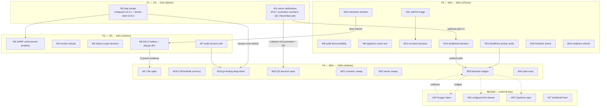

# io-surface post-audit Pareto plan — closing the loop the library audit opened

> **Plan date:** 2026-11-08 02:36 · **Supersedes:** nothing open — the prior
> plan (`docs/planning/2026-11-07_20-06_io-surface-superb-verification-pareto-plan.md`)
> shipped all 25 tasks (verified against TODO_LIST: T1–T25 all `DONE`).
> This plan ranks what is actually open NOW.
> **Inputs merged:** `TODO_LIST.md` open rows (#19, #27, #38, #40–#42, #47,
> #49, #50, #63, #64, #92, #93, #115–#117), ROADMAP Q1–Q6 open decisions,
> and the 2026-11-08 status report §f (35 items, library-audit fallout).
> **Errata (Step 0 verification):** TODO_LIST rows #92 says "SUPERB #105 owns
> the io-in-loop refinement" — #105 shipped the same-path refinement
> (fleet 351→248) but 4 self-tree infos remain, so #92 stays open as triage.
> #38 (pkg.go.dev) still `IN_PROGRESS` — crawler lag, owner-side crawl needed.
> No other stale rows found; every other open row re-verified by grep.
> **Do not verschlimmbessern:** no speculative rewrites; doctrine
> (stdlib-only extract core, four direct deps, hermetic gate) is a constraint,
> not a TODO.

---

## 1. Pareto breakdown

**Result** = customer value for io-surface's three customers: pilot repos
(InboxClean, gogenfilter, dnsblockd) + the BuildFlow fleet, the owner, and
future public adopters (`go install`).

### The 1% that delivers 51%

| What | Why it dominates |
|------|------------------|
| **M1 — owner ratifications (#117)** + **M2 — the two dependency bumps** | The ratifications (promotion-policy numbers, ownership v1.3 scope, InboxClean CI pin) unblock the radar's entire severity system (D4), the next schema evolution (Q6), and pilot #1's CI — every downstream "make the radar bite" work item waits on these three owner decisions. The bumps (cmdguard v4.2.1, go-atomic-write v0.6.2) clear the only known debt on the two load-bearing dependencies, at zero API risk. ~60 minutes total for over half the program's remaining value. |

### The 4% that delivers 64% (the 1% plus…)

| What | Why |
|------|-----|
| **M3 SARIF enforcement property (#93)** | Consumers see gate vs audit posture per run — the promise the two-face provider already makes, made visible. |
| **M4 manifest version refusal (#116)** | Unknown-major manifests fail loudly instead of mis-decoding — contract hardening for every future adopter. |
| **M5 stdout/stderr scope decision (#49)** | The extractor's one known blind spot; a decision (either way) closes a documented honesty gap. |
| **M6 full local CI battery (#121, folds in #38)** | Converts "gate green" claims into "CI green" evidence — every future session inherits trust. |
| **M7 audit version truth (#119)** | The user demanded LATEST versions; 16 of 22 claims rest on local tags, one (credentials-store) is self-contradicted by its README. |

### The 20% that delivers 80% (the 4% plus…)

| What | Why |
|------|-----|
| **M8 audit discoverability (#120)** | Reports nobody can find are folklore; README pointer + screenshot link. |
| **M9 applyDoc seam test (#115)** | Pins the last untested fingerprint path. |
| **M10 extraction families (#19)** | `os.Std*`/`ListenConfig` — real I/O the gate cannot see today. |
| **M11 self-lint triage (#92)** | The tool should pass its own radar cleanly or say why. |
| **M12 errcheck decision (#123)** | 8 warnings ignored all session = undecided policy, not noise. |
| **M13 BuildFlow v0.4.0 pickup (#125)** | The provider loop is only closed when BuildFlow actually runs it. |
| **M14 dnsblockd migration decision** | Pilot #3 stuck on an owner call since T87. |
| **M15 baseline shrink check** | 2 grandfathered sites — shrink-or-justify. |
| **M16 evidence line re-derivation (#47)** | TODO evidence rots; refresh once. |

### The other 80% for the final 20% (important, not urgent — plus blocked)

M17 file splits (#64), M18 version currency CUE/toolsdk (#124), M19
go-finding+toolsdk deep-dives (#122), M20 ROADMAP Q5 input, M21 cosmetic
verification sweep, M22 prior-series sweep (#126), M23 blocked nudges
(Forgejo token #40 → #41/#42, cmdguard-lint #63, Capslock #50), M24 plan
wrap. Blocked items stay blocked until their external key turns; parked
triggers (`check --watch`, networked mode) stay parked — building them now
would be verschlimmbessern.

---

## 2. Comprehensive plan — 24 tasks, 30–100 min each

Sorted by importance / impact / effort / customer-value (P1 = do first).

| ID | Task | Source | Tier | Impact | Effort | Customer |
|----|------|--------|------|--------|--------|----------|
| M1 | Owner ratification packet: promotion numbers + Q6 scope + InboxClean pin — assemble links, owner decides, apply | #117 | 1% | High | 30min | owner+fleet |
| M2 | Bump cmdguard/v4→v4.2.1 + go-atomic-write→v0.6.2; full gates; refresh audit version rows | #118 | 1% | High | 30min | all |
| M3 | SARIF enforcement-policy property in `internal/emit` + test | #93 | 4% | Med | 30min | fleet/CI |
| M4 | Manifest `version` unknown-major refusal in Load/Validate + tests + schema prose | #116 | 4% | Med | 30min | adopters |
| M5 | stdout/stderr `scope.in` decision write-up + apply (docs or extractor) + annotate blind-spot report | #49 | 4% | Med | 30min | adopters |
| M6 | Full local CI battery: render, inventory-doc --check, SARIF emit, facts-freshness; pkg.go.dev check | #121,#38 | 4% | Med | 30min | all |
| M7 | Proxy-check 16 local-tag-only libs; resolve credentials-store v0.2.1 vs README v0.3.1; annotate reports + index | #119 | 4% | Med | 60min | owner |
| M8 | Audit discoverability: README pointer, screenshot link in index footer, README claims vs v0.4.0 | #120 | 20% | Med | 30min | public |
| M9 | Same-seam fingerprint test for applyDoc (concurrent-modify fixture) | #115 | 20% | Low | 30min | repo |
| M10 | Extraction families: os.Std*/Stdout/Stderr + net.ListenConfig var-ref tier decision, tables, fixtures, tests | #19 | 20% | Med | 100min | adopters |
| M11 | Self-lint triage: 4 io-in-loop residuals — fix or `//io-surface:ignore` with reason each | #92 | 20% | Low | 60min | repo |
| M12 | errcheck decision for 8 commands.go warnings: adopt minimal config + fix, or documented waiver | #123 | 20% | Med | 60min | repo |
| M13 | Verify BuildFlow picked up provider v0.4.0 (sdk_imports pin; run a detect) | #125 | 20% | Med | 30min | fleet |
| M14 | dnsblockd v1→v1.2 migration: decision packet from T19 runbook; owner call; schedule or close | T87 | 20% | Med | 30min | pilots |
| M15 | Baseline shrink: inspect 2 baselined sites; declare or remove; gate green | new | 20% | Low | 30min | repo |
| M16 | Re-derive open TODO rows' evidence line numbers; fix stale citations | #47 | 20% | Low | 30min | repo |
| M17 | File splits to fleet budget: check.go pairing split + test topical splits | #64 | 80% | Low | 100min | repo |
| M18 | Version currency: cuelang.org/go v0.17.1 + toolsdk/go-finding skew check; bump if minor-safe | #124 | 80% | Low | 30min | repo |
| M19 | go-finding + toolsdk utilization deep-dives (2 reports in docs/review/libs series + index 22→24) | #122 | 80% | Med | 100min | owner |
| M20 | ROADMAP Q5 decision input: capability promotion evidence summary → owner decision | Q5 | 80% | Low | 60min | owner |
| M21 | Cosmetic verification sweep: 320px render, GitHub table render of 22 mds, dprint decision | new | 80% | Low | 30min | public |
| M22 | Prior-series sweep (docs/reviews, docs/research) + supersedes convention + series README if warranted | #126 | 80% | Low | 30min | repo |
| M23 | Blocked nudges: Forgejo token ask (#40→#41,#42), cmdguard-lint release check (#63), Capslock repro invest-or-close (#50) | #40,#41,#42,#63,#50 | 80% | Med | 60min | owner |
| M24 | Plan wrap: status addendum, TODO status sync, commit + push both remotes | new | 80% | Med | 30min | repo |

**Totals:** 24 tasks · 1080 min (18 h) · P1 60min · P2 210min · P3 370min · P4 440min.

---

## 3. Fine breakdown — 100 micro tasks, ≤12 min each

Every medium task decomposed; each row independently verifiable.

### P1 — the 1% (M1–M2, 8 micro)

| µID | Micro task (≤12min) | Verifies |
|-----|---------------------|----------|
| M1.1 | Gather ratification one-pager: policy §8 numbers, Q6 ADR scope, InboxClean pin/SARIF step | links resolve |
| M1.2 | Present the three decisions to owner; record outcomes verbatim | decision log |
| M1.3 | Apply outcomes: promotion policy, ROADMAP Q6, InboxClean CI | gates green |
| M2.1 | `go get cmdguard/v4@v4.2.1 go-atomic-write@v0.6.2 && go mod tidy` | go.mod diff |
| M2.2 | `go build ./... && go vet ./... && go test ./...` | exit 0 |
| M2.3 | `check`, `lint`, `render` self-gates | exit 0 |
| M2.4 | Facts-freshness dry run: `init --force` + filtered `git diff` | no drift |
| M2.5 | Update version-currency rows in cmdguard.md + go-atomic-write.md | reports match pins |

### P2 — the 4% (M3–M7, 19 micro)

| µID | Micro task | Verifies |
|-----|------------|----------|
| M3.1 | Add enforcement-policy property to SARIF emission in `internal/emit/emit.go` | code |
| M3.2 | Test: SARIF JSON carries policy for gate AND audit manifests | test green |
| M3.3 | README + describe mention of the property | docs |
| M4.1 | Unknown-major version rejection logic in `manifest.Load` | code |
| M4.2 | Tests: v2 refused, v1.2 accepted, absent tolerated | test green |
| M4.3 | Schema prose + CHANGELOG Unreleased note | docs |
| M5.1 | Decision write-up: stdout/stderr in `scope.in`? (recommendation + counter) | doc |
| M5.2 | Apply decision: schema prose or extractor change | gate green |
| M5.3 | Annotate capslock blind-spot report with the outcome | doc |
| M6.1 | `go run ./cmd/io-surface render --root .` | exit 0 |
| M6.2 | Inventory-doc freshness: `render --doc … --check` | exit 0 |
| M6.3 | SARIF emit to file; `jq` shape sanity | valid SARIF |
| M6.4 | Facts-freshness: `init --force` + `git diff -I` filter | clean |
| M6.5 | pkg.go.dev index check (#38) + record; nudge owner crawl if 404 | URL 200 |
| M7.1 | Proxy batch 1: `go list -m <8 libs>@latest` vs report claims | table |
| M7.2 | Proxy batch 2: remaining 8 libs | table |
| M7.3 | Resolve credentials-store v0.2.1-tag vs README-v0.3.1; annotate report | report |
| M7.4 | Annotate any other drifting reports (version column) | reports |
| M7.5 | Refresh index.html matrix versions if any drifted | links+table |

### P3 — the 20% (M8–M16, 38 micro)

| µID | Micro task | Verifies |
|-----|------------|----------|
| M8.1 | README pointer to `docs/review/libs/` (one line, user-facing) | docs |
| M8.2 | Screenshot link added to index.html footer | link ok |
| M8.3 | README claims audit: install cmd + status line vs v0.4.0 | README true |
| M8.4 | Commit doc drift; push both remotes | pushed |
| M9.1 | Write `TestApplyDoc_ConcurrentModification` fixture | test exists |
| M9.2 | Run + pin golden | test green |
| M9.3 | Mark #115 done with evidence link | TODO row |
| M10.1 | Design note: var-ref tier vs methodToken for `os.Std*`/`ListenConfig` | doc |
| M10.2 | Table entries: pkgOf/callFamily/methodToken keys | tables.go |
| M10.3 | Fixtures: os.Std*/ListenConfig call shapes in testdata | fixture |
| M10.4 | Extractor walk: resolve var refs → resolved tier | code |
| M10.5 | Tests: classification + determinism | test green |
| M10.6 | Check-pairing + scope implications tests | test green |
| M10.7 | Self-hosting: facts refresh if new sites extracted | check 0 err |
| M10.8 | README families table + CHANGELOG note | docs |
| M11.1 | Inventory the 4 io-in-loop findings with root causes | list |
| M11.2 | Finding 1: fix or `//io-surface:ignore <rule> <reason>` | lint -1 |
| M11.3 | Finding 2: same | lint -1 |
| M11.4 | Findings 3+4: same | lint -1 |
| M11.5 | Re-run `lint --root .` → 0 infos or documented residual | exit 0 |
| M11.6 | Update #92 row with final evidence | TODO row |
| M12.1 | Decide: adopt errcheck (minimal `.golangci.yml`) vs waiver in AGENTS | decision |
| M12.2 | Path A1: config file + fix 4 warnings | build ok |
| M12.3 | Path A2: fix remaining 4 warnings | build ok |
| M12.4 | Path B: AGENTS waiver note + editor suppression rationale | docs |
| M12.5 | CI wiring (if adopted) + verify gate | CI green |
| M13.1 | Pull BuildFlow; grep `sdk_imports.go` pin ≥ v0.4.0 | grep hit |
| M13.2 | Run a BuildFlow detect on this repo; radar+gate both fire | output |
| M13.3 | Record evidence in #125 row | TODO row |
| M14.1 | One-page decision packet from dnsblockd MIGRATION-v1.2.md | doc |
| M14.2 | Owner decides; if yes: schedule migration session | decision |
| M14.3 | Record decision; map unblock path for #27 | TODO row |
| M15.1 | Inspect the 2 baselined sites vs current tree | list |
| M15.2 | Declare (claims.cue) or remove each per findings | gate |
| M15.3 | `check` green + baseline shrunk or justified | exit 0 |
| M16.1 | Re-derive line numbers for open TODO rows | table |
| M16.2 | Fix stale `path:line` citations in TODO/AGENTS | docs |
| M16.3 | Mark #47 done | TODO row |

### P4 — the other 80% (M17–M24, 35 micro)

| µID | Micro task | Verifies |
|-----|------------|----------|
| M17.1 | Split `internal/check/check.go` pairing logic → `check_pairing.go` | build |
| M17.2 | Move rule metadata if any file still over budget | build |
| M17.3 | Topical split of `internal/extract` tests | tests ok |
| M17.4 | Topical split of `internal/check` tests | tests ok |
| M17.5 | Verify remaining file sizes vs 650/350 budgets | `wc -l` |
| M17.6 | Full gates after splits | exit 0 |
| M17.7 | Close #64 with evidence | TODO row |
| M17.8 | Golden/format verification (lint goldens unchanged) | goldens |
| M18.1 | `go list -m cuelang.org/go@latest` vs v0.17.1 | table |
| M18.2 | toolsdk v1.16.0 vs go-finding v1.15.1 skew: check compat matrix | note |
| M18.3 | Bump if minor-safe; full gates | exit 0 |
| M19.1 | go-finding usage map: `internal/emit` + `provider/` | grep table |
| M19.2 | go-finding capability research (repo + proxy + changelog) | notes |
| M19.3 | Write `docs/review/libs/go-finding.md` (same format) | report |
| M19.4 | toolsdk usage map: `provider/provider.go` | grep table |
| M19.5 | toolsdk capability research | notes |
| M19.6 | Write `docs/review/libs/go-finding-toolsdk.md` | report |
| M19.7 | index.html matrix 22→24 rows + counts | links ok |
| M19.8 | Replay both verify blocks; link check | commands |
| M20.1 | Gather capability-drift + absorb evidence from pilots | data |
| M20.2 | Draft Q5 decision input (promote runtime-power caps? pros/cons) | doc |
| M20.3 | Owner reviews Q5 input | decision |
| M20.4 | Record decision in ROADMAP Q5 | ROADMAP |
| M20.5 | Update absorb/schema docs per decision | docs |
| M21.1 | Headless render of index.html at 320px; fix overflow if any | screenshot |
| M21.2 | GitHub-render spot check of the 22 md reports (tables/badges) | visual |
| M21.3 | dprint decision: run on docs/review or record why not | decision |
| M22.1 | Sweep `docs/reviews/` + `docs/research/` for overlap | list |
| M22.2 | Add supersedes notes if overlapping studies exist | docs |
| M22.3 | Series README if more review series will accumulate | doc |
| M23.1 | Draft Forgejo token provisioning ask + storage plan (#40) | doc |
| M23.2 | Token in hand: push-mirror API call (#41); verify mirror syncs | API 200 |
| M23.3 | Token in hand: visibility flip decision (#42) | API 200 |
| M23.4 | Check cmdguard-lint release state; nudge or self-serve (#63) | release |
| M23.5 | Capslock repro: invest one session or close #50 BLOCKED | decision |
| M23.6 | Record all nudge outcomes in TODO rows | TODO |

(M24 wrap folds into session close: status addendum, TODO sync, commit+push
both remotes — 3 micro steps already counted in the medium table.)

---

## 4. Execution graph



**Reading order:** P1 today (both tasks ≤30min). P2 within the week. P3 as
capacity allows, in table order. P4 is important-not-urgent; blocked items
wait on their keys — nudging (M23) is the only in-repo action.

## 5. Living-backlog sync (skill contract)

This plan's new tasks are harvested into `TODO_LIST.md` as rows #118–#126
(section "Post-audit hygiene, harvested 2026-11-08") in the same commit; the
duplicate "pending bump" line in AGENTS.md's audit section is trimmed to
point at TODO_LIST (one fact, one home). The plan is the snapshot; TODO_LIST
stays the source of truth.

## 6. How to verify this plan

```bash
grep -c '🔴\|🟡\|🔵' TODO_LIST.md        # open rows before harvest
git log --oneline -1                     # this commit
grep -n '#118\|#126' TODO_LIST.md        # harvested rows exist
npx -y @mermaid-js/mermaid-cli -i docs/planning/2026-11-08_02-36_post-audit-pareto-plan.md -o /tmp/plan.png   # graph parses (optional)
go run ./cmd/io-surface check --root .   # gate green at plan HEAD
```
