# io-surface superb remainder plan — release, pilots, and the last 20%

> **Plan date:** 2026-11-08 06:27 · **Supersedes:** the OPEN REMAINDER of
> `docs/planning/2026-11-08_02-36_post-audit-pareto-plan.md` — M1–M12 of that
> plan SHIPPED this session (13 TODO rows DONE, execution report
> `docs/status/2026-11-08_06-16_post-audit-pareto-m1-m12-execution.md`); that
> plan remains the historical record, this plan ranks what is actually open NOW.
> **Inputs merged:** TODO_LIST open rows (#47, #64, #122, #124, #125, #126,
> #127 + harvested #128–#134), blocked rows (#27, #40–#42, #50, #63), the
> remainder tasks M13.2–M24, ROADMAP open questions Q1–Q5, and the execution
> report's §f list (50 items).
> **Errata (Step 0 verification, all re-verified live 2026-11-08 06:27):**
>
> - M1–M12 verified SHIPPED (commands, tests, gates green at HEAD; 13 rows DONE).
> - M13.1 verified done (BuildFlow `go.mod` pins io-surface **v0.4.0**;
>   `sdk_imports.go` blank-imports the provider) — only M13.2/M13.3 remain.
> - The old plan's errata listed #38 (pkg.go.dev) as IN_PROGRESS — now DONE
>   (HTTP 200, v0.4.0 Latest, crawled without owner-side trigger).
> - New discovery folded in: the prior audit session's screenshot claim was
>   false (no PNG ever committed); regenerated 2026-11-08 as
>   `docs/review/assets/libs-audit-index-2026-11-08.png` (359KB).
> - Promotion policy is now RATIFIED (§8 checked 2026-11-08) — any rule meeting
>   the gates may flip severity WITHOUT a further owner gate; W3 self-gate is
>   green today (`lint --root .` = 0 infos after M11).
> - Q6 ownership v1.3 scope is RATIFIED as design; the implementation session
>   is unscheduled and stays a schema-v1.3 decision (row created if missing).
> - 13 master commits sit unpushed on both remotes — the single most urgent item.
>   **Do not verschlimmbessern:** the doctrine (stdlib-only extract core, four
>   direct deps, hermetic gate, no `.golangci.yml`, errcheck waiver) is a
>   constraint, not a TODO. No speculative rewrites.

---

## 1. Pareto breakdown

**Result** = customer value for the three customers: pilot repos (InboxClean,
gogenfilter, dnsblockd) + the BuildFlow fleet, the owner, and public adopters
(`go install …@latest`).

### The 1% that delivers 51%

| What                                               | Why it dominates                                                                                                                                                                                                                                                                                                                                                                                                                                                                               |
| -------------------------------------------------- | ---------------------------------------------------------------------------------------------------------------------------------------------------------------------------------------------------------------------------------------------------------------------------------------------------------------------------------------------------------------------------------------------------------------------------------------------------------------------------------------------- |
| **N1 — push the 13 commits** + **N2 — cut v0.5.0** | Everything shipped this session (contract-version refusal, SARIF enforcement posture, ListenConfig extraction, writeDocVerified remap, errcheck waiver, 13 DONE rows) exists ONLY on the local machine until pushed, and is INVISIBLE to every consumer until a release tag lands on the module proxy. Two small tasks (~90min total) convert the entire session's work from local-only to durable + consumable; the release protocol is proven (v0.2.0/v0.3.0/v0.4.0 all shipped through it). |

### The 4% that delivers 64% (the 1% plus…)

| What                                             | Why                                                                                                                                                                                               |
| ------------------------------------------------ | ------------------------------------------------------------------------------------------------------------------------------------------------------------------------------------------------- |
| **N3 BuildFlow both-fires evidence (#125)**      | The provider loop is only closed when the fleet's tool provably runs BOTH faces — the promise v0.4.0 shipped, still unevidenced end-to-end.                                                       |
| **N4 dnsblockd decision packet (#130)**          | Pilot #3 has been stuck on the same owner call since T87; the owner just scheduled the session — the packet is the unblock artifact for #27.                                                      |
| **N5+N6 go-finding + toolsdk deep-dives (#122)** | The two direct deps that power the entire findings/SARIF/provider contract were excluded from the original 22-lib audit; the owner pre-approved the deep-dives and M2's re-scores set the format. |
| **N7 post-release verification**                 | CI-green at the tag + pkg.go.dev serving v0.5.0 is what turns "released" into "trustworthy"; the InboxClean pin proposal rides here.                                                              |

### The 20% that delivers 80% (the 4% plus…)

| What                                   | Why                                                                                                                                              |
| -------------------------------------- | ------------------------------------------------------------------------------------------------------------------------------------------------ |
| **N8+N9 file splits (#64)**            | The fleet-default 650/350 budgets are violated by check.go; splits shrink review surface and keep the BuildFlow size gate green everywhere.      |
| **N10 version currency (#124)**        | CUE and the toolsdk/go-finding skew are the only pins never checked against latest.                                                              |
| **N11 baseline shrink**                | 2 grandfathered sites — shrink-or-justify keeps the only-shrinks contract honest.                                                                |
| **N12 evidence re-derivation (#47)**   | TODO `path:line` citations rot; this session's edits moved lines again.                                                                          |
| **N13 Q5 decision input (#132)**       | The runtime-power vocabulary question blocks absorb's storage path; the ratified promotion policy makes this decision executable now.            |
| **N14 rendering checks (#127)**        | Mobile 320px + GitHub visual pass — reports nobody can read are folklore.                                                                        |
| **N15 series sweep (#126)**            | docs/reviews + docs/research overlap check before the series grows further.                                                                      |
| **N16 hygiene batch**                  | Archive ritual (15/15 at threshold), AGENTS facts-freshness cheat-sheet, go-finding propertyBag row (#133 harvest), Q6-implementation row check. |
| **N17 InboxClean gates + push (#134)** | Their hook load-skipped the pin bump commit; their canonical gates never ran on it.                                                              |

### The other 20% for the final 100% (important, not urgent — plus blocked)

N18 blocked nudges (#40/#41/#42 Forgejo chain, #63 cmdguard-lint, #50
Capslock repro), N19 Q1–Q4 owner decision packet (first blocking gate, flake,
weak-tier policy, binary purge), N20 go-taskqueue pilot prep (next adoption,
37 findings), N21 promotion readiness (fleet re-scan plan for the new
ruleset — M10's token entries + M11's ignore directives changed the self-tree
lint profile), N22 final wrap. Blocked items stay blocked until their external
key turns; nudging (N18) is the only in-repo action.

---

## 2. Comprehensive plan — 22 tasks, 30–100 min each

Sorted by importance / impact / effort / customer-value (P1 = do first).

| ID  | Task                                                                                                                         | Source              | Tier | Impact | Effort | Customer      |
| --- | ---------------------------------------------------------------------------------------------------------------------------- | ------------------- | ---- | ------ | ------ | ------------- |
| N1  | Push 13 commits to origin + github; confirm CI triggered on the new HEAD                                                     | #128                | 1%   | High   | 30min  | all           |
| N2  | Cut v0.5.0: version const, CHANGELOG heading, README status line, full gates, push, annotated tags both remotes, proxy check | #129                | 1%   | High   | 60min  | all consumers |
| N3  | M13 finish: targeted BuildFlow dry-run/detect proving BOTH faces fire; record evidence in #125                               | #125                | 4%   | Med    | 30min  | fleet         |
| N4  | M14 dnsblockd migration decision packet + session schedule; unblock path for #27                                             | #130                | 4%   | Med    | 30min  | pilots        |
| N5  | go-finding deep-dive: usage map (emit + provider) + capability research + report                                             | #122                | 4%   | Med    | 60min  | owner         |
| N6  | toolsdk deep-dive report + index.html 22→24 rows + re-screenshot                                                             | #122                | 4%   | Med    | 60min  | owner         |
| N7  | Post-release verify: CI green at tag, pkg.go.dev serves v0.5.0, InboxClean pin proposal (owner decides)                      | #129,#134           | 4%   | Med    | 30min  | pilots/public |
| N8  | Split `internal/check/check.go` pairing logic to a topical file                                                              | #64                 | 20%  | Med    | 100min | repo          |
| N9  | Test topical splits (extract/check) + budget verify (`wc -l` vs 650/350) + goldens unchanged                                 | #64                 | 20%  | Med    | 60min  | repo          |
| N10 | `cuelang.org/go` vs latest + toolsdk v1.16.0 / go-finding v1.15.1 skew note; bump if minor-safe                              | #124                | 20%  | Med    | 30min  | repo          |
| N11 | Baseline shrink: inspect the 2 baselined sites; declare or remove                                                            | #131                | 20%  | Low    | 30min  | repo          |
| N12 | Re-derive open TODO rows' `path:line` evidence; fix stale citations                                                          | #47                 | 20%  | Low    | 30min  | repo          |
| N13 | ROADMAP Q5 decision input: capability promotion evidence summary → owner → ROADMAP update                                    | #132                | 20%  | Med    | 60min  | owner         |
| N14 | Rendering checks: 320px render, GitHub visual pass of 22 md reports, dprint decision                                         | #127                | 20%  | Low    | 30min  | public        |
| N15 | Series sweep: docs/reviews + docs/research overlap + supersedes convention                                                   | #126                | 20%  | Low    | 30min  | repo          |
| N16 | Hygiene batch: archive ritual (15/15), AGENTS facts-freshness cheat-sheet, propertyBag/Q6-row checks                         | new,#133            | 20%  | Low    | 30min  | repo          |
| N17 | InboxClean on-demand gates (`nix flake check`, lint, test) + push decision packet                                            | #134                | 20%  | Med    | 30min  | pilots        |
| N18 | Blocked nudges: Forgejo token ask (#40→#41/#42), cmdguard-lint release check (#63), Capslock repro invest-or-close (#50)     | #40,#41,#42,#63,#50 | 80%  | Med    | 60min  | owner         |
| N19 | Q1–Q4 owner decision packet: first blocking gate, flake timing, weak-tier policy, binary purge                               | ROADMAP             | 80%  | Med    | 60min  | owner         |
| N20 | go-taskqueue pilot prep: onboarding plan from the fleet findings (37 findings)                                               | README "next"       | 80%  | Med    | 60min  | pilots        |
| N21 | Promotion readiness: fleet re-scan plan for the post-M10/M11 ruleset + ledger refresh (policy §7)                            | policy §7           | 80%  | Med    | 60min  | fleet         |
| N22 | Final wrap: TODO sync, plan annotation, push both remotes                                                                    | M24                 | 80%  | Med    | 30min  | repo          |

**Totals:** 22 tasks · 1030 min (~17 h) · P1 90min · P2 210min · P3 400min ·
P4 330min.

---

## 3. Fine breakdown — micro tasks, ≤12 min each

Every medium task decomposed; each row independently verifiable.

### P1 — the 1% (N1–N2, 8 micro)

| µID  | Micro task (≤12min)                                                                                        | Verifies        |
| ---- | ---------------------------------------------------------------------------------------------------------- | --------------- |
| N1.1 | `git fetch origin && git log HEAD..origin/master` (daemon race check)                                      | no surprise     |
| N1.2 | `git push origin master`                                                                                   | pushed          |
| N1.3 | `git push github master`                                                                                   | pushed          |
| N1.4 | Confirm CI triggered (gh run list) and docs-gates green at HEAD                                            | CI kicked off   |
| N2.1 | Bump version const in `cmd/io-surface/main.go` → 0.5.0                                                     | diff            |
| N2.2 | CHANGELOG: cut `[Unreleased]` → `[0.5.0] - 2026-11-08` + add empty Unreleased                              | docs            |
| N2.3 | README status line: v0.5.0 summary (contract refusal, SARIF posture, ListenConfig)                         | docs            |
| N2.4 | Full gates (build/vet/test -race/gofmt/check/lint/render/docs-gates)                                       | exit 0          |
| N2.5 | Commit (detailed message), push both remotes                                                               | pushed          |
| N2.6 | Wait for CI green on THAT commit before tagging (release protocol)                                         | gh run green    |
| N2.7 | Annotated tag v0.5.0 to origin + github; `go list -m github.com/larsartmann/io-surface@v0.5.0` proxy check | tag + proxy 200 |

### P2 — the 4% (N3–N7, 16 micro)

| µID  | Micro task                                                                          | Verifies     |
| ---- | ----------------------------------------------------------------------------------- | ------------ |
| N3.1 | `buildflow --dry-run --steps io-surface` (or step filter) — capture the step line   | step appears |
| N3.2 | Run the detect for real on this repo; capture gate-face output (manifest found)     | output       |
| N3.3 | Run the detect on a manifestless Go repo (radar face, info findings)                | output       |
| N3.4 | Record evidence in #125 → DONE                                                      | TODO row     |
| N4.1 | Read the T19 runbook + dnsblockd MIGRATION notes                                    | context      |
| N4.2 | Draft the one-page decision packet (scope, claims port, effort, risks)              | doc          |
| N4.3 | Add the packet link + schedule ask to #130; map #27 unblock path                    | TODO rows    |
| N5.1 | Usage map: `rg 'finding\.' internal/ provider/ cmd/` table (emit, provider, lint)   | grep table   |
| N5.2 | Research: go-finding repo (CHANGELOG, doc.go, SARIF/LSP surfaces, pipeline modules) | notes        |
| N5.3 | Score derivation + write `docs/review/libs/go-finding.md`                           | report       |
| N5.4 | Replay the report's verify block                                                    | commands     |
| N6.1 | toolsdk usage map: `rg 'toolsdk\.' provider/` + Spec contract summary               | grep table   |
| N6.2 | Research: toolsdk registry/triggers/options; BuildFlow's plugin contract            | notes        |
| N6.3 | Write `docs/review/libs/go-finding-toolsdk.md`                                      | report       |
| N6.4 | index.html: 22→24 rows, counts, verdict matrix; re-screenshot; footer date          | links ok     |
| N7.1 | `gh run watch`/list — CI green at the v0.5.0 tag SHA                                | green        |
| N7.2 | pkg.go.dev `@v0.5.0` URL check (200) + Latest badge reflects it                     | URL 200      |
| N7.3 | Draft the InboxClean pin @v0.4.0→@v0.5.0 proposal (owner decides; #134 tracks)      | doc          |

### P3 — the 20% (N8–N17, 40 micro)

| µID   | Micro task                                                                          | Verifies   |
| ----- | ----------------------------------------------------------------------------------- | ---------- |
| N8.1  | Measure: `wc -l internal/check/*.go` vs 650/350 budget table                        | numbers    |
| N8.2  | Split pairing logic → `internal/check/pairing.go` (mechanical move, no API change)  | build      |
| N8.3  | Split rule metadata/table if a file still breaches budget                           | build      |
| N8.4  | Full gates + check semantics unchanged (same findings on the fixture)               | tests      |
| N8.5  | Facts refresh (line moves) + INVENTORY re-render                                    | gates      |
| N9.1  | Split `internal/extract` test file by topic (classification/detectors/determinism)  | tests ok   |
| N9.2  | Split `internal/check` test file by topic (pairing/rules/lifecycle)                 | tests ok   |
| N9.3  | `wc -l` sweep vs budgets; document the final table                                  | numbers    |
| N9.4  | Lint goldens byte-identical (`TestGolden` green without `-update`)                  | goldens    |
| N9.5  | Close #64 with the before/after size table                                          | TODO row   |
| N10.1 | `go list -m cuelang.org/go@latest` vs v0.17.1                                       | table      |
| N10.2 | toolsdk v1.16.0 vs go-finding v1.15.1 skew: read both CHANGELOGs for contract notes | note       |
| N10.3 | Bump if minor-safe; full gates; else record the hold rationale                      | exit 0/row |
| N11.1 | Extract the 2 baseline IDs + read the sites                                         | list       |
| N11.2 | Declare in claims.cue OR remove the entry per findings                              | gate       |
| N11.3 | `check` green with shrunk-or-justified baseline; close #131                         | exit 0     |
| N12.1 | Grep every open row's `path:line` claim against the tree                            | table      |
| N12.2 | Fix stale citations in TODO_LIST (+AGENTS if any)                                   | docs       |
| N12.3 | Mark #47 DONE with the re-derived table                                             | TODO row   |
| N13.1 | Gather capability evidence: capabilities.cue, absorb --check drift, fleet facts     | data       |
| N13.2 | Draft Q5 input: promote runtime-power caps vs permanent-out-of-scope, pros/cons     | doc        |
| N13.3 | Present to owner; record the decision verbatim                                      | decision   |
| N13.4 | Update ROADMAP Q5 + absorb/schema docs per outcome                                  | docs       |
| N14.1 | Headless render index.html at 320px; inspect for overflow (DOM-metric fallback)     | screenshot |
| N14.2 | GitHub-render spot check of the 22 md reports (API-rendered HTML or owner eyeball)  | visual     |
| N14.3 | dprint decision for docs/review (run or record why not)                             | decision   |
| N14.4 | Close #127 with evidence                                                            | TODO row   |
| N15.1 | Sweep `docs/reviews/` + `docs/research/` for overlap with the audit series          | list       |
| N15.2 | Add supersedes notes where studies overlap                                          | docs       |
| N15.3 | Series README if more review series are coming; close #126                          | doc        |
| N16.1 | Archive ritual: move the oldest reports per cadence threshold (15/15 now)           | cadence    |
| N16.2 | AGENTS sharp-edges: add the facts-freshness compares-tree-vs-HEAD line              | docs       |
| N16.3 | Verify #133's propertyBag request has a verify-before-filing path (upstream repo)   | row        |
| N16.4 | Check a Q6-v1.3 implementation row exists; create if missing                        | TODO row   |
| N17.1 | Run InboxClean's on-demand gates: `nix flake check`, `nix run .#lint`, `.#test`     | green      |
| N17.2 | Push decision packet: pin bump commit `418ff69d` — push now or owner pushes         | doc/row    |
| N17.3 | Record outcomes in #134                                                             | TODO row   |

### P4 — the other 20% (N18–N22, 22 micro)

| µID   | Micro task                                                                              | Verifies  |
| ----- | --------------------------------------------------------------------------------------- | --------- |
| N18.1 | Draft the Forgejo token provisioning ask + storage plan (#40)                           | doc       |
| N18.2 | Note the unlocked chain: #41 push mirror API call, #42 visibility flip                  | doc       |
| N18.3 | cmdguard-lint: check its release state (module publishes without replace?) (#63)        | note      |
| N18.4 | Capslock phantom-edge: one repro session or close #50 BLOCKED (verify-before-filing)    | decision  |
| N18.5 | Record all nudge outcomes in the TODO rows                                              | TODO      |
| N19.1 | Q1 packet: which repo gets the first BLOCKING gate (dnsblockd vs InboxClean)            | doc       |
| N19.2 | Q2 packet: flake now vs Go-module-only (costs: fleet pin matrix row)                    | doc       |
| N19.3 | Q3 packet: weak-tier build-failing policy (`--strict-weak` compromise)                  | doc       |
| N19.4 | Q4 packet: binary blob purge (filter-repo) vs keep (~67 MB, SHA breakage)               | doc       |
| N19.5 | Present the 4 to the owner in ONE batch; record outcomes in ROADMAP                     | decisions |
| N20.1 | Pull the go-taskqueue fleet findings (37) and class them                                | list      |
| N20.2 | Draft the onboarding plan (init → claims → CI pin → gate green)                         | doc       |
| N20.3 | Owner review of the pilot plan                                                          | decision  |
| N21.1 | Plan the fleet re-scan for the post-M10/M11 ruleset (new `.Listen` weak-sites expected) | doc       |
| N21.2 | Refresh the promotion ledger §9 from the re-scan when it runs                           | ledger    |
| N21.3 | Note W3 self-gate status (green: 0 infos) in the ledger                                 | ledger    |
| N22.1 | Final TODO sync (strike N-task rows with evidence)                                      | TODO      |
| N22.2 | Annotate THIS plan non-destructively (docs-health ANNOTATE style)                       | docs      |
| N22.3 | Push both remotes; confirm CI green                                                     | pushed    |

---

## 4. Execution graph

```mermaid
flowchart TD
    subgraph P1["P1 — 1% → 51% (90min)"]
        N1["N1 push 13 commits<br/>origin + github"]
        N2["N2 cut v0.5.0<br/>version + CHANGELOG + tags + proxy"]
    end
    subgraph P2["P2 — 4% → 64% (210min)"]
        N3["N3 BuildFlow both-fires evidence"]
        N4["N4 dnsblockd decision packet"]
        N5["N5 go-finding deep-dive"]
        N6["N6 toolsdk deep-dive + index 24"]
        N7["N7 post-release verify + pin proposal"]
    end
    subgraph P3["P3 — 20% → 80% (400min)"]
        N8["N8 check.go split"]
        N9["N9 test splits + budgets"]
        N10["N10 CUE/toolsdk currency"]
        N11["N11 baseline shrink"]
        N12["N12 evidence re-derivation"]
        N13["N13 Q5 decision input"]
        N14["N14 rendering checks"]
        N15["N15 series sweep"]
        N16["N16 hygiene batch + archive"]
        N17["N17 InboxClean gates + push"]
    end
    subgraph P4["P4 — final 20% (330min)"]
        N18["N18 blocked nudges"]
        N19["N19 Q1–Q4 decision packet"]
        N20["N20 go-taskqueue pilot prep"]
        N21["N21 promotion readiness / fleet re-scan"]
        N22["N22 final wrap"]
    end
    N1 --> N2
    N2 --> N7
    N2 --> N3
    N6 -->|"index rows need release facts"| N7
    N5 --> N6
    N4 -->|"unblock path"| N20
    N8 --> N9
    N9 -->|"sizes settled"| N12
    N13 -->|"owner decision"| N21
    N16 -->|"archive before more reports"| N14
    N17 -->|"pilot green"| N20
    N21 --> N22
    N19 --> N22
    subgraph BLK["Blocked — external keys"]
        B40["#40 Forgejo token"]
        B63["#63 cmdguard-lint release"]
        B50["#50 Capslock repro"]
        B27["#27 dnsblockd lock"]
    end
    N18 -.->|"nudges"| B40
    N18 -.-> B63
    N18 -.-> B50
    B40 -.->|"unlocks push mirror"| N18
    B27 -.->|"unblocked by N4 packet"| N20
```



**Reading order:** P1 first (N1 alone is ~10min of commands and removes the
biggest risk). P2 same day — N2 must precede N7, and N5 before N6. P3 as
capacity allows in table order (N8→N9 sequential; the rest are independent).
P4 is important-not-urgent; blocked items wait on their keys.

---

## 5. Living-backlog sync (skill contract)

New tasks surfaced by this plan are harvested into `TODO_LIST.md` as rows
**#128–#134** (section "Remainder plan, harvested 2026-11-08") in the same
commit; existing open rows (#47, #64, #122, #124, #125, #126, #127) keep their
numbers — the plan's N-IDs map to them in the table above. The plan is the
snapshot; TODO_LIST stays the source of truth.

## 6. How to verify this plan

```bash
date                                                                 # plan freshness
grep -c '🔴 `TODO`' TODO_LIST.md                                    # open rows incl. #128–#134
grep -n '#128\|#134' TODO_LIST.md                                    # harvested rows exist
git log --oneline -1                                                 # this commit
go run ./cmd/io-surface check --root .                               # gate green at plan HEAD
go run github.com/Artmann-Technologies/docs-gates/cmd/docs-gates@2278406afdfd run   # 5/5 PASS
npx -y @mermaid-js/mermaid-cli -i docs/planning/2026-11-08_06-27_superb-remainder-plan.md -o /tmp/plan.png  # graph parses (optional)
```

## 7. Execution record (2026-11-08 session, N19 batch + Q1–Q4 landed)

The N19 Q1–Q4 owner batch was asked and answered (ONE question call,
15:45–15:50 CET): **Q1** InboxClean takes the first blocking gate
(executed: pin `@v0.5.1`, their `enforcement: "gate"` already blocks);
**Q2** flake NOW (executed: fleet go-standard flake, `nix run .# --
check --root .` green); **Q3** build `--strict-weak` (executed:
`Options.StrictWeak` + `TestRun_StrictWeakEscalates`); **Q4** purge now
(executed: mirror backup → `git filter-repo` → force-push BOTH remotes
(owner-approved) → v0.5.1 with `retract` directives → proxy serves the
clean zip, fresh clone 54 MB → 4 MB); **v1.3 shape** = ONE combined train
(TODO #138 closed). go-taskqueue onboarded per its plan (local commit
`5d223a42`, push owner-gated). Full outcomes live in ROADMAP Q1–Q6 and the
wrap status report. Known opens after this session: InboxClean CI
confirm blocked by a GitHub BILLING failure on the owner's account (jobs
never start), dnsblockd owner diff review (3 claim-conflicts + 21
UNREVIEWED fills), go-taskqueue claims judgment hour + push.
