# SUPERB Pareto Execution Plan — io-surface, ALL open TODOs

**Plan:** 2026-11-15 08:57 CET
**Sources:** `TODO_LIST.md` (164 ledger rows: 132 DONE, **32 open**), session
status report `docs/status/2026-11-15_08-53_docs-health-corpus-drain-and-dual-repo-gates-green.md`
§f, and `docs/status/2026-11-11_14-39_buildflow-red-to-green-fixture-formatter-contract.md`
§f items not yet ledgered (now harvested as rows #162-#165).
**New rows minted by this plan:** #161 (renamed from the duplicate-numbered
157 — the ledger already had a DONE #157 at line 221), #162, #163, #164,
#165.
**Sizing contract:** L1 tasks 30-100 min each (26 tasks); L2 micro-tasks
≤12 min each (131 micro-tasks). Every open row is covered by exactly one L1
task; nothing is double-scheduled; nothing blocked is disguised as ready.

---

## Guardrails (anti-Verschlimmbesser)

1. **One fact, one home** — the plan ranks and sequences; `TODO_LIST.md`
   stays the living backlog. This plan is a point-in-time snapshot; when it
   goes stale, docs-health ANNOTATE it, never rewrite it.
2. **Conventions stay per-repo** — io-surface ledger uses Status-column rows
   (🔴/🟡/🔵/🟢), NOT strikethrough; never import crush-config's strike
   style here. Manifest edits: `facts.cue` mechanical, claims/baseline human.
3. **No blocked work disguised as ready** — Forgejo token/mirror (#40-#42),
   dnsblockd owner decision, schema v1.3 ratification, upstream module ship
   (#63) get PREP or TRIAGE tasks only; execution stays gated.
4. **Don't break build** — every code task ends with `go build ./... && go
   test ./...` + the golden rule: `go run ./cmd/io-surface check --root .`
   stays 0 findings (self-hosting). Facts-adding changes re-run
   `init --root . --force` (facts-only refresh, guarded by
   TestWrite_ForceRefreshesFactsOnly).
5. **Concurrent sessions** — re-read files before editing (`pgrep -af
   buildflow`); today already produced one duplicate-number collision
   (two #157 rows) and 4 staged deletions this session did not author
   (fleet-evidence JSONs, portfolio html) which must ride NO commit made
   from this plan.

---

## Step 1 — Pareto breakdown

| Tier              | Share of result | Tasks                                                                                                                                         | Why THIS is the tier                                                                                                                                                                                                        |
| ----------------- | --------------- | --------------------------------------------------------------------------------------------------------------------------------------------- | --------------------------------------------------------------------------------------------------------------------------------------------------------------------------------------------------------------------------- |
| **1%**            | **51%**         | P01 (living-docs VERIFY+fix)                                                                                                                  | Every future session (human or agent) reads README/AGENTS/FEATURES first; wrong docs corrupt every downstream decision and re-dispatch shipped work. One pass here compounds across all later work.                         |
| **4%**            | **64%**         | + P03 self-gate.sh, P04 AGENTS.md slim, P05 pin automation                                                                                    | Kills the three RECURRING pains: CI breaks that a one-command local gate would have caught (the 14-39 report's own words), the buildflow preflight warning on every hook run (AGENTS.md 335>220), and silent pin rot in CI. |
| **20%**           | **80%**         | + P06-P16 (detector polish trio, cmd e2e, decision docs, staleness fixes, flake test check, banners, provider pin, render --lint, W3 re-scan) | The near-term actionable cluster: small, real product-quality fixes on the tool's own faces + documentation-debt closure. All local, all unblocked.                                                                         |
| **remaining 20%** | **100%**        | P17-P26 (root-causes, foreign-repo triage packets, schema spike, upstream repro packages, fleet unblock prep, confirm trio) + parked ledger   | The long tail is mostly blocked-on-external (owner decisions, tokens, upstream repos) or fleet-scale; prep/triage tasks convert them to decision-ready WITHOUT pretending they are executable today.                        |

**Visible math:** P01 alone addresses the docs-truth surface every other
task consumes (51%). P01-P05 = 5/26 tasks ≈ 4% of the count but remove the
highest-frequency failure modes (64%). P01-P16 = 16/26 ≈ 20% of tasks
covering ~80% of the practical value. P17-P26 + parked = the remainder.

---

## Step 2 — Comprehensive plan (L1, 30-100 min each, ALL todos, sorted)

| ID  | Task                                                                                                                                                                                                     | Covers           | Min | Impact | Effort | Customer value                                                                                             | Wave |
| --- | -------------------------------------------------------------------------------------------------------------------------------------------------------------------------------------------------------- | ---------------- | --- | ------ | ------ | ---------------------------------------------------------------------------------------------------------- | ---- |
| P01 | Living-docs VERIFY + fix pass: README/FEATURES/ROADMAP/AGENTS/CHANGELOG claims vs code (docs-health VERIFY; fix drift in place, cite evidence)                                                           | #162             | 90  | High   | M      | Every future session starts from true docs; kills ghost features and stale commands                        | 1    |
| P02 | TODO_LIST reconciliation from P01 findings: re-status/strike stale rows, dedupe, re-run docs-gates battery                                                                                               | (P01 fallout)    | 45  | High   | S      | Backlog becomes trustworthy; the gate enforces it stays so                                                 | 1    |
| P03 | `scripts/self-gate.sh`: one local command mirroring ci.yml's test job (facts re-check → self-check → self-render → inventory-doc --check → gofmt-empty)                                                  | #156             | 90  | High   | M      | Pre-push ritual stops the CI-break class that hit the 2026-11-08 and 14-39 sessions                        | 2    |
| P04 | AGENTS.md slim to ≤220 lines: move detail to README/docs per the preflight hint; keep agent-critical context                                                                                             | #152             | 75  | Med    | M      | Silences a warning on EVERY buildflow hook run; aligns the fleet budget                                    | 2    |
| P05 | Pin automation (#161): check for newer docs-gates tag, bump `ci.yml:111` pin, add renovate config or a CI pin-freshness check                                                                            | #161             | 45  | Med    | S      | CI's docs-gates leg stops rotting silently                                                                 | 2    |
| P06 | Detector-layer trio: #158 `emit.positionOf` empty-location SARIF anchor, #159 lint print-order alignment, #160 typed `extract.RuleDef.Severity`                                                          | #158 #159 #160   | 90  | Med    | M      | SARIF consumers get correct anchors; radar output order matches gate semantics; registry typos fail loudly | 3    |
| P07 | cmd-level e2e for `--strict-weak` flag parsing/exit code (check-level test exists)                                                                                                                       | #149             | 45  | Med    | S      | The CLI contract of a shipped flag is test-locked                                                          | 3    |
| P08 | `--json` vs `--format` consolidation DECISION (shorthand keep/deprecate) written into README + CHANGELOG-worthy note                                                                                     | #154             | 30  | Low    | S      | One documented CLI surface; ends the "both documented" drift                                               | 3    |
| P09 | CONTRIBUTING.md staleness fix (golangci-lint claim) + docs-pointer existence check (AGENTS.md-referenced docs) in CI or doctor                                                                           | #163             | 30  | Med    | S      | Contributors stop chasing a linter the repo deliberately does not run                                      | 3    |
| P10 | Rebuild `result` (vulnix stale-target) + record result-dir policy                                                                                                                                        | #164             | 30  | Low    | XS     | Warning surface shrinks; policy stops re-litigating                                                        | 3    |
| P11 | Exercise the flake's test check (`enableTestCheck = true`, flake.nix:52): run it, record the verdict in the row                                                                                          | #144             | 30  | Med    | S      | The declared test check is proven, not assumed                                                             | 3    |
| P12 | Archived-report `> **Live remainder:**` banner pass: grep archived/ for missing banners, add where the cadence ritual skipped them                                                                       | #165             | 60  | Low    | S      | A reader of any archived report sees its open remainder without re-deriving                                | 3    |
| P13 | Sweep BuildFlow's io-surface provider pin to v0.5.1 (go-ecosystem-upgrade loop: enumerate → bump → verify build+test → consumer CI green)                                                                | #150             | 45  | Med    | M      | Fleet consumers get the behavior-neutral strict-weak face                                                  | 3    |
| P14 | `render --lint` appendix DESIGN: flag shape, doc placement, golden implications                                                                                                                          | #153 (part 1)    | 30  | Low    | S      | One-doc-both-faces gets a reviewed design before code                                                      | 3    |
| P15 | `render --lint` appendix IMPLEMENT + tests + golden                                                                                                                                                      | #153 (part 2)    | 90  | Low    | M      | Gate + radar in one inventory doc                                                                          | 3    |
| P16 | W3 promotion re-scan per promotion-policy §9 (detector evidence re-derivation; feeds D4 evaluation)                                                                                                      | #151             | 60  | Med    | M      | The promotion decision queue advances on fresh evidence                                                    | 3    |
| P17 | Root-cause the stale system buildflow/docs-gates binary class (refresh pins, `buildflow doctor`, document the fix recipe)                                                                                | #143             | 60  | Med    | M      | Ends the FALSE-gate-red class for the whole fleet                                                          | 4    |
| P18 | Root-cause go-taskqueue BuildFlow fan-out count (53 vs 52 findings via `-s io-surface`)                                                                                                                  | #145             | 60  | Med    | M      | Tool-count trust between sibling repos                                                                     | 4    |
| P19 | go-taskqueue claims judgment hour: fill the empty claims blocks (resource/trigger/durability)                                                                                                            | #140             | 60  | Med    | M      | Pilot onboarding debt shrinks                                                                              | 4    |
| P20 | dnsblockd cluster TRIAGE PACKET: consolidate #27 (retire tools/io-extract), #139 (owner diff review), #146 (§5 warnings) into one owner-decision doc                                                     | #27 #139 #146    | 60  | Med    | M      | Blocked-on-owner work becomes a 5-minute owner decision                                                    | 4    |
| P21 | M20 capability promotion evidence summary → owner decision input (ROADMAP Q5)                                                                                                                            | #132             | 60  | Med    | M      | The capabilities question gets decision-grade evidence                                                     | 4    |
| P22 | Schema v1.3 DESIGN SPIKE: ownership closer-missing semantics (#135) + runtime-power capabilities first-class (#136) — design doc only, bump stays owner-gated                                            | #135 #136        | 100 | Med    | L      | The next schema version is designed before it is rushed                                                    | 4    |
| P23 | Audit rendering checks: mobile 320 px render of index.html (only 1280 px screen-shotted so far)                                                                                                          | #127             | 60  | Low    | M      | The docs site renders for the smallest real screen                                                         | 4    |
| P24 | Upstream filings repro package: #50 Capslock phantom NETWORK edges + #133 go-finding run-level propertyBag (repro-first, verify-before-filing)                                                           | #50 #133         | 100 | Med    | L      | Fleet-wide fixes start with verified upstream reports                                                      | 4    |
| P25 | Fleet unblock PREP: #40 Forgejo API token request packet, #41 push-mirror runbook, #42 visibility note, #155 Forgejo-CI port plan (ci.yml as template, drop windows jobs) — execution gated on the token | #40 #41 #42 #155 | 60  | High   | M      | The manual dual-push + GitHub-billing dependency ends the moment the owner drops the token in              | 4    |
| P26 | Confirm trio: #142 InboxClean gate confirm (post-scope-shift), #147 old GitHub Releases retained check, #148 billing blast-radius audit note                                                             | #142 #147 #148   | 45  | Low    | S      | Three loose ends closed or converted to owner questions                                                    | 4    |

**Coverage check:** every open row maps to exactly one task — 27→P20,
40/41/42→P25, 50→P24, 63→PARKED (errata), 127→P23, 132→P21, 133→P24,
135/136→P22, 139/146→P20, 140→P19, 142→P26, 143→P17, 144→P11, 145→P18,
147/148→P26, 149→P07, 150→P13, 151→P16, 152→P04, 153→P14+P15, 154→P08,
155→P25, 156→P03, 161→P05, 162→P01, 163→P09, 164→P10, 165→P12. ✓ 33 rows /
32 open + parked #63.

---

## Step 3 — Detailed breakdown (L2, ≤12 min each, ALL todos, sorted)

| ID                                          | Micro-task                                                                                                                | Min | Verify                         |
| ------------------------------------------- | ------------------------------------------------------------------------------------------------------------------------- | --- | ------------------------------ |
| **P01 — living-docs VERIFY (90)**           |                                                                                                                           |     |                                |
| P01.1                                       | README: every command in "Getting started" run verbatim (`go run ./cmd/io-surface --help`, check, init, render)           | 12  | commands exit 0                |
| P01.2                                       | README: exit-code table vs `cmd/io-surface/main.go` exitCode mapping                                                      | 6   | 0/1/2 semantics match          |
| P01.3                                       | README: family/discipline prose vs `internal/scaffold/schema.cue` closed enums                                            | 12  | 10 families, 7 disciplines     |
| P01.4                                       | FEATURES: every FULLY_FUNCTIONAL row re-derived (flag, detector, SARIF, strict-weak…)                                     | 12  | evidence paths exist           |
| P01.5                                       | FEATURES: PARTIALLY/DISABLED rows still accurate (fleet pilots, InboxClean/dnsblockd)                                     | 12  | rows match reality             |
| P01.6                                       | ROADMAP: raw ideas still raw; graduated ideas actually moved to TODO_LIST                                                 | 8   | no PLANNED-in-both split brain |
| P01.7                                       | AGENTS.md: commands block, invariants list, sharp edges vs current code (`pkgOf`, tiers, testdata trees)                  | 12  | claims grep-clean              |
| P01.8                                       | CHANGELOG: Keep-a-Changelog format; version const vs latest entry (`cmd/io-surface/main.go`)                              | 8   | const == changelog head        |
| P01.9                                       | Fix all drift found, in place, with evidence citations                                                                    | 10  | `git diff` review              |
| **P02 — TODO_LIST reconciliation (45)**     |                                                                                                                           |     |                                |
| P02.1                                       | Apply P01 findings: re-status rows whose work shipped (🔴→🟢 with evidence)                                               | 12  | diff reviewed                  |
| P02.2                                       | Dedupe semantic duplicates found in P01 (keep better row)                                                                 | 10  | row count shrinks or equals    |
| P02.3                                       | Renumber-collision audit: `grep -oE "^\| [0-9]+" \| sort \| uniq -d` empty                                                | 6   | no duplicate ids               |
| P02.4                                       | Re-run docs-gates battery after edits                                                                                     | 5   | 5/5 PASS                       |
| P02.5                                       | Pre-flight any NEW lines before writing (additions-only model)                                                            | 6   | SAFE verdicts                  |
| P02.6                                       | Commit the reconciliation separately                                                                                      | 6   | clean status                   |
| **P03 — self-gate.sh (90)**                 |                                                                                                                           |     |                                |
| P03.1                                       | Extract ci.yml test-job step list into a checklist                                                                        | 8   | steps enumerated               |
| P03.2                                       | Write `scripts/self-gate.sh` skeleton (set -euo pipefail, cwd=root)                                                       | 10  | shellcheck clean               |
| P03.3                                       | Stage 1: facts freshness (`init --force` + filtered `git diff -I` on commit:/date:)                                       | 10  | drift detected when planted    |
| P03.4                                       | Stage 2: self-check (`check --root .` exit contract)                                                                      | 6   | 0 findings                     |
| P03.5                                       | Stage 3: self-render + render --doc --check (INVENTORY freshness)                                                         | 10  | check passes                   |
| P03.6                                       | Stage 4: gofmt -l empty gate                                                                                              | 4   | catches planted bad fmt        |
| P03.7                                       | Failure-mode test: plant a stale fact, confirm non-zero exit + clear message                                              | 10  | exit != 0 with WHAT/WHY        |
| P03.8                                       | Wire into README dev loop + AGENTS.md commands block                                                                      | 8   | docs updated                   |
| P03.9                                       | Full run on clean tree (green path)                                                                                       | 6   | exit 0 end-to-end              |
| P03.10                                      | Commit + battery re-run                                                                                                   | 8   | 5/5 PASS                       |
| **P04 — AGENTS.md slim (75)**               |                                                                                                                           |     |                                |
| P04.1                                       | Inventory AGENTS.md sections by audience (agent-critical vs docs-duplicative)                                             | 10  | section table                  |
| P04.2                                       | Move command details → README (users) or docs/check-semantics.md (semantics)                                              | 12  | links resolve                  |
| P04.3                                       | Move history-flavored sharp edges → the owning status reports (annotate, not delete)                                      | 12  | no fact orphaned               |
| P04.4                                       | Rewrite to ≤220 lines keeping: commands, self-hosting rule, invariants, testing patterns, conventions                     | 12  | wc -l ≤ 220                    |
| P04.5                                       | `nix flake check` (agents-md-valid + module renders)                                                                      | 8   | all passed                     |
| P04.6                                       | Fresh-eyes read: would a new session get what it needs?                                                                   | 10  | checklist pass                 |
| P04.7                                       | buildflow preflight re-run: warning gone                                                                                  | 6   | no docs/agents-md-size         |
| P04.8                                       | Commit                                                                                                                    | 5   | clean                          |
| **P05 — pin automation (45)**               |                                                                                                                           |     |                                |
| P05.1                                       | Query latest docs-gates revision (gh api or `nix flake prefetch github:Artmann-Technologies/docs-gates`)                  | 8   | rev vs 2278406afdfd            |
| P05.2                                       | If newer: bump ci.yml:111 pin; run the docs-gates step locally                                                            | 10  | step exit 0                    |
| P05.3                                       | Choose mechanism: renovate config (regex manager for `go run …@pin`) vs CI freshness check                                | 8   | decision recorded              |
| P05.4                                       | Implement the chosen mechanism                                                                                            | 12  | config/check in repo           |
| P05.5                                       | Test the mechanism (stale-pin detection on a branch)                                                                      | 7   | detects planted staleness      |
| **P06 — detector trio (90)**                |                                                                                                                           |     |                                |
| P06.1                                       | #158: reproduce empty-location SARIF anchor (`lint --format sarif` on a token-tier finding)                               | 10  | pseudo-file `io-surface` seen  |
| P06.2                                       | #158: fall back to the site's real file:line (or repo-root rule anchor) in `internal/emit`                                | 12  | anchor = real path             |
| P06.3                                       | #158: fixture/golden update (`-update`) + review diff                                                                     | 10  | goldens intentional            |
| P06.4                                       | #159: read check's strongest-first sort; mirror comparator in lint presentation                                           | 12  | same severity ordering         |
| P06.5                                       | #159: lint golden re-pin + manual eyeball on fleetscan fixture                                                            | 8   | ordering matches               |
| P06.6                                       | #160: `extract.RuleDef.Severity` → typed enum (`extract.Severity`) with registry-time validation                          | 12  | typo = build/test failure      |
| P06.7                                       | #160: sweep all 8 detector registrations to the typed enum                                                                | 8   | compiles, table complete       |
| P06.8                                       | `go build && go test ./...` + self-gate (once P03 lands)                                                                  | 10  | green, 0 findings              |
| P06.9                                       | Update FEATURES/README detector notes if behavior-visible                                                                 | 8   | docs match                     |
| **P07 — strict-weak cmd e2e (45)**          |                                                                                                                           |     |                                |
| P07.1                                       | Read `TestRun_StrictWeakEscalates` + the `--strict-dirs` cmd-test precedent                                               | 8   | pattern understood             |
| P07.2                                       | Write `runApp`-driven e2e: `--strict-weak` alone (exit contract, findings escalated)                                      | 12  | test red→green                 |
| P07.3                                       | e2e: `--strict-weak` + `--enforce` interplay on the detectors tree                                                        | 10  | exit codes table               |
| P07.4                                       | e2e: bad value / unknown flag variants (usage exit 2)                                                                     | 8   | exit 2                         |
| P07.5                                       | Full suite + goldens byte-identical                                                                                       | 7   | `go test ./...` green          |
| **P08 — --json decision (30)**              |                                                                                                                           |     |                                |
| P08.1                                       | Grep all `--json` usages in repo + fleet scripts (fleetscan.sh, docs)                                                     | 6   | usage inventory                |
| P08.2                                       | Write the decision: keep shorthand (cost: 0) vs deprecate (cost: fleet churn) — with evidence                             | 10  | decision doc'd in row          |
| P08.3                                       | Apply: README wording + deprecation path if chosen                                                                        | 8   | docs consistent                |
| P08.4                                       | Close row #154 (🟢 + evidence)                                                                                            | 6   | ledger updated                 |
| **P09 — CONTRIBUTING + pointer check (30)** |                                                                                                                           |     |                                |
| P09.1                                       | Rewrite CONTRIBUTING build/lint section: buildflow + flake commands, no golangci-lint claim; link docs/errcheck-policy.md | 12  | claims match decisions         |
| P09.2                                       | Add pointer check: list AGENTS.md/README `docs/*.md` references, assert files exist (script or doctor step)               | 10  | catches planted missing file   |
| P09.3                                       | Wire the check into self-gate.sh (if P03 landed) or CI                                                                    | 8   | runs green                     |
| **P10 — result/ + policy (30)**             |                                                                                                                           |     |                                |
| P10.1                                       | `nix build .# -o result`; confirm vulnix stale-target warning gone in next buildflow run                                  | 12  | warning absent                 |
| P10.2                                       | Record result-dir policy (gitignored artifact; why not checked-in) in AGENTS.md one-liner                                 | 6   | documented                     |
| P10.3                                       | Confirm gofmt/testd unchanged; commit                                                                                     | 6   | clean tree                     |
| P10.4                                       | Close row #164                                                                                                            | 6   | 🟢 + evidence                  |
| **P11 — flake test check (30)**             |                                                                                                                           |     |                                |
| P11.1                                       | `nix flake check` full run; isolate the test-check derivation output                                                      | 10  | verdict captured               |
| P11.2                                       | Record verdict + any failures in row #144 (evidence, not vibes)                                                           | 8   | row updated                    |
| P11.3                                       | If red: bisect which check output fails; file follow-up row                                                               | 12  | follow-up row or green         |
| **P12 — archived banners (60)**             |                                                                                                                           |     |                                |
| P12.1                                       | `grep -L "Live remainder" docs/status/archived/*.md` → candidate list                                                     | 4   | list emitted                   |
| P12.2                                       | For each candidate: verify struck/routed completeness BEFORE banner (check-rows default)                                  | 12  | per-file verdict               |
| P12.3                                       | Prepend `> **Live remainder:**` banners (only where open work truly remains)                                              | 12  | banners accurate               |
| P12.4                                       | MANIFEST cross-check: banner claims agree with manifest reasons                                                           | 10  | no contradiction               |
| P12.5                                       | Commit batch + battery                                                                                                    | 8   | 5/5 PASS                       |
| P12.6                                       | Close row #165 with the banner inventory                                                                                  | 6   | 🟢                             |
| P12.7                                       | (if >12 files) second batch pass                                                                                          | 8   | same gates                     |
| **P13 — provider pin sweep (45)**           |                                                                                                                           |     |                                |
| P13.1                                       | Confirm v0.5.1 is the desired target (tags, CHANGELOG; behavior-neutral claim)                                            | 6   | tag verified                   |
| P13.2                                       | Bump BuildFlow go.mod pin                                                                                                 | 6   | go.mod diff minimal            |
| P13.3                                       | BuildFlow `go build && go test` (providers suite; 2 known pre-existing golangci reds noted, unrelated)                    | 12  | build green                    |
| P13.4                                       | io-surface self-gate against the new pin (it consumes BuildFlow, not vice versa — confirm direction)                      | 8   | direction confirmed            |
| P13.5                                       | Commit in BuildFlow (repo: BuildFlow row if needed) + note in #150                                                        | 8   | merge-by-reference ready       |
| P13.6                                       | Close #150 or convert to landed-verification note                                                                         | 5   | 🟢                             |
| **P14 — render --lint design (30)**         |                                                                                                                           |     |                                |
| P14.1                                       | Read render blocks.go (BEGIN/END pattern) + lint Run signature                                                            | 8   | integration points known       |
| P14.2                                       | Design: flag name, appendix placement (END of INVENTORY.md?), determinism rules                                           | 10  | design noted in row            |
| P14.3                                       | Golden implications: new golden file or block-level check                                                                 | 6   | approach fixed                 |
| P14.4                                       | Record design in #153 for review                                                                                          | 6   | design citable                 |
| **P15 — render --lint implement (90)**      |                                                                                                                           |     |                                |
| P15.1                                       | Implement `--lint` appendix rendering (lint findings table inside the doc)                                                | 12  | renders on fixture             |
| P15.2                                       | `--check` interplay: appendix must not break INVENTORY freshness check                                                    | 10  | check passes                   |
| P15.3                                       | Golden + `-update`; review diff word by word                                                                              | 12  | goldens intentional            |
| P15.4                                       | e2e: runApp `render --lint --doc docs/architecture/io-surface/INVENTORY.md`                                               | 10  | exit contract                  |
| P15.5                                       | Docs: README render section + FEATURES row                                                                                | 8   | docs match                     |
| P15.6                                       | Full suite + self-check                                                                                                   | 10  | green                          |
| P15.7                                       | Close #153 with evidence                                                                                                  | 6   | 🟢                             |
| P15.8                                       | Battery + commit                                                                                                          | 8   | 5/5 PASS                       |
| P15.9                                       | (buffer) edge cases: empty lint findings → empty appendix                                                                 | 8   | no empty-section drift         |
| P15.10                                      | (buffer) SARIF face unaffected                                                                                            | 6   | lint-radar SARIF step green    |
| **P16 — W3 re-scan (60)**                   |                                                                                                                           |     |                                |
| P16.1                                       | Re-read promotion-policy §9 (the W3 green status + re-scan plan)                                                          | 8   | protocol loaded                |
| P16.2                                       | Run fleetscan (`./scripts/fleetscan.sh`) → docs/evidence/ (never /tmp)                                                    | 12  | JSON lands in evidence         |
| P16.3                                       | Re-derive detector evidence table vs D4 bar (FP≈0)                                                                        | 12  | numbers computed               |
| P16.4                                       | Record W3 verdict in row #151 + policy doc pointer                                                                        | 8   | evidence cited                 |
| P16.5                                       | If promotion candidates emerge: route to owner decision, never self-promote                                               | 10  | decision queued                |
| P16.6                                       | Commit evidence + battery                                                                                                 | 10  | clean                          |
| **P17 — stale tooling root cause (60)**     |                                                                                                                           |     |                                |
| P17.1                                       | Reproduce: `buildflow doctor` on this host; capture the delta signature                                                   | 10  | signature recorded             |
| P17.2                                       | Rebuild BuildFlow in-repo (`nix build .#`), `nix run .#reinstall`, refresh shims                                          | 12  | binaries current               |
| P17.3                                       | Re-run the previously-red gate; confirm false-red gone                                                                    | 8   | gate green                     |
| P17.4                                       | Write the fix recipe into AGENTS.md sharp-edges (it already has one — refresh it)                                         | 8   | recipe current                 |
| P17.5                                       | Sweep other fleet repos for the same stale-binary state (pgrep + doctor one-liner)                                        | 10  | fleet note                     |
| P17.6                                       | Close #143 or split remaining scope                                                                                       | 6   | 🟢 or scoped                   |
| P17.7                                       | (buffer) docs-gates binary freshness check idea → candidate row                                                           | 6   | row minted                     |
| **P18 — taskqueue fan-out count (60)**      |                                                                                                                           |     |                                |
| P18.1                                       | Reproduce both counts: `-s io-surface` → 53 vs the 52 baseline; diff the finding lists                                    | 12  | delta identified               |
| P18.2                                       | Classify the +1 (real finding vs counting artifact)                                                                       | 10  | classification cited           |
| P18.3                                       | Fix or file (go-taskqueue side if its fixture drifted)                                                                    | 12  | fix or upstream row            |
| P18.4                                       | Record verdict in #145                                                                                                    | 6   | 🟢 or scoped                   |
| P18.5                                       | Battery + commit                                                                                                          | 8   | green                          |
| P18.6                                       | (buffer) cross-check other sibling counts for the same class                                                              | 12  | sweep note                     |
| **P19 — claims judgment hour (60)**         |                                                                                                                           |     |                                |
| P19.1                                       | Load go-taskqueue onboarding packet (docs/planning/2026-11-08_go-taskqueue-pilot-onboarding.md)                           | 8   | context loaded                 |
| P19.2                                       | Judgment pass 1: claims blocks 1-80 (resource/trigger/durability)                                                         | 12  | blocks filled                  |
| P19.3                                       | Judgment pass 2: blocks 81-160                                                                                            | 12  | blocks filled                  |
| P19.4                                       | Judgment pass 3: blocks 161-230                                                                                           | 12  | blocks filled                  |
| P19.5                                       | Consistency skim: same shapes judged same way                                                                             | 8   | spot-check                     |
| P19.6                                       | Push to go-taskqueue (repo: go-taskqueue row) + close #140                                                                | 8   | merge-by-reference             |
| **P20 — dnsblockd triage packet (60)**      |                                                                                                                           |     |                                |
| P20.1                                       | Read #27, #139, #146 + dnsblockd MIGRATION-v1.2.md §5 warnings                                                            | 10  | sources loaded                 |
| P20.2                                       | Consolidate into one owner-decision doc: what, why-blocked, options, recommendation                                       | 12  | packet drafted                 |
| P20.3                                       | Attach the 3 live claim-conflict warnings (loadTrialBlock…) verbatim                                                      | 8   | evidence verbatim              |
| P20.4                                       | Route packet to owner (TODO_BLOCKED link + report reference)                                                              | 8   | decision-ready                 |
| P20.5                                       | Note the tools/io-extract retirement dependency (#27) explicitly                                                          | 8   | no silent coupling             |
| P20.6                                       | Update the three rows to 🔵 BLOCKED with packet pointer                                                                   | 8   | ledger honest                  |
| P20.7                                       | Battery + commit                                                                                                          | 6   | green                          |
| **P21 — M20 evidence summary (60)**         |                                                                                                                           |     |                                |
| P21.1                                       | Pull capability promotion evidence: docs/evidence/fleetscan JSONs + T17 verdicts (archived retro)                         | 10  | sources loaded                 |
| P21.2                                       | Tabulate: rule × fleet FPs × promotion bar (D4: FP≈0)                                                                     | 12  | table computed                 |
| P21.3                                       | Draft the Q5 decision input: promote which, park which, drop which                                                        | 12  | options with numbers           |
| P21.4                                       | Route to ROADMAP Q5 + owner queue (never self-decide)                                                                     | 8   | routed                         |
| P21.5                                       | Close #132 as decision-input-complete                                                                                     | 6   | 🟢 scoped                      |
| P21.6                                       | Battery                                                                                                                   | 6   | green                          |
| P21.7                                       | (buffer) cross-check against absorb --check drift output                                                                  | 6   | consistency                    |
| **P22 — schema v1.3 spike (100)**           |                                                                                                                           |     |                                |
| P22.1                                       | Re-read ratified v1.3 scope (#135 ownership closer-missing + #136 runtime-power)                                          | 8   | scope loaded                   |
| P22.2                                       | Enumerate #Closure semantics: which ownership states are closer-missing?                                                  | 12  | state list                     |
| P22.3                                       | Draft CUE: ownership v1.3 closed enums + required fields                                                                  | 12  | schema draft                   |
| P22.4                                       | Runtime-power capabilities: package-level absorb facts shape (#136)                                                       | 12  | shape draft                    |
| P22.5                                       | Migration map: v1.2 → v1.3 per pilot (InboxClean v1.2, dnsblockd v1)                                                      | 12  | migration table                |
| P22.6                                       | Identify breaking surfaces: `internal/capability` enum, absorb writer, check rules                                        | 10  | blast radius                   |
| P22.7                                       | Write the design doc (docs/planning/ or ADR-style note)                                                                   | 12  | doc exists                     |
| P22.8                                       | Owner-gate: bump decision + pilot migration order                                                                         | 10  | decision queued                |
| P22.9                                       | Leave #135/#136 🔵 with design pointer                                                                                    | 6   | ledger honest                  |
| P22.10                                      | (buffer) schema version-bump checklist from AGENTS.md invariants                                                          | 6   | checklist ready                |
| **P23 — mobile render audit (60)**          |                                                                                                                           |     |                                |
| P23.1                                       | Set up 320 px capture (browser tool or headless screenshot)                                                               | 10  | capture works                  |
| P23.2                                       | Render index.html at 320 px; screenshot full page                                                                         | 10  | screenshot exists              |
| P23.3                                       | Audit: overflow, tap targets, table scroll behavior                                                                       | 12  | issues listed                  |
| P23.4                                       | Fix small CSS issues found (or row them if structural)                                                                    | 12  | fixes applied                  |
| P23.5                                       | Re-screenshot + compare                                                                                                   | 8   | improved                       |
| P23.6                                       | Record verdict in #127; close or scope                                                                                    | 8   | 🟢/scoped                      |
| **P24 — upstream repro package (100)**      |                                                                                                                           |     |                                |
| P24.1                                       | #50: build the minimal Capslock SSA repro (range-func/interface phantom NETWORK edge)                                     | 12  | repro deterministic            |
| P24.2                                       | #50: capture tool versions (Capslock installed with repo toolchain per AGENTS.md)                                         | 8   | versions cited                 |
| P24.3                                       | #50: draft the issue (github-voice; verify-before-filing gate)                                                            | 12  | draft ready                    |
| P24.4                                       | #50: owner gate before filing (verify-before-filing requires it for external repos)                                       | 6   | queued                         |
| P24.5                                       | #133: check go-finding's SARIF model for runs[].properties support today                                                  | 10  | capability confirmed           |
| P24.6                                       | #133: draft the capability request with our consumer story (io-surface lint face)                                         | 12  | draft ready                    |
| P24.7                                       | #133: owner gate before filing                                                                                            | 6   | queued                         |
| P24.8                                       | Package both drafts into one owner review block                                                                           | 8   | single decision point          |
| P24.9                                       | (buffer) search upstream trackers for existing issues (dedupe before filing)                                              | 10  | no duplicate                   |
| P24.10                                      | (buffer) record repro artifacts under docs/evidence/                                                                      | 6   | artifacts kept                 |
| **P25 — fleet unblock prep (60)**           |                                                                                                                           |     |                                |
| P25.1                                       | #40: token request packet (what token, which scope, where it goes, why safe)                                              | 12  | packet ready                   |
| P25.2                                       | #41: push-mirror runbook (server UI steps, fallback: keep dual-push)                                                      | 12  | runbook drafted                |
| P25.3                                       | #42: visibility decision note (io-surface private vs public; go-install implications)                                     | 8   | tradeoffs stated               |
| P25.4                                       | #155: Forgejo-CI port plan: ci.yml → Forgejo workflow, windows jobs dropped, runner = evo-x2                              | 12  | plan drafted                   |
| P25.5                                       | Mark the four rows 🔵 BLOCKED on the token with packet pointers                                                           | 8   | ledger honest                  |
| P25.6                                       | Battery + commit                                                                                                          | 8   | green                          |
| **P26 — confirm trio (45)**                 |                                                                                                                           |     |                                |
| P26.1                                       | #142: check InboxClean's gate state post-scope-shift (their repo, footer grep)                                            | 10  | state recorded                 |
| P26.2                                       | #147: list old GitHub Releases (v0.2.0/v0.4.0/v0.5.0) source-archive retention                                            | 10  | inventory captured             |
| P26.3                                       | #147: confirm/adjust the purge follow-through verdict                                                                     | 8   | verdict honest                 |
| P26.4                                       | #148: write the billing blast-radius audit note (superseded-by-#155 for the fix; audit survives)                          | 10  | note done                      |
| P26.5                                       | Close/convert all three rows                                                                                              | 7   | 🟢 or 🔵 owner                 |

---

## Execution graph

```mermaid
flowchart TD
    subgraph W1["Wave 1 · 1% → 51%"]
        P01[P01 living-docs VERIFY 90m]
        P02[P02 TODO reconciliation 45m]
        P01 --> P02
    end

    subgraph W2["Wave 2 · 4% → 64%"]
        P03[P03 self-gate.sh 90m]
        P04[P04 AGENTS.md slim 75m]
        P05[P05 pin automation 45m]
    end

    subgraph W3["Wave 3 · 20% → 80%"]
        P06[P06 detector trio 90m]
        P07[P07 strict-weak e2e 45m]
        P08[P08 json decision 30m]
        P09[P09 CONTRIBUTING+pointers 30m]
        P10[P10 result/ rebuild 30m]
        P11[P11 flake test check 30m]
        P12[P12 banner pass 60m]
        P13[P13 provider pin 45m]
        P14[P14 render-lint design 30m]
        P15[P15 render-lint impl 90m]
        P16[P16 W3 re-scan 60m]
    end

    subgraph W4["Wave 4 · remaining 20%"]
        P17[P17 stale-binary RCA 60m]
        P18[P18 taskqueue count RCA 60m]
        P19[P19 claims hour 60m]
        P20[P20 dnsblockd packet 60m]
        P21[P21 M20 evidence 60m]
        P22[P22 schema v1.3 spike 100m]
        P23[P23 mobile audit 60m]
        P24[P24 upstream repro 100m]
        P25[P25 fleet unblock prep 60m]
        P26[P26 confirm trio 45m]
    end

    P02 --> P03
    P03 --> P09
    P03 --> P15
    P05 --> P06
    P14 --> P15
    P16 --> P21
    P25 -.->|"BLOCKED: owner token"| GATE1{{owner}}
    P20 -.->|"BLOCKED: owner decision"| GATE2{{owner}}
    P22 -.->|"BLOCKED: schema bump approval"| GATE3{{owner}}
    P24 -.->|"BLOCKED: file-approval"| GATE4{{owner}}

    P02 --> BATT[docs-gates battery 5/5]
    P15 --> BATT
    P12 --> BATT
```

---

## Errata (Step-0 corrections recorded so the next session is not misled)

1. **Row #157 was duplicated by this session** — the ledger already had a
   DONE #157 (fleetscan silent zero-scan) at line 221; the renovate row was
   renumbered **#161** with a provenance note. Lesson: `uniq -d` the row ids
   before appending (now P02.3).
2. **Rows #158-#160 appeared from a concurrent session** after this
   session's earlier TODO_LIST read (they were absent at 08:50, present at
   08:57). Included in P06; concurrent-session re-read discipline re-stated
   in the guardrails.
3. **#144 verified still open with evidence**: `enableTestCheck = true`
   exists (flake.nix:52) but no recorded exercise verdict was found.
4. **#63 verified still gated**: `go.mod` carries no `replace` lines, so
   cmdguard-lint-in-CI remains blocked on the upstream module shipping
   standalone. PARKED — not scheduled; re-check when cmdguard releases the
   lint module.
5. **#148 is partially superseded** by #155 for the FIX, but its audit
   half survives (P26.4 keeps it alive deliberately).
6. **This session's earlier fixes already landed**: 14-39 §f27 → #161,
   §f18 struck inline, docs-gates battery FAIL → PASS. Not re-scheduled.
7. **4 staged deletions this session did not author** (docs/evidence
   fleetscan JSONs ×3, portfolio-io-insights.html) sit in the index — NO
   commit from this plan may include them; they belong to the owner or a
   concurrent session.

## Parked / blocked ledger (deliberately NOT scheduled)

| Item                                          | Blocker                                                   | Re-entry trigger             |
| --------------------------------------------- | --------------------------------------------------------- | ---------------------------- |
| #63 cmdguard-lint in CI                       | upstream module must ship without go.mod replace          | cmdguard release notes       |
| #40/#41/#42/#155 execution                    | Forgejo admin token not on this machine; server UI access | owner drops token            |
| #27/#139/#146 execution                       | dnsblockd owner decision (§g-Q2 class)                    | owner answers the P20 packet |
| #135/#136 bump execution                      | schema bump approval + pilot order                        | owner approves P22 design    |
| #50/#133 filing                               | verify-before-filing owner gate                           | owner approves P24 drafts    |
| vulnix nixpkgs CVEs, govulncheck GO-2026-6859 | external (nixpkgs/Go upstream)                            | channel/toolchain updates    |

## Verification bar (every task)

`go build ./... && go vet ./... && go test ./...` green · `gofmt -l .`
empty · `go run ./cmd/io-surface check --root .` 0 findings · docs-gates
battery 5/5 · no commit includes the 4 foreign staged deletions · one
commit per logical task with a detailed message.
