# SUPERB Pareto Unblock & Release Plan — io-surface

**Created:** 2026-11-22 15:06 CET · pareto-planning agent (Crush, glm-5.3-flash session) · backlog basis: TODO_LIST.md @ 28 open rows (verified 2026-11-22 15:06), owner directive "Pareto the 20/80 · 4/64 · 1/51, comprehensive plan, then micro-tasks, .md + mermaid, commit & push"
**Battery:** 5/5 PASS (`docs-gates run`, 2026-11-22 ~15:00). **Self-gate:** GREEN (all 12 ci.yml stages, last full run 2026-11-21 20:15).

## Step 0 — Input verification (done, not assumed)

- All 28 open TODO rows re-censused today: `grep -o '^| [0-9]*' TODO_LIST.md` → 173, 27, 135, 136, 142, 143, 155, 172, 40, 41, 42, 50, 63, 133, 166, 167, 170, 174, 175, 176, 177, 181, 182, 183, 178, 179, 180, 184.
- **#63 re-verified still blocked today** (15:07): `go run github.com/larsartmann/cmdguard/lint/cmd/cmdguard-lint@latest` still fails on replace directives — the row stays open; fix remains in the cmdguard repo's release flow.
- Prior plans read: `docs/planning/2026-11-15_08-57_SUPERB-io-surface-pareto-execution-plan.md` (executed + errata'd 44e7162 — no re-dispatch), remainder plan N1–N21 (all landed), the two fresh §f sections (15-01 + 19-55, harvested into rows #173–#184 on 2026-11-21). Nothing in this plan re-dispatches done work.
- Push state at planning time: origin 1 / github 5 ahead (`git rev-list --count`) — everything ships only via the release train or the owner's push call.

## The Pareto core

| Tier                     | Actions (rows)                                                                                                                      | Cumulative value | Why this tier moves the needle                                                                                                                                                                                                                                                                                                                                         |
| ------------------------ | ----------------------------------------------------------------------------------------------------------------------------------- | ---------------- | ---------------------------------------------------------------------------------------------------------------------------------------------------------------------------------------------------------------------------------------------------------------------------------------------------------------------------------------------------------------------- |
| **1% → 51%**             | **#40** Forgejo token provision (owner, 15 min) + **#173** release train (60 min)                                                   | **~51%**         | #40 is the single unblock key: six rows (#41, #42, #155, #174, #142, #148) are hard-gated on it. #173 converts every shipped-but-unreleased feature (render --lint, strict-weak, SARIF anchors, severity enum, 165-bullet hygiene line) into something `go install …@latest` users actually get — and the tag's CI run is the first real validation of the new ci.yml. |
| **4% → 64%**             | + **#50** + **#133** upstream filings (drafts ready) + **#155** Forgejo CI port                                                     | **~64%**         | The two filings fix a fleet-wide phantom-evidence class (#50) and unblock the SARIF run-level contract (#133) for every consumer. The Forgejo port removes GitHub billing as a fleet-wide CI single point of failure (the 2026-11-08 InboxClean blackout class).                                                                                                       |
| **20% → 80%**            | + **#135 + #136** schema-v1.3 train + promotion evidence chain (**#175**, #176, #177, #172)                                         | **~80%**         | Schema v1.3 is the largest product-capability step on the board (ownership semantics + runtime-power capabilities, both owner-ratified 2026-11-08). The evidence chain is what any future severity promotion legally requires — without the sampler it never becomes cheap.                                                                                            |
| **remaining 20% → 100%** | 16 hygiene/cross-repo rows: #27, #63, #166, #167, #170, #178–#180, #181–#184, cadence ritual, post-fix re-score, CHANGELOG grouping | **100%**         | Real but small; none block anything above. Bounded, mostly ≤45 min, several owner-console one-liners.                                                                                                                                                                                                                                                                  |

## Comprehensive plan (30–100 min tasks, ALL 28 rows, sorted by impact · effort · customer value)

| #   | Task (rows)                                                                                                                                                                                                                                                                    | Effort  | Depends on   | Customer value                                                                            | Blocked-on       |
| --- | ------------------------------------------------------------------------------------------------------------------------------------------------------------------------------------------------------------------------------------------------------------------------------ | ------- | ------------ | ----------------------------------------------------------------------------------------- | ---------------- |
| T1  | **Cut v0.5.2** (#173): purge-bullet grouping decision, version const, README status, CHANGELOG cut, full gates, tag both remotes, proxy check, CI-green confirm                                                                                                                | 60 min  | —            | Every consumer gets the 0.5.1→0.5.2 line; CI validates the --lint freshness step for real | owner push/tag   |
| T2  | **Forgejo token sitting** (#40, packet §1 checklist ready)                                                                                                                                                                                                                     | 15 min  | —            | Unblocks the entire fleet-automation chain                                                | **owner**        |
| T3  | **Push mirror via runbook** (#41 §2): POST push_mirrors, deploy key, marker-commit sync ≤10 min, AGENTS remotes flip                                                                                                                                                           | 30 min  | T2           | Ends manual dual-push forever; GitHub mirror stays fresh without owner ritual             | T2               |
| T4  | **Forgejo visibility flip** (#42 §3): execute the recorded recommendation (private through burn-in)                                                                                                                                                                            | 5 min   | T3           | Closes the leak-surface question                                                          | T3 + owner       |
| T5  | **Forgejo CI port, io-surface first** (#155 §4): runner enable, port ci.yml, drop windows jobs, first green run                                                                                                                                                                | 100 min | T2           | Fleet CI sovereignty; kills the billing blackout class                                    | T2               |
| T6  | **InboxClean re-confirm + billing audit** (#142 + #148): post-cutover gate confirm, enumerate silently-blocked fleet jobs                                                                                                                                                      | 30 min  | T5           | First blocking gate repo proven on the new CI home                                        | T5               |
| T7  | **Renovate App activation** (#174): install app, verify first automated pin PR                                                                                                                                                                                                 | 5 min   | —            | The docs-gates/capslock pins stop rotting silently                                        | **owner**        |
| T8  | **Schema v1.3 A — contract bump** (#136 §1): version enum + v1.3 gate + taxonomy-freeze accounting + closed-ten capability enum                                                                                                                                                | 100 min | —            | Unblocks ownership + runtime-power (both owner-ratified)                                  | —                |
| T9  | **Schema v1.3 B — runtime-power capabilities** (#136 §3): absorb package-level facts, advisory direct-edge rule, 63-entry evidence baseline                                                                                                                                    | 100 min | T8           | Capslock's noisy-but-real reachability becomes stored signal                              | T8               |
| T10 | **Schema v1.3 C — ownership semantics** (#135 + #136 claims.ownership): enum + conditional helper name, closer-missing per-value semantics, tests, README rule cards                                                                                                           | 100 min | T8           | Closes the top closer-missing FP class fleet-wide                                         | T8               |
| T11 | **File Capslock issue** (#50): line-number re-verify at posting time, voice pass, file, link packet                                                                                                                                                                            | 60 min  | owner order  | Fleet-wide phantom-evidence fix upstream; retires 2 justified-alive baselines on accept   | **owner**        |
| T12 | **File go-finding request + train** (#133): file run-level propertyBag request; then release → bump → emit migration → provider re-release                                                                                                                                     | 60 min  | owner order  | Enforcement posture moves to the run level for every go-finding consumer                  | **owner**        |
| T13 | **fp-sample.sh** (#175): N≥30 sampler script + first sample run + promotion-policy §7 ledger update                                                                                                                                                                            | 60 min  | —            | Severity decisions become cheap and legal                                                 | —                |
| T14 | **Fleetscan hygiene** (#176 + #177): discordsync double-listing verify (pma discovery), template-readme err-dropped 17-hit triage                                                                                                                                              | 45 min  | —            | Next fleetscan's numbers become trustworthy per-repo                                      | —                |
| T15 | **docs-gates upstream batch** (#178 + §d1 guard): §f heading-shape warning issue/PR + purge semantic guard (refuse double-tilde-strike lines on non-DONE rows)                                                                                                                 | 60 min  | —            | The two trap classes that cost this fleet real incidents get gate-level fixes             | —                |
| T16 | **SKILLS matcher facts** (#179): audit-all matcher facts (MinTokenLen ≥4, quorum 2, DF 8, skip-marker form) into the docs-health skill                                                                                                                                         | 30 min  | —            | Next docs-health session skips an hour of re-derivation                                   | —                |
| T17 | **BuildFlow courtesy** (#180): daemon-commit intent confirm + vendorHash real-vs-noise one-liner into BuildFlow's AGENTS                                                                                                                                                       | 15 min  | —            | The stale-binary trap stops resurrecting fleet-wide                                       | —                |
| T18 | **320px-probe.sh** (#181): harness out of /tmp into a nix-declared script; evidence README updated                                                                                                                                                                             | 20 min  | —            | The scrollWidth evidence becomes reproducible                                             | —                |
| T19 | **Phantom class-A minimization** (#183): isolate json/v2 streaming shape → standalone repro → append to #50 packet                                                                                                                                                             | 45 min  | —            | The Capslock filing cites both families with repros                                       | —                |
| T20 | **Artifact decisions** (#184 + #182): consumer-or-drop for lint SARIF + capslock.json; tripwire WARN-vs-FAIL owner call                                                                                                                                                        | 30 min  | owner        | CI stops shipping unread dead weight                                                      | **owner**        |
| T21 | **Micro-hygiene pair** (#166 + #167): dated-suppression calendar entry; portfolio-io-insights.html intent confirm + trash                                                                                                                                                      | 20 min  | owner (#167) | The two dated rot-traps get calendars or closures                                         | **owner**        |
| T22 | **Provider DAG e2e** (#170): scratch repo, BuildFlow gate loop, toolsdk Detect face → findings in the BuildFlow report                                                                                                                                                         | 45 min  | —            | The DAG wiring unit tests only mock gets a live proof                                     | —                |
| T23 | **Promotion routing decision** (#172): owner verdict doc after T13's sample; never self-promote                                                                                                                                                                                | 60 min  | T13          | The promotion conversation becomes a decision, not a debate                               | T13 + owner      |
| T24 | **Manifest-first regen (upstream feature)** (#27 option A): init --force seeds from the EXISTING manifest (keep declared-but-blind sites + claims/baseline; skip scope when declared), dnsblockd round-trip acceptance test, then their Nix-check flip + io-extract retirement | 100 min | —            | Unblocks the oldest BLOCKED pilot row; every future pilot regen becomes safe              | owner scheduling |
| T25 | **cmdguard-lint re-check** (#63): proxy re-verify @latest (re-verified blocked today, 15:07) + nudge ping                                                                                                                                                                      | 12 min  | —            | One go run line lands in CI the day upstream ships replace-free                           | upstream         |
| T26 | **Cadence ritual** (12-58/14-39 cross 21 days on 2026-12-02): annotate remainders, archive, battery                                                                                                                                                                            | 45 min  | date         | The corpus stays under the 15-unarchived threshold                                        | date             |
| T27 | **Post-fix health re-score** (this audit's §b1): battery + recount against the 7.25/5.35 as-found baseline                                                                                                                                                                     | 15 min  | —            | The fix delta becomes a number, not a narrative                                           | —                |

All 28 rows covered: 173→T1 · 40→T2 · 41→T3 · 42→T4 · 155→T5 · 142+148→T6 · 174→T7 · 136→T8+T9 · 135→T10 · 50→T11 · 133→T12 · 175→T13 · 176+177→T14 · 178→T15 · 179→T16 · 180→T17 · 181→T18 · 183→T19 · 184+182→T20 · 166+167→T21 · 170→T22 · 172→T23 · 27→T24 · 63→T25 · 143→T2's home-manager half (owner system switch, packet-ready) · 166/167→T21.

**Note on #143**: the shim-refresh half was re-verified current 2026-11-15 (row evidence); the remaining half is a home-manager input bump + system switch — owner-gated at system level, folded into the T2 sitting.

## Fine plan (≤15 min micro-tasks, ALL of the above, sorted by execution order)

| ID  | Micro-task                                                                                                                      | ≤min | Parent       | Doer        |
| --- | ------------------------------------------------------------------------------------------------------------------------------- | ---- | ------------ | ----------- |
| 001 | Decide CHANGELOG purge-bullet grouping: one dated subsection vs as-is (§e6) — record in #173 evidence                           | 10   | T1           | agent+owner |
| 002 | Bump `version` const + README Status line to 0.5.2                                                                              | 5    | T1           | agent       |
| 003 | Cut CHANGELOG: Unreleased → [0.5.2] heading (purge bullets per decision 001)                                                    | 10   | T1           | agent       |
| 004 | Full gates: build/vet/test -race/gofmt/self-check/facts-fresh/self-render/inventory-doc/dprint/SARIF×2                          | 15   | T1           | agent       |
| 005 | Annotated tag v0.5.2 → push BOTH remotes                                                                                        | 5    | T1+owner     | owner       |
| 006 | Proxy check `go list -m …@v0.5.2` + CI-green confirm on the tag SHA                                                             | 10   | T1           | agent       |
| 007 | Forgejo UI: create token per packet §1 (repository:write + admin), save ~/.config/forgejo/token chmod 600, `tea login add`      | 15   | T2           | **owner**   |
| 008 | POST /repos/lars/io-surface/push_mirrors per runbook §2 (deploy key = gogenfilter's)                                            | 10   | 007          | agent       |
| 009 | Marker-commit sync verify: push marker → mirror syncs ≤10 min                                                                   | 10   | 008          | agent       |
| 010 | Flip AGENTS "Remotes & publish" to origin-only + drop the manual dual-push note                                                 | 10   | 009          | agent       |
| 011 | Visibility flip per §3 recommendation (stay private through burn-in) — record decision                                          | 5    | 009+owner    | **owner**   |
| 012 | Enable Forgejo Actions runner evo-x2 server-side (owner console)                                                                | 15   | 007          | **owner**   |
| 013 | Port ci.yml → .forgejo/workflows/ci.yml, drop windows jobs, pin actions to Forgejo equivalents                                  | 60   | 012          | agent       |
| 014 | First green Forgejo run on master + required-status flip                                                                        | 15   | 013          | agent       |
| 015 | InboxClean gate re-confirm on Forgejo (#142)                                                                                    | 10   | 014          | agent       |
| 016 | Billing blast-radius inventory (#148): enumerate fleet jobs silently blocked 11-08→cutover                                      | 15   | 014          | agent       |
| 017 | Install Renovate GitHub App on the repo (owner console)                                                                         | 5    | —            | **owner**   |
| 018 | Verify first Renovate PR opens for the docs-gates pin line                                                                      | 10   | 017          | agent       |
| 019 | Schema v1.3 §1: version enum `"io-surface/v1.3"` + unknown-version refusal + taxonomy-freeze accounting table                   | 60   | —            | agent       |
| 020 | Schema v1.3 §3a: closed-ten capability enum + `#CapabilityName` growth (runtime-power names)                                    | 30   | 019          | agent       |
| 021 | Schema v1.3 §3b: absorb package-level capability facts (never per-site disciplines)                                             | 60   | 020          | agent       |
| 022 | Schema v1.3 §3c: advisory runtime-power-direct shadow-tier rule (info, never exits 1)                                           | 30   | 021          | agent       |
| 023 | Schema v1.3 tests: closed-enum refusal, advisory-only verdict, v1.2 manifests load unchanged                                    | 30   | 022          | agent       |
| 024 | Schema v1.3 ownership: `claims.ownership: "self"\|"caller"\|"helper"` enum + additive default-on-absent                         | 30   | 019          | agent       |
| 025 | closer-missing per-value semantics: caller drops on return/store, helper names the closing call                                 | 60   | 024          | agent       |
| 026 | Ownership tests: FP-mapping table (cache store→caller, pool→helper), suppression interplay                                      | 30   | 025          | agent       |
| 027 | Docs sync: README v1.3 section, rule cards, DOMAIN_LANGUAGE claims row, CHANGELOG                                               | 30   | 023+026      | agent       |
| 028 | Full gates + schema-v1.3 pilot manifest round-trip on this repo                                                                 | 15   | 027          | agent       |
| 029 | #50: re-verify phantom line numbers at posting time (verify-before-filing §5)                                                   | 15   | owner order  | agent       |
| 030 | #50: final voice pass on the issue body (github-voice register)                                                                 | 15   | 029          | agent       |
| 031 | #50: file on google/capslock + link the repro packet                                                                            | 10   | 030          | agent       |
| 032 | #50: post-accept follow-up (retire the 2 justified-alive baselines)                                                             | 15   | 031+upstream | agent       |
| 033 | #133: final voice pass + file the run-level propertyBag request                                                                 | 15   | owner order  | agent       |
| 034 | #133: follow-through train — go-finding release → io-surface bump → emit migration → provider re-release                        | 60   | 033          | agent       |
| 035 | fp-sample.sh: script the §7 sampler (per-rule N≥30, fleetscan JSON input)                                                       | 45   | —            | agent       |
| 036 | fp-sample.sh: first sample run + promotion-policy §7 ledger update                                                              | 15   | 035          | agent       |
| 037 | #176: grep pma discovery for the discordsync/DiscordSync duplicate (294 sites each)                                             | 10   | —            | agent       |
| 038 | #176: merge or annotate in the fleetscan aggregate + evidence README                                                            | 5    | 037          | agent       |
| 039 | #177: triage template-readme's 17 err-dropped hits (real bugs vs carve-out class)                                               | 25   | —            | agent       |
| 040 | #177: record verdict (fix upstream or add carve-out) + fleetscan rerun note                                                     | 10   | 039          | agent       |
| 041 | #178: file docs-gates issue — warn/parse off-canon §f heading shapes (the 6-day blind spot)                                     | 15   | —            | agent       |
| 042 | #178: file docs-gates issue — purge semantic guard (double-tilde marks on non-DONE rows; the 6-row incident)                    | 15   | —            | agent       |
| 043 | #178: upstream PR (or accepted-issue follow-up) for both guards                                                                 | 30   | 041+042      | agent       |
| 044 | #179: write matcher facts (MinTokenLen ≥4, quorum 2, DF 8, skip-marker prefix) into the docs-health SKILL.md                    | 20   | —            | agent       |
| 045 | #179: verify the fan-out resolves the edited checkout (readlink + guard script)                                                 | 10   | 044          | agent       |
| 046 | #180: confirm BuildFlow daemon commits (pin bump 4e5def7b9 + vendorHash) match owner intent                                     | 10   | owner        | agent+owner |
| 047 | #180: one-line vendorHash real-vs-noise recipe into BuildFlow's AGENTS.md                                                       | 5    | 046          | agent       |
| 048 | #181: extract the /tmp probe harness → scripts/320px-probe.sh                                                                   | 20   | —            | agent       |
| 049 | #181: nix-declare deps + update docs/evidence/README.md provenance                                                              | 10   | 048          | agent       |
| 050 | #183: isolate json/v2 streaming-writer shape (v2_stream.go:156 → response.Write)                                                | 30   | —            | agent       |
| 051 | #183: standalone repro attempt + append result to the #50 packet                                                                | 15   | 050          | agent       |
| 052 | #184: scan consumers for the lint SARIF artifact (LSP/dashboard candidates)                                                     | 15   | —            | agent       |
| 053 | #184: owner call consumer-or-drop for both artifacts; edit ci.yml accordingly                                                   | 15   | 052+owner    | agent+owner |
| 054 | #182: owner call tripwire severity (advisory WARN vs strict FAIL)                                                               | 5    | —            | **owner**   |
| 055 | #182: edit self-gate.sh to the decided severity + probe the stale-entry-point path                                              | 10   | 054          | agent       |
| 056 | #166: calendar entry 2027-02-11 for the suppression re-evaluation                                                               | 10   | —            | agent       |
| 057 | #167: owner intent confirm → trash portfolio-io-insights.html + AGENTS evidence bullet update                                   | 10   | owner        | agent+owner |
| 058 | #170: scratch repo scaffold with cmd/+internal/ + BuildFlow config                                                              | 15   | —            | agent       |
| 059 | #170: run the gate loop; assert findings land in the BuildFlow report; record proof                                             | 30   | 058          | agent       |
| 060 | #172: decision-doc prep (promotion conversation inputs from 036)                                                                | 15   | 036          | agent       |
| 061 | #172: owner verdict → ROADMAP Theme 5 update                                                                                    | 15   | 060+owner    | agent+owner |
| 062 | #27: manifest-first regen — implementation design read + facts-regen change (seed from existing manifest)                       | 60   | —            | agent       |
| 063 | #27: keep declared-but-blind sites + claims/baseline; skip scope when package declares one                                      | 60   | 062          | agent       |
| 064 | #27: dnsblockd round-trip acceptance test (the packet's acceptance criterion)                                                   | 30   | 063          | agent       |
| 065 | #27: dnsblockd Nix-check flip + tools/io-extract retirement review (their repo, post-upstream tag)                              | 30   | 064+release  | agent       |
| 066 | #63: proxy re-check @latest (re-verified blocked 2026-11-22 15:07) + refresh row evidence                                       | 10   | upstream     | agent       |
| 067 | #63: ping the cmdguard nudge (replace-free lint release)                                                                        | 5    | 066          | agent       |
| 068 | #143: home-manager input bump + system switch (kills the shim resurrection trap)                                                | 15   | owner/system | **owner**   |
| 069 | Post-fix health re-score: battery + recount vs 7.25/5.35 baseline; append to the audit trail                                    | 15   | —            | agent       |
| 070 | Cadence prep 2026-12-02: verify 12-58/14-39 remainders struck, prepend live-remainder banners, archive                          | 45   | date         | agent       |
| 071 | Daemon-commit stray-file check: `git show --stat f669714 cf75493` — confirm the purge commits carried exactly the intended sets | 10   | —            | agent       |
| 072 | ID-space coordination note to the concurrent session: mints now at #184 (TODO_LIST census)                                      | 5    | —            | agent       |

72 micro-tasks · every medium task decomposed · no row orphaned · owner items isolated so agent work never stalls on the console.

## Execution graph

```mermaid
flowchart TD
    subgraph ONE["1% → 51%"]
        T2["T2 · #40 token<br/>(OWNER, 15m)"]
        T1["T1 · #173 release cut<br/>(60m)"]
    end
    subgraph FOUR["4% → 64%"]
        T3["T3 · #41 mirror<br/>(30m)"]
        T4["T4 · #42 visibility<br/>(5m, OWNER)"]
        T5["T5 · #155 Forgejo CI<br/>(100m)"]
        T6["T6 · #142+#148 confirm<br/>(30m)"]
        T11["T11 · #50 file Capslock<br/>(60m, OWNER order)"]
        T12["T12 · #133 propertyBag<br/>(60m, OWNER order)"]
        T7["T7 · #174 Renovate<br/>(5m, OWNER)"]
    end
    subgraph TWENTY["20% → 80%"]
        T8["T8 · v1.3 contract<br/>(100m)"]
        T9["T9 · v1.3 runtime-power<br/>(100m)"]
        T10["T10 · v1.3 ownership<br/>(100m)"]
        T13["T13 · #175 sampler<br/>(60m)"]
        T14["T14 · #176+#177 fleetscan<br/>(45m)"]
        T23["T23 · #172 routing<br/>(60m, OWNER)"]
    end
    subgraph REST["remaining 20% → 100%"]
        T15["T15 · #178 docs-gates<br/>(60m)"]
        T16["T16 · #179 SKILLS<br/>(30m)"]
        T17["T17 · #180 BuildFlow<br/>(15m)"]
        T18["T18 · #181 probe<br/>(20m)"]
        T19["T19 · #183 class-A<br/>(45m)"]
        T20["T20 · #184+#182 artifacts<br/>(30m)"]
        T21["T21 · #166+#167 micro<br/>(20m)"]
        T22["T22 · #170 DAG e2e<br/>(45m)"]
        T24["T24 · #27 manifest-first<br/>(100m)"]
        T25["T25 · #63 recheck<br/>(12m)"]
        T26["T26 · cadence 12-02<br/>(45m)"]
        T27["T27 · re-score<br/>(15m)"]
    end

    T2 --> T3 --> T4
    T2 --> T5 --> T6
    T2 --> T7
    T8 --> T9 --> T10
    T13 --> T23
    T11 -.-> T19
    T26 -.->|"2026-12-02"| T26
```

Solid edges = hard dependencies; dashed = soft (information feed). Owner-console nodes (T2, T4, T7, T11-order, T12-order, T20-call, T21-intent, T61-verdict, T68) are isolated so every agent-executable path runs without waiting.

## Anti-verschlimmbesserung guardrails

1. Every task above edits only what its row names — no speculative refactors, no schema churn outside T8–T10 (the taxonomy freeze holds until that train).
2. TODO_LIST stays the living source: this plan is a snapshot; if execution mints NEW rows, they go to TODO_LIST (docs-health HARVEST), never only here.
3. The purge-bullet CHANGELOG shape changes only via decision 001, then one commit — never re-edit history.
4. Owner-gated nodes stay owner-gated: no agent performs console actions or files upstream issues without the recorded order (verify-before-filing still gates #50/#133).
5. After each medium task: gates (`scripts/self-gate.sh` or `docs-gates run` for docs-only changes) before the next one starts.

## Errata / verification notes

- #63 re-verified open at plan time (15:07, command above) — not assumed from the row.
- 19-55's skip-marked suggestions 37–41 deliberately NOT minted (skip contract); only #35/#36-class (#184) was already minted yesterday.
- The §f-canon renames of 2026-11-21 (15-01 + 19-55) are upstreamed as TODO #178 — this plan's T15 executes, not re-dispatches.
